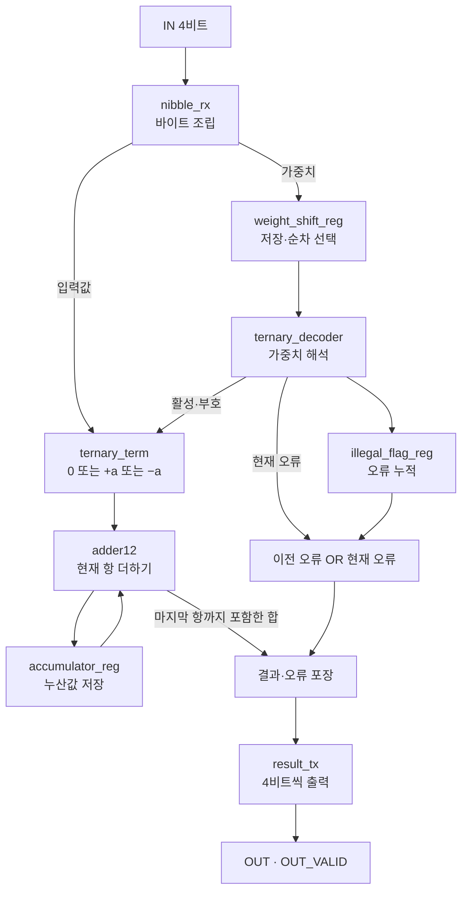

# circuit-team-05 · 삼진 내적 3-A

MyChip 2026 4차(0.5 µm CMOS) 회로팀. 안내서 팀 3(3-A): 삼진 가중치 8개 내적 (10바이트 → 2바이트). top `v_ternary8_top`.

## 폴더 구조

| 경로 | 내용 |
| --- | --- |
| `src/` | 설계 원본 전부: RTL 모듈 10개 (`v_ternary8_top` 외) |
| `mychip/` | 합성·배치배선·사인오프 결과 ([안내](mychip/README.md)) |
| `docs/` | 문서 |
| `.github/` | CI: `RTL CI`, `MyChip integration`, `MyChip PDK`, `Physical checks`, `ASIC RTL to GDS`(실제 구현 실험·미확인 공정 항목 별도 표시) |
| `scripts/` · `tests/` · `verification/` | 팀 PR 규칙 검사·RTL CI·PDK 검사 도구와 시험 (저장소 맨 위 경로를 전제로 동작) |
| `.githooks/` · `.claude/` · `.codex/` · `AGENTS.md` · `CLAUDE.md` | 에이전트·Git 후킹과 작업 규칙 |
| `requirements-ci.txt` | CI 파이썬 의존성 |
| `README.md` · `.gitignore` 등 | 저장소 안내와 Git 설정 |

다섯 팀 저장소의 맨 위는 같은 모양입니다. 이 표에 없는 것이 맨 위에 생기면 `MyChip integration` 체크가 실패합니다 (규칙: [contract/flow.toml](https://github.com/SNU-SSC-Lab/circuit-integration/blob/main/contract/flow.toml)). 새 폴더·파일은 `src/` 아래에 둡니다.

## 팀 안내

Division: Circuit Design

Status: Preparing

### Project Overview

Vision 칩의 경량 영상처리를 위한 **가중치 재설정형 8항 삼진 내적 CMOS 가속 코어**를 설계하고 검증합니다. 향후 작은 영상 신경망의 연산 블록으로 활용할 수 있도록 정확한 정수 연산과 구현 크기를 확인합니다.

최종 목표는 **MyChip MPW 4차 서비스에 설계를 제출하고, 제작된 칩을 FPGA와 연결하여 실제 동작을 확인하는 것**입니다.

```text
y = w0·a0 + w1·a1 + … + w7·a7
```

입력값은 signed 8비트 정수 8개, 가중치는 −1·0·+1입니다. 가중치에 따라 각 항을 0, +a 또는 −a로 만들고, 하나의 가산기와 누산 레지스터로 순차적으로 더합니다. 결과는 signed 12비트로 표현합니다. RTL 테스트벤치와 GitHub Actions CI를 추가했으며 검사 방법과 범위는 [RTL CI 안내](docs/ci.md)에 정리했습니다.

#### Interface

외부 FPGA와 공통 4비트 입력·4비트 출력으로 통신합니다. 가중치 두 바이트를 먼저 받은 뒤 입력값 여덟 바이트를 받고, 결과와 오류 플래그를 4비트씩 네 번 출력합니다.

| 구분 | 신호 | 역할 |
| --- | --- | --- |
| 클록·리셋 | `CLK`, `RST_N` | 상승 에지 동작, 동기식 active-low 리셋 |
| 입력 | `IN[3:0]`, `IN_VALID`, `IN_READY` | 가중치·입력값 수신 및 수신 허용 제어 |
| 출력 | `OUT[3:0]`, `OUT_VALID` | 결과 전송, 별도 `OUT_READY` 없음 |

상세 연산 범위, 인코딩, 통신 순서와 오류·리셋 규칙은 [RFC 0001](docs/rfcs/0001-ternary8-interface.md)에서 검토합니다.

#### Structure

```text
src/         Verilog RTL 소스 10개
docs/rfcs/   동작·협업·문서 작성 규약
docs/specs/  작업 기획·구현 계획과 기존 RTL의 역작성 SPEC
scripts/     에이전트·PR·Git 공통 검사
tests/policy/ 후킹 검사 시험
```

#### Architecture



[`v_ternary8_top`](src/v_ternary8_top.v)이 전체 모듈을 연결합니다. [`dot8_controller`](src/dot8_controller.v)는 **가중치 수신 → 입력값 8개 처리 → 결과 출력** 순서에 따라 저장·누산·가중치 이동·출력 시점을 제어합니다.

### Team Members

| 이름 | 역할 | GitHub |
| --- | --- | --- |
| 김령교 | 팀장 | [lumirevel](https://github.com/lumirevel) |
| 이상원 | 설계 및 구현 | [swl0421](https://github.com/swl0421) |
| 도재겸 | 검증 및 테스트 | [Dojaegyum](https://github.com/Dojaegyum) |

### Project Documentation

- [SSC 노션 Circuit Team 05](https://app.notion.com/p/Circuit-Team-05-40f6437817b6813f8867cb2b6e1df32f): 프로젝트 정보, 팀 구성과 활동 기록
- 설계 참고자료: 김태완, 「My Chip 설계 실습 안내서」(2026.10.18). 삼진 내적 주제는 20~23쪽, 공통 외부 인터페이스는 6~7쪽을 참고합니다.
- [RFC 0001 — 삼진 내적 회로의 연산 및 외부 인터페이스](docs/rfcs/0001-ternary8-interface.md): 연산 범위, 통신, 오류와 리셋 규약. 현재 상태는 Draft입니다.
- [RFC 0002 — 협업과 문서 작성](docs/rfcs/0002-collaboration.md): 문서별 역할, SPEC 기반 변경, PR과 리뷰 규칙.
- [SPEC 목록](docs/specs/README.md): 후킹 구현 계획과 모듈별 역작성 문서.
- [후킹 사용 방법](docs/hooks.md): 설치·확인·검사와 지원 범위.
- [PR 1·2·3 팀 안내](docs/team-pr-guide.md): 작업 내용과 팀원이 따라 할 순서. 계속 다듬을 초안.
- [RTL CI](docs/ci.md): 검사 이름·시나리오·실행 방법과 결과 해석.
- [RTL → GDS·검증·리포트](docs/verification/rtl-to-gds-guide.md): 비교·OpenROAD 구현·SOP28 조립·실행법·리포트. [SPEC 0017](docs/specs/0017-rtl-to-gds.md). 코어 LVS·기능 회귀와 금속 연결을 검사하며, 공정 RC·전체 DRC·GPIO 검증·핀맵은 미확인.
- [P&R 검증 방법론](docs/verification/pnr-methodology.md): 합성 이후 검사 항목과 제출 검토의 구분.
- [Magic·Netgen 상세 사용서](docs/verification/magic-netgen-guide.md): 설치·연습·실제 DRC/LVS 준비·PEX. `Physical checks`는 연습 회로 자체 시험이며 실제 코어 검사는 위 ASIC 흐름으로 구분.

### Repository Guidelines

- 소스 코드를 역할에 맞게 정리합니다.
- 설정 및 실행 절차를 문서화합니다.
- 변경은 작업 브랜치에서 PR로 검토하며, `main`에 직접 push하지 않습니다.
- PR 본문은 **What**(변경 내용), **Why**(변경 이유), **How**(구현 방법과 검증 근거)를 설명합니다.
- 지켜야 할 규칙은 RFC에, 이번 작업의 기획 의도·구현·검증 계획은 SPEC에 기록합니다.
- 자격 증명, 비공개 PDK 파일과 반출이 제한된 연구 자료는 커밋하지 않습니다.
