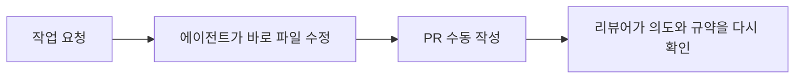
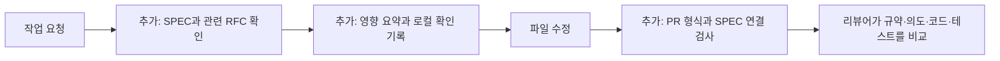

# SPEC 0001 에이전트의 SPEC 기반 작업 확인

- 종류: 구현 계획. PR 2의 대상이며 규약 자체는 RFC 0002에 둔다.
- 관련 규약: RFC 0002 DOC01~DOC04, PR01, AUTO01.

## What

Claude Code와 Codex가 코드·규약을 수정하기 전에 관련 SPEC과 RFC를 확인하도록 한다. PR 본문을 검사하고 원격 main 직접 push를 막는다. 동일한 검사 함수를 다음 CI PR에서 호출할 수 있게 Python 표준 라이브러리로 작성한다.

합격 조건은 두 에이전트의 도구 입력 형식에서 확인 전 수정 차단, 확인 후 허용, 문서 변경 후 확인 무효화, 잘못된 PR 본문 차단, Git 전송 목적지가 main이면 차단하는 것이다. 기존 RTL은 수정하지 않는다. RFC 0001을 규약 중심으로 정리하고 기존 RTL 10개 모듈의 SPEC을 기준 커밋에서 역작성한다. 이 문서 정리는 코드의 원래 기획 의도나 시험 통과를 주장하지 않는다.

## Why

현재는 대화와 README에만 작업 규칙이 있어, 에이전트가 규약을 보지 않고 파일을 고칠 수 있다. 팀원이 변경 의도와 코드 차이를 읽고 판단할 자료도 자동으로 검사하지 않는다. 두 에이전트의 설정은 나누되 실제 판정은 한 스크립트로 공유해 규칙 차이를 줄인다.

## How

### 대상 파일과 구조

- `scripts/policy.py`: 문서·PR 검사, 사전 확인과 에이전트 도구 입력 처리, Git push 검사.
- `.claude/settings.json`, `.codex/hooks.json`: SessionStart와 PreToolUse를 같은 Python 진입점으로 연결.
- `.githooks/pre-push`, `scripts/install_hooks.py`: 실제 전송 ref를 검사하는 Git 훅과 로컬 설치.
- `AGENTS.md`, `CLAUDE.md`: RFC와 SPEC을 읽는 순서, 쉬운 문장과 시각화 원칙 안내.
- `docs/specs/index.json`: SPEC별 대상 경로·규약 경로·확인 버전. 사람 설명은 각 SPEC의 'RFC 확인'에 둔다.
- `tests/policy/`: 임시 저장소·실제 로컬 push·도구 입력을 이용한 검사.

### 변경 전



### 변경 후



기존의 '확인 없이 수정' 연결을 삭제한다. 다음 CI PR에서 E를 서버에서도 실행한다. 로컬 기록은 서버로 보내지 않으며, CI는 PR·SPEC에 남은 규약 참조와 버전을 검사한다.

### 핵심 코드 차이

기존에는 전송 전 검사 코드가 없다. 새 Git 훅은 로컬 브랜치 이름이 아니라 Git이 stdin으로 전달한 목적지 ref를 검사한다. 따라서 기능 브랜치의 `HEAD:main` 전송도 막는다.

```diff
+ if fields[2] == "refs/heads/main":
+     raise PolicyError("main 직접 push·삭제는 금지합니다. 작업 브랜치와 PR을 사용하세요.")
```

### 수정 전 확인

시작 훅은 세션 ID와 SPEC 확인 방법을 안내한다. 에이전트는 `review` 명령에 SPEC과 이번 영향 요약을 전달한다. 명령은 SPEC·관련 RFC의 전체 내용을 출력하고 SPEC·RFC·목록의 내용 해시와 요약을 로컬 Git 메타데이터에 기록한다. 이 기록은 커밋하지 않는다. 다른 세션에서 재사용하지 않으며 문서가 바뀌면 다시 확인한다.

직접 파일 편집 도구는 대상 경로와 SPEC의 범위를 확인한다. 임의 셸 쓰기는 완전한 경로 분석이 불가능하므로, 명확히 읽기 전용으로 분류하지 못한 명령에는 유효한 확인 기록을 요구한다. 셸의 실제 변경 파일 범위는 PR 검사에서 다시 대조한다. 읽기 명령이나 일반 안내 문서의 직접 편집까지 모두 막지 않는다.

GitHub 연결 도구의 PR 본문은 같은 검사로 처리한다. 로컬 확인과 파일 범위를 검사할 수 없는 원격 코드·ref 쓰기는 로컬 브랜치에서 작업하도록 안내하며 차단한다. 임의 REST 호출이나 일반 HTTP 도구까지 완전하게 분석하는 기능은 만들지 않는다.

### 문서와 PR 검사

문서 검사는 RFC의 규칙 항목, SPEC의 What·Why·How와 RFC 확인, 대상 경로 등록, RTL 10개 모듈의 SPEC 연결을 확인한다. PR 검사는 빈 항목·남은 안내 문구, 선택한 SPEC의 최신 규약 버전, base와 head 사이의 변경 파일 범위를 대조한다. 삭제·이름 변경은 이전 경로도 확인한다. 코드 변경 PR은 흐름 변경 여부를 선언한다. 있음이면 선택한 SPEC의 전후 Mermaid 그림 두 개와 핵심 diff를, 없음이면 생략 이유를 검사한다. 실제 기획의 타당성과 그림의 의미는 판정하지 않는다.

### 설치와 제한

Git 훅 설치는 이 저장소의 `core.hooksPath`만 설정한다. 기존 다른 훅 경로가 있으면 덮어쓰지 않는다. 에이전트의 신뢰 설정이나 전역 설정은 자동으로 바꾸지 않는다. Codex는 프로젝트 훅 신뢰 검토 후 활성화해야 한다. Git Bash와 Windows PowerShell 실행 경로를 시험한다.

이 PR의 시험은 모델 호출 없는 도구 입력 재현과 실제 Git 훅 실행이다. 실제 에이전트 모델 세션에서의 신뢰 UI와 편집 차단은 별도 수동 확인 대상으로 남긴다. 확인되지 않은 설치 상태를 '활성화 완료'라고 기록하지 않는다.

### 검증 계획

1. 임시 Git 저장소에서 확인 없는 수정은 거절하고 확인 후 허용한다.
2. RFC·SPEC·목록을 바꾸거나 세션이 다르면 다시 거절한다.
3. 두 에이전트의 Edit·Write·apply_patch·셸·PR 연결 도구 형식을 재현한다.
4. 잘못된 JSON과 없는 SPEC·규약은 명확한 이유로 거절한다.
5. 임시 bare 원격에 기능 브랜치 push는 허용하고 main 생성·삭제·강제 갱신·여러 ref 중 main을 차단한다.
6. 실제 셸 실행기로 훅 설정의 명령을 실행해 stdin과 종료 코드를 확인한다.
7. PR 검사에서 누락된 SPEC, 다른 모듈 SPEC, 빈 본문, 오래된 규약 버전을 거절한다.
8. `src/`가 PR 1 기준과 같은지 확인한다. RTL 시뮬레이션은 다음 CI 작업에서 구성한다.

## RFC 확인

RFC 0002 DOC01~DOC04에 따라 규약과 계획을 분리하고, 그림은 현재 작업 흐름의 전후를 비교한다. PR01에 따라 PR 1을 기반으로 PR 2를 만든다. AUTO01에 따라 로컬 절차와 서버 강제력을 혼동하지 않고, 실제 활성화·사람의 이해 여부를 자동 검사가 보장한다고 주장하지 않는다. 현재 RFC 버전은 index.json에 기록한다.
