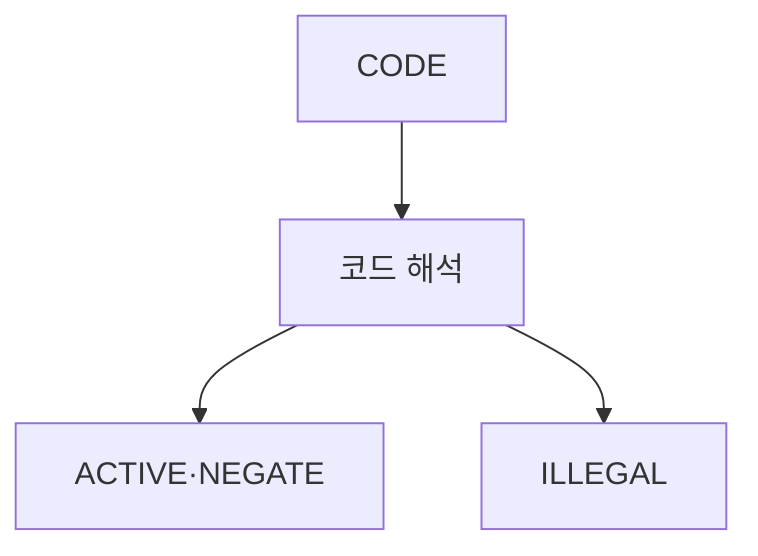

# SPEC 0002 ternary_decoder

- 종류: 기존 코드 역작성. 원래 작성자의 기획 의도는 별도 확인이 필요하다.
- 기준 소스: `src/ternary_decoder.v`, 커밋 `a0f903374793da91a978e376032076dcf7d87d67`.
- 검증 상태: 소스 검토만 수행. 아래 시험은 계획이며 RTL 시뮬레이션 결과가 아니다.

## What

2비트 가중치 코드를 해석하는 모듈이다. 아래 포트는 현재 코드에서 확인했다.

| 포트 | 방향 | 폭 | 수치 해석 |
| --- | --- | --- | --- |
| `CODE` | input | [1:0] | 비트 표현 |
| `ACTIVE` | output | 1비트 | 비트 표현 |
| `NEGATE` | output | 1비트 | 비트 표현 |
| `ILLEGAL` | output | 1비트 | 비트 표현 |

## Why

2비트 가중치 표현을 항 생성과 오류 처리에 연결한다.

## How

### 현재 구현

ACTIVE는 CODE 두 비트의 XOR, NEGATE는 CODE[1], ILLEGAL은 두 비트의 AND다.

00은 (0,0,0), 01은 (1,0,0), 10은 (1,1,0), 11은 (0,1,1)을 출력한다. 순서는 ACTIVE·NEGATE·ILLEGAL이다.

조합회로이며 리셋이나 저장 상태가 없다. 불법 코드에서 NEGATE=1이어도 ACTIVE=0이므로 항은 0이다.

### 현재 흐름

### 변경과 시험 계획

이번 역작성에서는 RTL 변경 없음. 기존과 수정 후 흐름을 임의로 만들지 않는다. 이후 수정하면 이 SPEC의 What·Why·How와 변경 전후 코드·그림을 갱신한다.

- 4개 코드의 세 출력을 전수 비교한다.
- 11 코드의 항이 top 연결에서 0이 되는지 별도 통합 시험한다.

## RFC 확인

RFC 0001의 HW01의 코드 표를 세 제어 신호로 변환한다. HW04의 불법 코드는 ILLEGAL=1과 ACTIVE=0으로 전달한다. 디코더 단독으로는 오류 누적이나 결과 포장을 검사할 수 없어 top 시험과 연결한다. 확인한 버전은 index.json에 기록한다.
