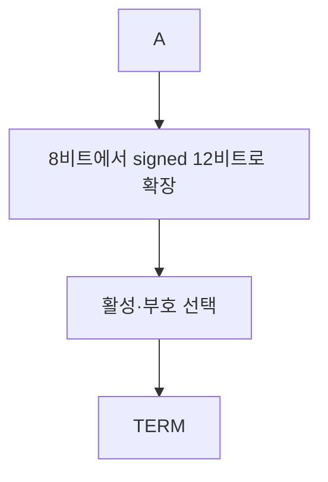

# SPEC 0003 ternary_term

- 종류: 기존 코드 역작성. 원래 작성자의 기획 의도는 별도 확인이 필요하다.
- 기준 소스: `src/ternary_term.v`, 커밋 `a0f903374793da91a978e376032076dcf7d87d67`.
- 검증 상태: 소스 검토만 수행. 아래 시험은 계획이며 RTL 시뮬레이션 결과가 아니다.

## What

입력값을 부호 확장하고 현재 항을 생성하는 모듈이다. 아래 포트는 현재 코드에서 확인했다.

| 포트 | 방향 | 폭 | 수치 해석 |
| --- | --- | --- | --- |
| `A` | input | [7:0] | 비트 표현 |
| `ACTIVE` | input | 1비트 | 비트 표현 |
| `NEGATE` | input | 1비트 | 비트 표현 |
| `TERM` | output | [11:0] | signed |

## Why

−128의 부호를 반전할 때 +128을 잃지 않도록 폭을 먼저 늘린다.

## How

### 현재 구현

A 포트는 unsigned 8비트지만 A[7]을 네 번 복제해 signed 12비트 a_ext로 만든다.

ACTIVE=0이면 0, ACTIVE=1이고 NEGATE=0이면 a_ext, NEGATE=1이면 −a_ext를 출력한다.

조합회로다. ACTIVE=0이 NEGATE보다 우선한다. −128과 NEGATE=1 조합의 출력은 +128이다.

### 현재 흐름

### 변경과 시험 계획

이번 역작성에서는 RTL 변경 없음. 기존과 수정 후 흐름을 임의로 만들지 않는다. 이후 수정하면 이 SPEC의 What·Why·How와 변경 전후 코드·그림을 갱신한다.

- 256개 입력과 디코더의 4개 코드 조합으로 1,024개 항을 검사한다.
- 음수·양수·0과 −128 부호 반전, 비활성 우선순위를 확인한다.

## RFC 확인

RFC 0001의 HW01의 −128 부호 반전을 지키려면 12비트 확장이 반전보다 먼저 와야 한다. HW04의 불법 코드 항은 ACTIVE=0으로 우회한다. HW06의 1,024조합 전수 검사를 이 모듈과 디코더의 연결에 적용한다. 확인한 버전은 index.json에 기록한다.
