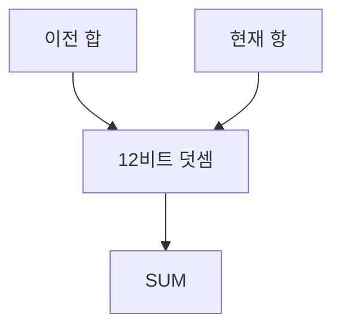

# SPEC 0004 adder12

- 종류: 기존 코드 역작성. 원래 작성자의 기획 의도는 별도 확인이 필요하다.
- 기준 소스: `src/adder12.v`, 커밋 `a0f903374793da91a978e376032076dcf7d87d67`.
- 검증 상태: 소스 검토만 수행. 아래 시험은 계획이며 RTL 시뮬레이션 결과가 아니다.

## What

현재 항을 누산값에 더하는 모듈이다. 아래 포트는 현재 코드에서 확인했다.

| 포트 | 방향 | 폭 | 수치 해석 |
| --- | --- | --- | --- |
| `A` | input | [11:0] | signed |
| `B` | input | [11:0] | signed |
| `SUM` | output | [11:0] | signed |

## Why

클록 사이에 다음 누산값을 계산해 레지스터와 최종 결과가 공유하도록 한다.

## How

### 현재 구현

A·B·SUM은 모두 signed 12비트다. SUM=A+B를 조합으로 계산한다.

carry·포화 처리는 없다. 모듈 자체에서는 12비트 밖의 결과가 잘린다.

회로 전체의 합법적인 8항 내적 범위는 12비트 안에 있다. 단일 모듈의 모든 임의 입력에 무오버플로를 보장하는 것은 아니다.

### 현재 흐름

### 변경과 시험 계획

이번 역작성에서는 RTL 변경 없음. 기존과 수정 후 흐름을 임의로 만들지 않는다. 이후 수정하면 이 SPEC의 What·Why·How와 변경 전후 코드·그림을 갱신한다.

- 0·양수·음수·상쇄와 합법 누산 경계를 비교한다.
- 임의 모듈 입력의 범위 초과는 12비트 잘림으로 별도 해석한다.

## RFC 확인

RFC 0001의 HW01의 전체 합 범위를 다루는 누산 경로다. 임의의 두 12비트 입력 합은 넘칠 수 있으므로 모듈 시험의 잘림과 합법 내적의 정확성 시험을 구분한다. HW06의 극값은 top까지 연결해 검사한다. 확인한 버전은 index.json에 기록한다.
