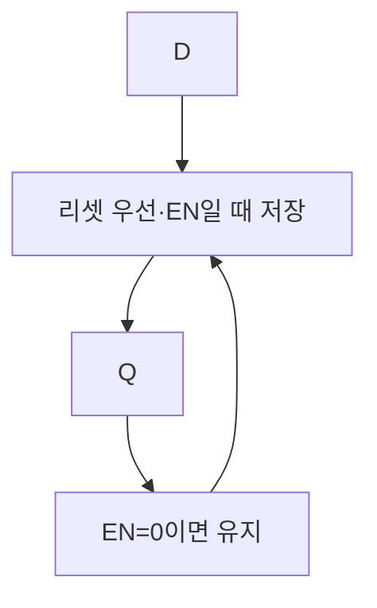

# SPEC 0005 accumulator_reg

- 종류: 기존 코드 역작성. 원래 작성자의 기획 의도는 별도 확인이 필요하다.
- 기준 소스: `src/accumulator_reg.v`, 커밋 `a0f903374793da91a978e376032076dcf7d87d67`.
- 검증 상태: 소스 검토만 수행. 아래 시험은 계획이며 RTL 시뮬레이션 결과가 아니다.

## What

누산값을 저장하는 모듈이다. 아래 포트는 현재 코드에서 확인했다.

| 포트 | 방향 | 폭 | 수치 해석 |
| --- | --- | --- | --- |
| `CLK` | input | 1비트 | 비트 표현 |
| `RST_N` | input | 1비트 | 비트 표현 |
| `EN` | input | 1비트 | 비트 표현 |
| `D` | input | [11:0] | signed |
| `Q` | output | [11:0] | signed |

## Why

조합으로 계산한 acc_next를 허용된 에지에만 저장한다.

## How

### 현재 구현

상승 에지에서 RST_N=0이면 Q=0으로 초기화한다.

리셋이 아니고 EN=1이면 D를 Q에 저장하며 나머지는 유지한다.

D·Q는 signed 12비트다. top은 외부 리셋과 WORK_CLEAR를 결합한 로컬 RST_N을 연결한다.

주석에 CLEAR가 언급되지만 별도 CLEAR 포트는 없다. 초기화는 RST_N을 통해 전달된다.

### 현재 흐름

### 변경과 시험 계획

이번 역작성에서는 RTL 변경 없음. 기존과 수정 후 흐름을 임의로 만들지 않는다. 이후 수정하면 이 SPEC의 What·Why·How와 변경 전후 코드·그림을 갱신한다.

- 리셋과 EN 동시 활성 시 리셋 우선, EN=0 유지, EN=1 저장을 검사한다.
- 새 작업의 W0 처리 시 top 연결을 통한 초기화를 확인한다.

## RFC 확인

RFC 0001의 HW04의 작업 간 합 초기화를 top의 로컬 리셋으로 전달받는다. HW05에 따라 리셋은 EN보다 우선해야 한다. 단독 모듈은 작업 경계를 모르므로 W0 초기화는 통합 시험으로 검사한다. 확인한 버전은 index.json에 기록한다.
