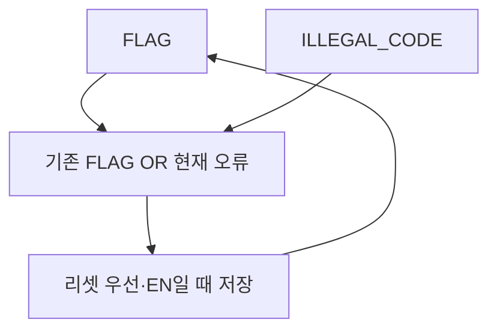

# SPEC 0006 illegal_flag_reg

- 종류: 기존 코드 역작성. 원래 작성자의 기획 의도는 별도 확인이 필요하다.
- 기준 소스: `src/illegal_flag_reg.v`, 커밋 `a0f903374793da91a978e376032076dcf7d87d67`.
- 검증 상태: 소스 검토만 수행. 아래 시험은 계획이며 RTL 시뮬레이션 결과가 아니다.

## What

작업 중 발생한 오류를 기억하는 모듈이다. 아래 포트는 현재 코드에서 확인했다.

| 포트 | 방향 | 폭 | 수치 해석 |
| --- | --- | --- | --- |
| `CLK` | input | 1비트 | 비트 표현 |
| `RST_N` | input | 1비트 | 비트 표현 |
| `EN` | input | 1비트 | 비트 표현 |
| `ILLEGAL_CODE` | input | 1비트 | 비트 표현 |
| `FLAG` | output | 1비트 | 비트 표현 |

## Why

앞선 항의 오류를 마지막 결과까지 유지한다.

## How

### 현재 구현

상승 에지에서 RST_N=0이면 FLAG=0이다.

EN=1이면 FLAG | ILLEGAL_CODE를 저장하고 EN=0이면 유지한다.

top은 작업 초기화용 로컬 리셋과 ACC_EN을 연결한다. 현재 코드 오류는 top에서 FLAG와 OR해 최종 항까지 반영한다.

주석의 CLEAR는 독립 포트가 아니다.

### 현재 흐름

### 변경과 시험 계획

이번 역작성에서는 RTL 변경 없음. 기존과 수정 후 흐름을 임의로 만들지 않는다. 이후 수정하면 이 SPEC의 What·Why·How와 변경 전후 코드·그림을 갱신한다.

- 한 번 1이 된 오류의 유지, EN=0에서 오류 무시, 리셋 해제를 확인한다.
- 마지막 항만 불법인 전체 작업과 다음 작업의 오류 해제를 검사한다.

## RFC 확인

RFC 0001의 HW04의 오류 유지를 OR 저장으로 구현하며 새 작업에서 로컬 리셋을 받는다. HW05의 리셋을 EN보다 우선한다. 마지막 항 오류를 놓치지 않는지는 top의 illegal_next 연결까지 함께 검사한다. 확인한 버전은 index.json에 기록한다.
