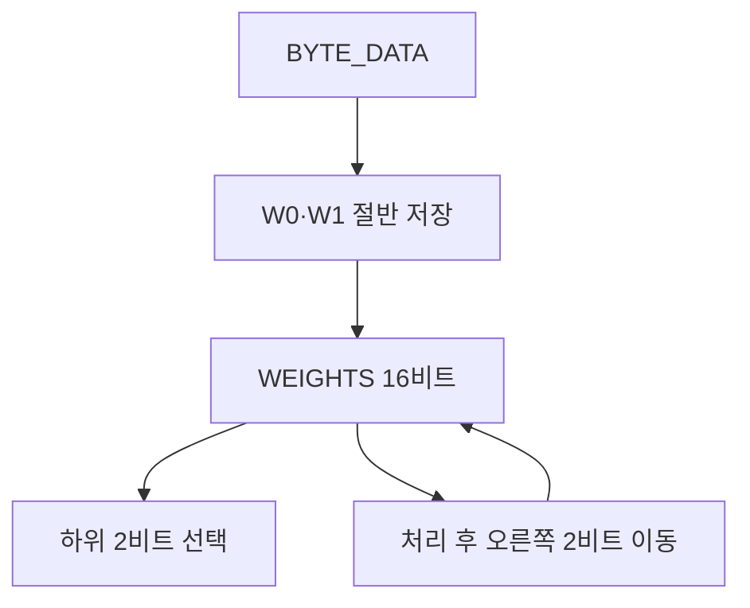

# SPEC 0007 weight_shift_reg

- 종류: 기존 코드 역작성. 원래 작성자의 기획 의도는 별도 확인이 필요하다.
- 기준 소스: `src/weight_shift_reg.v`, 커밋 `a0f903374793da91a978e376032076dcf7d87d67`.
- 검증 상태: 소스 검토만 수행. 아래 시험은 계획이며 RTL 시뮬레이션 결과가 아니다.

## What

가중치를 저장하고 현재 코드를 순서대로 선택하는 모듈이다. 아래 포트는 현재 코드에서 확인했다.

| 포트 | 방향 | 폭 | 수치 해석 |
| --- | --- | --- | --- |
| `CLK` | input | 1비트 | 비트 표현 |
| `RST_N` | input | 1비트 | 비트 표현 |
| `BYTE_DATA` | input | [7:0] | 비트 표현 |
| `LOAD_W0` | input | 1비트 | 비트 표현 |
| `LOAD_W1` | input | 1비트 | 비트 표현 |
| `SHIFT_EN` | input | 1비트 | 비트 표현 |
| `WEIGHTS` | output | [15:0] | 비트 표현 |

## Why

16비트에 넣은 8개 코드를 하위 2비트로 차례로 제공한다.

## How

### 현재 구현

우선순위는 리셋, LOAD_W0, LOAD_W1, SHIFT_EN, 유지 순이다.

LOAD_W0는 하위 8비트만, LOAD_W1은 상위 8비트만 BYTE_DATA로 바꾼다. 다른 절반은 유지한다.

SHIFT_EN이면 오른쪽으로 2비트 이동하고 상위 두 비트를 0으로 채운다.

현재 가중치는 WEIGHTS[1:0]이다. top은 입력값 바이트 처리마다 이동시켜 w0~w7 순서로 사용한다.

### 현재 흐름

### 변경과 시험 계획

이번 역작성에서는 RTL 변경 없음. 기존과 수정 후 흐름을 임의로 만들지 않는다. 이후 수정하면 이 SPEC의 What·Why·How와 변경 전후 코드·그림을 갱신한다.

- 서로 다른 가중치 8개의 선택 순서, 부분 저장과 제어 우선순위를 검사한다.
- 가중치 수신·입력 첫 조각에서 이동하지 않는지 컨트롤러 통합으로 확인한다.

## RFC 확인

RFC 0001의 HW02의 W0·W1 비트 배치를 그대로 저장한다. 가중치 이동 시점이 어긋나면 HW01의 wi와 ai 짝이 바뀌므로 8개 위치를 따로 검사한다. HW04의 새 작업에서 두 바이트를 다시 적재한다. 확인한 버전은 index.json에 기록한다.
