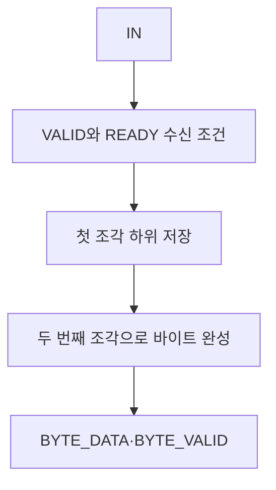

# SPEC 0008 nibble_rx

- 종류: 기존 코드 역작성. 원래 작성자의 기획 의도는 별도 확인이 필요하다.
- 기준 소스: `src/nibble_rx.v`, 커밋 `a0f903374793da91a978e376032076dcf7d87d67`.
- 검증 상태: 소스 검토만 수행. 아래 시험은 계획이며 RTL 시뮬레이션 결과가 아니다.

## What

4비트 입력 두 조각을 한 바이트로 조립하는 모듈이다. 아래 포트는 현재 코드에서 확인했다.

| 포트 | 방향 | 폭 | 수치 해석 |
| --- | --- | --- | --- |
| `CLK` | input | 1비트 | 비트 표현 |
| `RST_N` | input | 1비트 | 비트 표현 |
| `IN` | input | [3:0] | 비트 표현 |
| `IN_VALID` | input | 1비트 | 비트 표현 |
| `IN_READY` | input | 1비트 | 비트 표현 |
| `BYTE_DATA` | output | [7:0] | 비트 표현 |
| `BYTE_VALID` | output | 1비트 | 비트 표현 |

## Why

공통 핀에서 받은 두 조각을 내부 연산에 사용할 바이트로 바꾼다.

## How

### 현재 구현

상승 에지에 IN_VALID && IN_READY일 때만 수신한다. 첫 조각은 low_nibble에 저장한다.

두 번째 조각은 {IN, low_nibble}로 BYTE_DATA에 저장하고 BYTE_VALID=1로 만든다.

정상 동작의 다음 에지에는 BYTE_VALID를 0으로 내린다. BYTE_DATA는 다음 완성 바이트까지 유지한다.

리셋은 low_nibble·half_received·BYTE_DATA·BYTE_VALID를 0으로 만든다.

이 모듈 자체가 IN_READY를 생성하지 않는다. top의 컨트롤러가 BYTE_VALID=1인 동안 수신을 막는 연결 계약이다.

### 현재 흐름

### 변경과 시험 계획

이번 역작성에서는 RTL 변경 없음. 기존과 수정 후 흐름을 임의로 만들지 않는다. 이후 수정하면 이 SPEC의 What·Why·How와 변경 전후 코드·그림을 갱신한다.

- 낮은 조각 우선, 공백 삽입, READY=0 무수신, 완성 펄스 1회를 검사한다.
- 반 바이트 리셋과 컨트롤러 연결에서 중복 수신이 없는지 확인한다.

## RFC 확인

RFC 0001의 HW02의 성공한 수신만 세고 하위 조각을 먼저 저장하는 규칙을 구현한다. BYTE_VALID 펄스는 내부 전달 계약이며 READY 생성은 컨트롤러 책임이다. HW05의 리셋에서 반 바이트를 버리는지 검사한다. 확인한 버전은 index.json에 기록한다.
