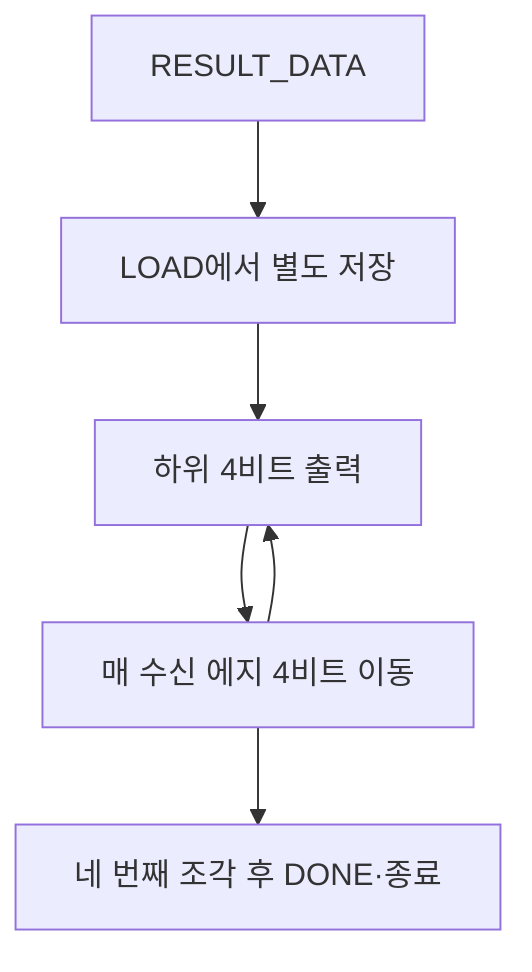

# SPEC 0009 result_tx

- 종류: 기존 코드 역작성. 원래 작성자의 기획 의도는 별도 확인이 필요하다.
- 기준 소스: `src/result_tx.v`, 커밋 `a0f903374793da91a978e376032076dcf7d87d67`.
- 검증 상태: 소스 검토만 수행. 아래 시험은 계획이며 RTL 시뮬레이션 결과가 아니다.

## What

저장된 결과를 4비트씩 전송하는 모듈이다. 아래 포트는 현재 코드에서 확인했다.

| 포트 | 방향 | 폭 | 수치 해석 |
| --- | --- | --- | --- |
| `CLK` | input | 1비트 | 비트 표현 |
| `RST_N` | input | 1비트 | 비트 표현 |
| `LOAD` | input | 1비트 | 비트 표현 |
| `RESULT_DATA` | input | [15:0] | 비트 표현 |
| `OUT` | output | [3:0] | 비트 표현 |
| `OUT_VALID` | output | 1비트 | 비트 표현 |
| `DONE` | output | 1비트 | 비트 표현 |

## Why

계산 중 바뀌는 누산값과 출력 데이터를 분리해 네 조각을 안정적으로 내보낸다.

## How

### 현재 구현

우선순위는 리셋, LOAD, busy 처리다. LOAD이면 RESULT_DATA를 저장하고 index=0, busy=1로 만든다.

busy이면 OUT은 하위 4비트, OUT_VALID=1이다. busy가 아니면 OUT=0, OUT_VALID=0이다.

다음 상승 에지마다 오른쪽 4비트 이동한다. index=3인 구간에 DONE=1이며 그 구간을 끝내는 에지에 busy를 내린다.

LOAD 에지 직후 첫 조각이 나타나며, 외부가 이를 수신하는 것은 다음 상승 에지다.

busy 중 LOAD가 들어오면 기존 출력이 덮어써진다. 정상 top 컨트롤러는 이 입력을 만들지 않는다.

### 현재 흐름

### 변경과 시험 계획

이번 역작성에서는 RTL 변경 없음. 기존과 수정 후 흐름을 임의로 만들지 않는다. 이후 수정하면 이 SPEC의 What·Why·How와 변경 전후 코드·그림을 갱신한다.

- 네 조각 순서·OUT_VALID 길이·DONE 구간을 검사한다.
- 출력 중 리셋과 LOAD 우선순위는 모듈 시험에서, 중복 LOAD 부재는 통합 시험에서 확인한다.

## RFC 확인

RFC 0001의 HW03의 네 조각 연속 수신을 위해 첫 출력은 LOAD 다음 상승 에지에서 수신한다. DONE은 마지막 출력 구간에만 1이다. HW05의 리셋은 출력을 중단해야 한다. 정상 동작 중 LOAD 중복 방지는 컨트롤러까지 확인한다. 확인한 버전은 index.json에 기록한다.
