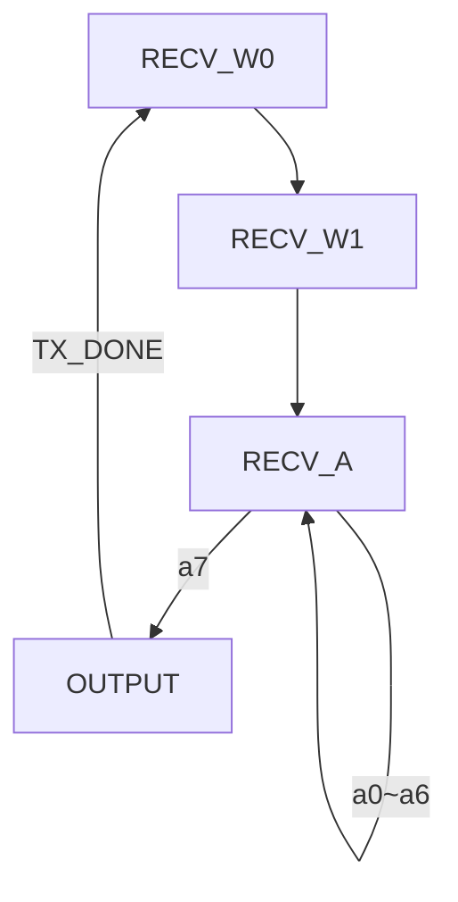

# SPEC 0010 dot8_controller

- 종류: 기존 코드 역작성. 원래 작성자의 기획 의도는 별도 확인이 필요하다.
- 기준 소스: `src/dot8_controller.v`, 커밋 `a0f903374793da91a978e376032076dcf7d87d67`.
- 검증 상태: 소스 검토만 수행. 아래 시험은 계획이며 RTL 시뮬레이션 결과가 아니다.

## What

가중치 수신, 계산과 출력 순서를 제어하는 모듈이다. 아래 포트는 현재 코드에서 확인했다.

| 포트 | 방향 | 폭 | 수치 해석 |
| --- | --- | --- | --- |
| `CLK` | input | 1비트 | 비트 표현 |
| `RST_N` | input | 1비트 | 비트 표현 |
| `BYTE_VALID` | input | 1비트 | 비트 표현 |
| `TX_DONE` | input | 1비트 | 비트 표현 |
| `IN_READY` | output | 1비트 | 비트 표현 |
| `LOAD_W0` | output | 1비트 | 비트 표현 |
| `LOAD_W1` | output | 1비트 | 비트 표현 |
| `WEIGHT_SHIFT` | output | 1비트 | 비트 표현 |
| `WORK_CLEAR` | output | 1비트 | 비트 표현 |
| `ACC_EN` | output | 1비트 | 비트 표현 |
| `RESULT_LOAD` | output | 1비트 | 비트 표현 |

## Why

같은 입력 포트를 사용하는 가중치와 데이터의 용도를 수신 순서로 구분한다.

## How

### 현재 구현

상태는 RECV_W0, RECV_W1, RECV_A, OUTPUT이다. 상태와 a_index는 상승 에지에서 바뀐다.

RECV_W0의 BYTE_VALID에서 LOAD_W0·WORK_CLEAR, RECV_W1에서는 LOAD_W1을 만든다.

RECV_A의 BYTE_VALID마다 ACC_EN·WEIGHT_SHIFT를 만들고 index를 증가시킨다.

index=7의 BYTE_VALID에서 RESULT_LOAD도 함께 만들고 OUTPUT으로 전환한다.

OUTPUT에서 TX_DONE을 보면 RECV_W0로 복귀한다. IN_READY는 BYTE_VALID=0이고 수신 상태일 때만 1이다.

리셋 시 RECV_W0·index=0이다. 모든 제어 출력에는 조합 기본값 0이 있다.

### 현재 흐름

### 변경과 시험 계획

이번 역작성에서는 RTL 변경 없음. 기존과 수정 후 흐름을 임의로 만들지 않는다. 이후 수정하면 이 SPEC의 What·Why·How와 변경 전후 코드·그림을 갱신한다.

- 각 BYTE_VALID의 제어 펄스·index와 TX_DONE 복귀를 검사한다.
- a7 결과 저장과 누산 동시 허용, 출력 중 입력 차단, reset 우선순위를 확인한다.

## RFC 확인

RFC 0001의 HW02의 바이트 순서와 1회 처리를 상태·제어 펄스로 구현한다. HW03의 마지막 항 포함과 출력 중 입력 차단, HW04의 새 W0 초기화, HW05의 상태 복구를 함께 검사한다. 확인한 버전은 index.json에 기록한다.
