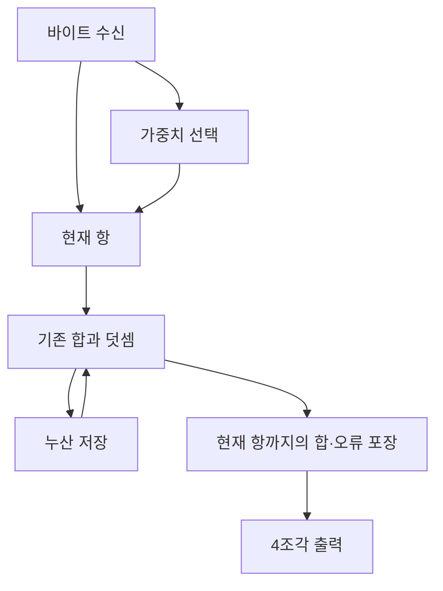

# SPEC 0011 v_ternary8_top

- 종류: 기존 코드 역작성. 원래 작성자의 기획 의도는 별도 확인이 필요하다.
- 기준 소스: `src/v_ternary8_top.v`, 커밋 `a0f903374793da91a978e376032076dcf7d87d67`.
- 검증 상태: 소스 검토만 수행. 아래 시험은 계획이며 RTL 시뮬레이션 결과가 아니다.

## What

연산 모듈을 연결하고 결과와 오류를 포장하는 최상위 모듈이다. 아래 포트는 현재 코드에서 확인했다.

| 포트 | 방향 | 폭 | 수치 해석 |
| --- | --- | --- | --- |
| `CLK` | input | 1비트 | 비트 표현 |
| `RST_N` | input | 1비트 | 비트 표현 |
| `IN` | input | [3:0] | 비트 표현 |
| `IN_VALID` | input | 1비트 | 비트 표현 |
| `IN_READY` | output | 1비트 | 비트 표현 |
| `OUT` | output | [3:0] | 비트 표현 |
| `OUT_VALID` | output | 1비트 | 비트 표현 |

## Why

수신한 입력을 순차 내적으로 계산하고 외부 시험 포트로 내보낸다.

## How

### 현재 구현

nibble_rx의 byte_data는 가중치 저장부와 항 생성부에 공통 연결된다. 사용 시점은 컨트롤러가 정한다.

weights[1:0]을 디코딩해 term을 만들고 acc_next=acc+term을 계산한다.

acc_flag_rst_n=RST_N & ~work_clear로 누산값·오류를 작업마다 초기화한다.

illegal_next=illegal_weight | illegal_code, result_data={000, illegal_next, acc_next}다.

a7 처리 에지에서 acc_next를 저장하므로 마지막 항이 빠지지 않는다. 같은 에지의 가중치 이동 전 값을 계산에 사용한다.

코어 RTL 연결만 있으며 실제 pad ring·패키지 구현을 이 파일에서 완료했다고 볼 수 없다.

### 현재 흐름

### 변경과 시험 계획

이번 역작성에서는 RTL 변경 없음. 기존과 수정 후 흐름을 임의로 만들지 않는다. 이후 수정하면 이 SPEC의 What·Why·How와 변경 전후 코드·그림을 갱신한다.

- 외부 입력 20조각으로 기준 모델과 비교하고 ±1024·마지막 항·각 위치·불법 오류를 검사한다.
- 리셋 복구·연속 작업·입력 공백·32클록 상한을 확인한다.
- 실제 단일 가감산 경로의 자원 공유는 합성에서 별도 확인한다.

## RFC 확인

RFC 0001의 HW01~HW06의 외부 관측 합격 조건을 이 모듈에 적용한다. 특히 acc 대신 acc_next, 저장 오류 대신 현재 오류까지 OR한 값을 출력해야 한다. RTL 포트의 준수와 실제 pad·합성 자원·물리 검증을 구분한다. 확인한 버전은 index.json에 기록한다.
