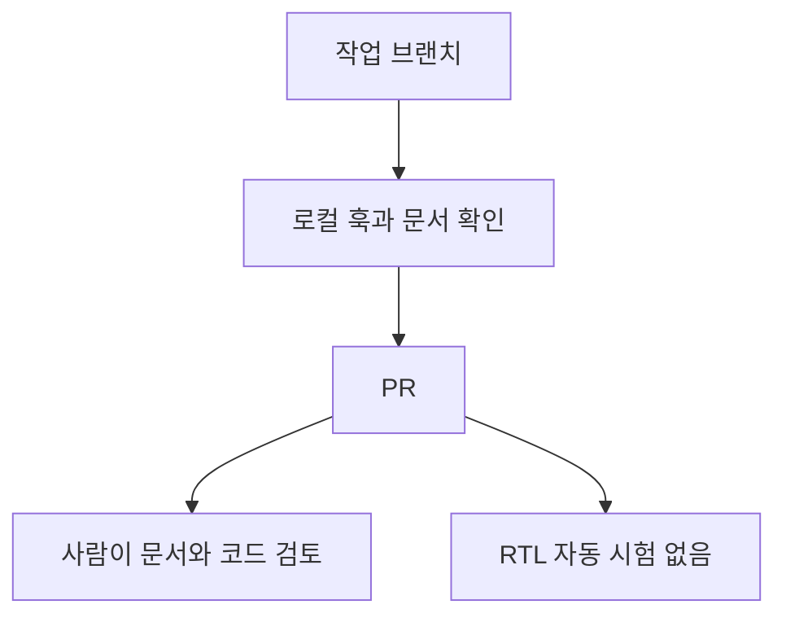
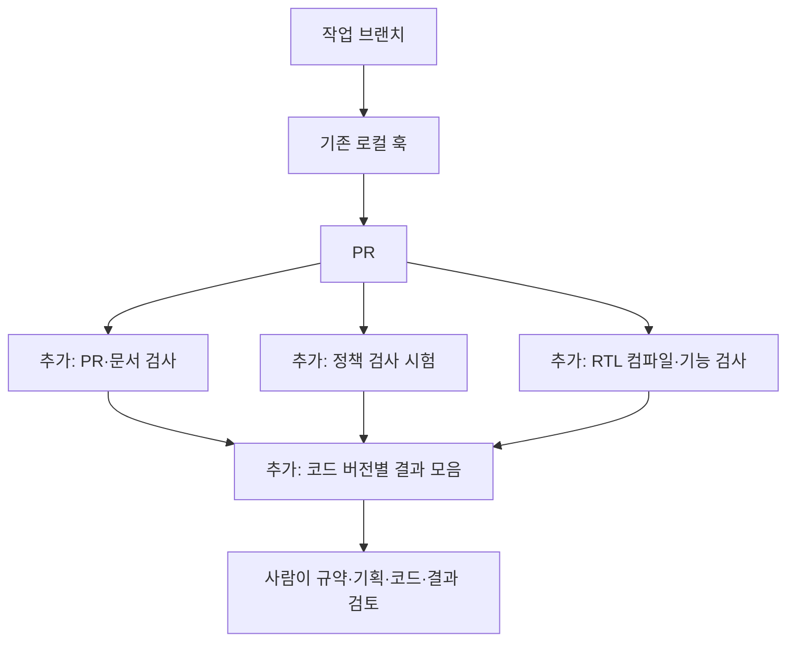

# SPEC 0012 문서와 RTL 검증 CI

- 상태: 전체 검사를 PR마다 실행하도록 합의했고 Workflow를 구현한다. 실행 결과는 별도로 기록한다.
- 기준: PR 2의 `feat/spec-driven-hooks` 위에서 PR 3으로 진행한다.
- 관련 규약: RFC 0001 HW01~HW06, RFC 0002 DOC01~DOC04·PR01·AUTO01.

## What

PR이 올라오면 문서·협업 규칙과 RTL 기능을 자동으로 검사하고, 실패한 입력과 검사한 코드 버전을 남긴다. 첫 검증 대상은 현재의 8항 삼진 내적 코어다. 회로를 발전시키거나 합의한 요구사항을 바꿀 때 검증 대상·정답 모델·테스트도 함께 바꿀 수 있게 구성한다.

이번 범위는 다음과 같다.

- PR 본문, SPEC 연결, RFC 확인 버전과 전후 설명을 검사한다.
- PR 2에서 작성한 정책 검사 시험을 Linux와 Windows에서 실행한다.
- Icarus Verilog와 cocotb로 모듈별·최상위 RTL 기능을 검사한다.
- RFC 0001의 전수·경계·무작위·오류·통신·리셋·응답 시간 시험을 구성한다.
- 어떤 코드와 규약을 검사했는지, 무엇이 통과·실패·미실행인지 결과로 남긴다.

이 PR은 기존 RTL의 기능을 바꾸지 않는다. 테스트가 기존 버그를 발견하면 관련 모듈 SPEC에 근거를 남기고 수정 작업을 별도로 검토한다. 테스트 기대값을 현재 RTL 결과에 맞춰 고치지 않는다.

ASIC 합성, ETRI 공정의 배치배선·STA·DRC/LVS·추출 후 검증, Vivado의 FPGA 구현과 실물 보드 시험은 후속 범위다. 이번 CI의 통과를 물리 검증이나 제작 가능 판정으로 표시하지 않는다.

## Why

현재는 로컬 훅과 문서 검사만 있고 RTL을 실행해 자동 채점하는 테스트는 없다. 리뷰어는 실제 기능이 규약과 맞는지 별도 환경에서 확인해야 한다. 로컬 훅 설치 여부에 따라서도 검사 실행 여부가 달라진다.

서버에서 같은 명령으로 검사를 실행하고 결과를 PR에 연결하면 팀원이 재현할 수 있다. 정답 계산·통신·테스트 사례를 분리하면 이후 회로 변경에서도 필요한 부분을 명확하게 수정할 수 있다.

## How

### 변경 전



### 변경 후



기존 수동 리뷰는 유지한다. 'RTL 자동 시험 없음' 경로를 제거하고 세 검사를 추가한다. ASIC 물리 검증을 통과한 것으로 보이는 빈 작업은 만들지 않는다.

### 대상 파일

| 파일·디렉터리 | 역할 |
| --- | --- |
| `.github/workflows/ci.yml` | 이벤트, 실행 환경, 검사 순서와 결과 보관 |
| `scripts/ci_policy.py` | 이벤트 파일에서 PR 본문·base·head를 읽어 기존 검사 호출 |
| `scripts/policy.py`, `tests/policy/` | 기존 검사기의 회로 확장 대응과 시험 |
| `verification/designs/ternary8.json` | top, RTL 목록, 규약·SPEC, 테스트 묶음과 설계 정보 |
| `tests/rtl/model.py` | RTL 구조와 독립적인 정답 계산 |
| `tests/rtl/transport.py` | 4비트 입력 전송과 출력 복원 |
| `tests/rtl/test_top.py`, `verification/scenarios.json` | 전수·경계·무작위 입력 생성과 규약별 시나리오 목록 |
| `tests/rtl/test_*.py` | 모듈별·통합 검사와 자동 채점 |
| `scripts/run_rtl.py`, `scripts/benchmark_ci.py`, `requirements-ci.txt` | 로컬·CI 공통 실행과 확인된 의존성 버전 |
| `docs/ci.md` | 실행 방법, 결과 해석과 지원 범위 |
| `scripts/setup_rtl.sh`, `scripts/ci_report.py`, `verification/lint.vlt` | 고정 Verilator 설치·실행 근거 수집·한정된 lint 제외 |
| `src/*.v` | 파일 끝 개행만 추가. 연산·통신 로직 변경 없음 |
| `.gitattributes` | RTL·셸·Workflow·lint 설정의 LF 줄바꿈을 clone 후에도 유지 |

### PR별 전체 검사와 lint 처리

사용자가 로컬 실행 시간을 확인하고 전체 검사의 PR별 실행에 동의했다. 문서·정책 검사와 RTL lint·단위·통합·전체 회귀·커버리지를 매 PR에서 실행한다. RTL 검사는 설치를 한 번만 하도록 한 job의 이름 붙은 다섯 단계로 구성한다. lint가 실패해도 나머지 시험과 결과 보관을 실행하고 최종 실패는 유지한다. 제한 시간은 정책 job 10분, RTL job 25분, 결과 보관은 7일로 시작한다.

Verilator는 공식 저장소의 v5.048 커밋 `d0aa828c217410fffc73d92077b6f4f54830357c`를 빌드하고 캐시한다. Icarus는 Ubuntu 24.04 패키지를 설치하고 실제 버전을 기록한다. Python 3.12.3과 cocotb 2.0.1을 사용한다. 설치 시간은 앞서 보고한 시험 실행 시간과 구분한다.

기존 RTL 열 파일에는 마지막 개행만 추가한다. `weights[15:2]`는 top에서 직접 소비하지 않으며 `weight_shift_reg` 내부에서 다음 항을 위해 이동한다. 이 경고만 파일·종류·메시지를 지정한 `verification/lint.vlt`로 제외한다. 다른 미사용 신호 경고와 EOF 경고는 유지한다. 이 제외 근거도 PR에서 설계자가 검토한다. 커버리지 제외와는 별개다.

```diff
- Verilator --lint-only --Wall ...
+ Verilator --lint-only --Wall verification/lint.vlt ...
```

위 변경은 lint 판정에만 적용한다. 단위·통합·회귀의 기대 결과와 RTL 블록 흐름은 바꾸지 않는다.

Workflow YAML은 실행 순서를 맡고 실제 판정은 Python에 둔다. 회로별 실행 설정은 JSON으로 분리한다. 새 회로를 지원하기 위해 지금 RTL을 범용 파라미터 회로로 바꾸지는 않는다.

### 검사 이름과 합격 기준

| CI 이름 | 내용 |
| --- | --- |
| pr-policy | PR·SPEC·RFC와 문서 형식 검사 |
| policy-unit | 공통 검사기 시험, Ubuntu·Windows |
| rtl-lint | Verilator 정적 검사와 Icarus 컴파일 |
| rtl-unit | 9개 하위 모듈의 개별 기능 검사 |
| rtl-integration | top의 경계·오류·프로토콜·리셋·연속 작업 |
| rtl-regression | 합법 가중치 전수와 고정 seed 10,000작업 |
| rtl-coverage | Verilator로 통합·회귀 재실행, RTL 줄 커버리지 보고 |

필수 시나리오는 모두 통과해야 한다. 코드 커버리지는 숫자만으로 안전성을 판정하지 않고 미도달 항목과 함께 보고한다. 도달 불가능한 코드 제외는 이유와 사람 리뷰가 필요하다. 보편적인 80%·90% 합격선으로 표현하지 않는다. 실행 시간을 로컬에서 측정한 후 사용자가 PR별 실행 범위를 판단한다. 측정 전에는 전체 회귀를 줄이지 않는다.

### 실행 시점과 환경

- `pull_request`의 opened·synchronize·reopened·edited·ready_for_review에서 실행한다. 본문이나 기준 브랜치를 바꿨을 때도 다시 검사한다.
- `push`의 main에서 문서·정책·RTL 검사를 실행한다. PR 본문 검사는 PR 이벤트에만 적용한다.
- 수동 실행도 제공한다. 실행할 Workflow가 기본 브랜치에 반영되기 전의 제약은 구현 시 확인한다.
- PR은 대상 브랜치가 main인지와 무관하게 검사해 연속 PR을 지원한다. PR 3의 실제 base는 PR 2 브랜치다.
- 정책 시험은 Ubuntu·Windows에서, RTL 시험은 Ubuntu에서 실행하는 구성을 우선 검증한다.
- 같은 PR에 새 실행이 생기면 오래된 실행을 취소한다. 실행 제한 시간과 결과 보관 기간은 실제 소요 시간·용량을 측정해 정한다.
- Python·cocotb는 실행 확인한 버전을 고정한다. Icarus 버전은 기록하고 지원 범위를 검사한다. 아직 검증하지 않은 버전 조합을 지원 완료로 적지 않는다.

PR 이벤트의 base·head SHA와 본문은 이벤트 JSON에서 읽는다. PR 본문을 셸 명령 문자열로 직접 삽입하지 않는다. 가능한 한 읽기 전용 권한으로 실행하고 학교 라이선스·PDK·비밀값은 사용하지 않는다. 권한 있는 이벤트에서 PR 코드를 실행하는 구성은 이 설계에 포함하지 않는다.

### 문서·정책 검사

기존 `check-docs`와 `check-pr`을 재사용한다. PR 검사에는 이벤트가 알려 준 정확한 base와 head를 전달하고 필요한 Git 이력을 가져온다. 최상위 통합 검사는 GitHub의 PR 병합 시험 버전을 사용하되, 검사한 head·base·병합 시험 SHA를 구분해 기록한다. SPEC 범위 검사는 실제 PR head의 변경 파일을 기준으로 한다.

현재 `check-docs`는 src 바로 아래의 .v 파일에 역작성 SPEC을 요구한다. 새 모듈은 먼저 작성한 SPEC을 사용할 수 있어야 하므로 하위 디렉터리의 .v·.sv까지 탐색하고, '관련 SPEC이 연결됐는가'를 확인하도록 바꾼다. 기존 10개 모듈이 역작성 문서라는 역사적 사실은 목록에 유지한다.

```diff
- if not any(covered(e, file) and e.get('kind') == 'reverse' for e in entries.values()):
+ if not any(covered(e, file) for e in entries.values()):
```

위 diff는 예정한 핵심 변경이다. 실제 구현에서 하위 경로 탐색과 새 모듈·삭제·이름 변경 시험도 함께 작성한다. PR·SPEC의 존재 검사를 사람이 합의했다는 증거로 표현하지 않는다.

### 독립 정답 모델과 회로별 설정

정답 모델은 비트 입력을 signed 정수로 해석한 뒤 Python 정수의 내적을 계산한다. 불법 코드의 0 항과 오류 OR, 결과 포장은 규약을 기준으로 처리한다. 가중치 이동 레지스터와 컨트롤러의 상태 전이를 복제하지 않는다.

통신 코드는 핀의 수신 조건, 조각 조립과 샘플링을 맡는다. 테스트 사례 생성기는 이 두 구현과 분리한다. 모듈 수·가중치 조합 수·기대 결과를 CI YAML에 고정하지 않는다.

첫 설계 설정에는 현재의 8항·입력 8비트·가중치 코드 2비트·결과 12비트·외부 4비트·응답 상한 32클록과 관련 규약 버전을 명시한다. 새 설계는 별도 설정과 필요한 정답 모델·통신 코드를 추가한다. 설정 값을 바꿨다는 이유로 기존 RTL이 새 기능을 지원한다고 판정하지 않는다.

### RTL 검사 항목

| 규약·대상 | 검사 | 기대 판정 |
| --- | --- | --- |
| 디코더·항 생성 | 입력 256종 × 코드 4종 | 0·+a·−a와 불법 코드 처리 일치 |
| 덧셈·누산·오류 레지스터 | 경계·저장 허용·유지·리셋 우선 | 폭·부호와 저장 규칙 일치 |
| 가중치 저장 | 부분 적재·이동 순서·제어 우선순위 | w0~w7 위치와 유지 동작 일치 |
| 수신·출력 | 입력 공백·READY 대기·조립·출력 개수 | 성공한 수신만 처리, 네 조각 연속 출력 |
| 컨트롤러 | 각 상태·입력 번호·마지막 항 | 제어 신호와 상태 전이 일치 |
| HW01·HW06 통합 | 합법 가중치 6,561종 × 다섯 경계 입력 배열 | 독립 모델의 결과와 일치 |
| HW03·HW04 통합 | ±1024·−1·상쇄·각 위치·마지막 항·불법 코드 | 결과·오류 비트와 작업 경계 일치 |
| HW05 통합 | 가중치 사이·각 입력·출력 조각에서 리셋 | 작업 폐기 후 W0부터 정상 복구 |
| HW06 회귀 | 고정 seed 10,000작업과 입력 공백 | 정답 일치와 응답 상한 준수 |

10개 모듈 각각을 단위 시험 또는 명시된 통합 시험에 연결한다. 정답 모델 자체도 손계산 예제·±1024·오류 포장 사례로 검사한다. 비트 폭을 초과하는 단일 가산기 임의 입력의 잘림과 합법 내적의 정확성은 구분한다.

상승 에지 직전의 안정된 외부 신호를 수신 기준으로 삼고, 에지 후 내부 갱신 관찰과 분리한다. 시뮬레이터의 이벤트 순서 때문에 첫 출력 조각을 건너뛰지 않도록 전송기 자체도 시험한다. 리셋은 네 상승 에지 유지·하강 에지 해제·두 클록 대기를 따른다.

입력 대기와 출력 대기에 각각 제한을 두어 무한 대기를 실패로 처리한다. 결과 유효 구간의 X·Z, 결과 누락·중복, 32클록 초과도 실패다. 프로그램 종료 코드가 0이어도 테스트 0개, 누락된 결과 또는 실패·오류가 있는 JUnit이면 통과시키지 않는다.

경계 입력 배열은 모두 0, 모두 127, 모두 −128, 127/−128 교대, [−128,−1,0,1,126,127,3,−3]의 다섯 가지다. seed는 20261112로 고정한다. 무작위 시험은 입력 전체 범위와 가중치 네 코드를 사용하고 각 작업에 입력 공백을 섞는다. 개별 시나리오와 규약 대응은 verification/scenarios.json에 기록한다.

처음에는 전체 회귀의 실행 시간을 측정한다. PR 검사를 줄여야 한다면 기본 검사와 별도 전체 회귀를 나누는 이유·실행 시점·검증 완료 조건을 명시한다. 합격 조건을 조용히 축소하지 않는다.

### 규약 변경과 기획 변경

규약을 유지하는 구현 변경은 기존 정답과 회귀를 유지한다. 규약을 바꾸면 해당 RFC, 변경 SPEC, 설계 설정, 모델·테스트와 필요한 제약을 함께 검토한다. 기존·변경 후 규칙과 삭제·완화한 시험의 이유를 보여준다.

규약 변경 PR의 head는 제안한 새 규약으로 검사할 수 있다. 새 규약의 적절성과 합의 여부는 팀의 리뷰·병합으로 결정한다. 공식 MyChip 제약은 팀 내부 합의만으로 변경 가능한 규칙과 구분한다. 규약을 지켰는지 검증하려는 모델·테스트가 같은 실수를 공유하지 않는지도 리뷰한다.

### 결과와 실패 재현

결과에는 코드 head·base·통합 시험 버전, 사용한 RFC 버전, 대상 top·설계 설정, 도구 버전과 명령, seed, 실제 시험 수·통과·실패·미실행 수를 남긴다. 실패 시 해당 가중치·입력·수신 타이밍과 기대·실제 출력을 남긴다. 필요한 실패 사례만 파형으로 재실행할 수 있게 한다.

결과 요약과 JUnit은 실패해도 보관한다. 실패를 결과 업로드 성공으로 덮어쓰지 않는다. RTL 검사 통과·문서 검사 통과·물리 검증 미실행을 별도로 표시한다. GHA 상태 표시와 GitHub 요금제·설정에 따른 강제 병합 차단 가능 여부도 구분한다.

### ASIC 물리 검증과의 경계

Vivado는 AMD FPGA 구현 도구다. ETRI CMOS PDK를 추가한다고 ASIC 합성·배치배선·공정 검증 도구로 바뀌지 않는다. 추후 공정이 지원하는 합성·P&R·타이밍·물리 검증 도구와 라이선스, 표준셀·검증 deck, 실행 서버를 확인한 뒤 별도 SPEC으로 연결한다. cocotb는 테스트벤치이며 실제 실행에는 지원 시뮬레이터가 필요하다.

## RFC 확인

RFC 0001 HW01~HW06의 현재 회로 계약을 첫 검증 대상으로 삼는다. 초기 목표 10 MHz의 RTL 클록 실행은 실제 칩 타이밍 통과를 뜻하지 않는다. 정답 모델과 수신 순서·리셋·마지막 항·응답 상한을 분리해 검사한다.

RFC 0002에 따라 규약·기획·구현 결과를 구분하고, 관련 SPEC과 확인 버전을 PR에 연결한다. DOC04의 전후 그림은 이번 CI 추가 전후이며 RTL 구조 변경을 뜻하지 않는다. AUTO01에 따라 문서 자동 검사와 사람의 의미 판단을 구분한다. 이번 협업 규약에는 RFC·정답 모델·기대 결과를 함께 바꾸는 PR의 팀장 승인 조건을 명시한다. RFC 0001의 회로 계약은 바꾸지 않는다.

## 설계 검토 상태

모듈 단위 시험 9개, 통합 시험 4개, 회귀 시험 2개를 Icarus에서 실행했다. Verilator에서도 통합·회귀 6개 시험을 실행했다. 첫 전체 회귀 42,805작업은 통과했다. 첫 RTL 줄 집계는 96/98개 계측 지점 도달, 제외 없음이다. 최초 lint는 기존 경고 11개로 실패했고 개행과 한정된 미사용 경고 처리 후 로컬에서 통과했다. 자세한 시나리오와 측정 범위는 [CI 실행 안내](../ci.md)에 기록한다.

Workflow를 작성했으며 GitHub 실행 결과는 PR의 Checks와 실행 링크로 기록한다. 실제 실행하기 전까지 GHA 통과로 표시하지 않는다. 브랜치 보호 등록은 관리자 권한이 필요한 별도 작업이다. ASIC 도구 환경 준비를 주장하지 않는다.

공식 참고: [GitHub Actions 이벤트](https://docs.github.com/en/actions/reference/workflows-and-actions/events-that-trigger-workflows), [cocotb 시뮬레이터 지원](https://docs.cocotb.org/en/stable/simulator_support.html), [Vivado 2024.2 구현 대상](https://docs.amd.com/r/2024.2-English/ug904-vivado-implementation/About-the-Vivado-Implementation-Process).
