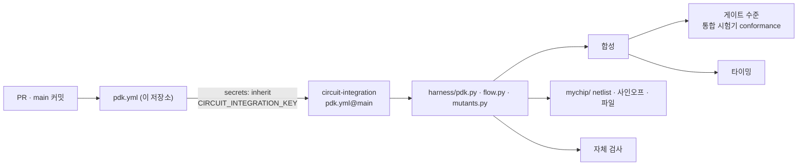
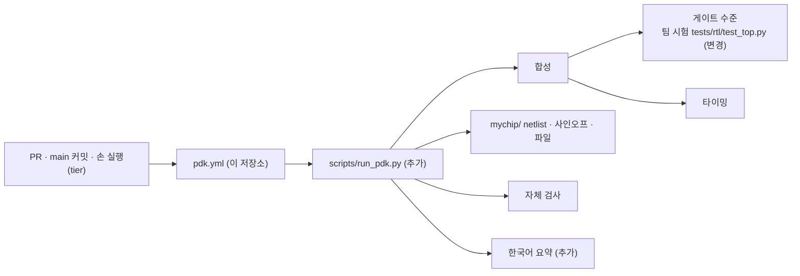

# SPEC 0015 MyChip PDK 검사를 이 저장소로 옮기기

- 상태: 제안. SPEC 0014의 검사 내용은 그대로 두고, 검사 코드를 이 저장소로 옮긴다.
- 기준: `main`(73b5050) 위의 단일 PR. `RTL CI`(SPEC 0012)와 `MyChip integration`(SPEC 0013)은 바꾸지 않는다.
- 관련 규약: RFC 0001 HW01~HW06(현재 회로 계약), RFC 0002 DOC02·DOC04·PR01·AUTO01.

## What

`MyChip PDK` 체크를 이 저장소 안의 코드만으로 돌린다. 지금까지 `.github/workflows/pdk.yml`은 동아리 통합 저장소의 재사용 workflow(`SNU-SSC-Lab/circuit-integration/.github/workflows/pdk.yml@main`)를 불렀다. 이 PR부터는 같은 검사를 이 저장소의 `scripts/`가 직접 실행한다. 체크 이름 `MyChip PDK`와 실행 시점(PR, `main` 커밋)은 그대로다.

검사 다섯 가지:

1. 합성: Yosys로 RTL을 4차 PDK(NSPL_05CMOS_PDK_260820) 표준셀에 맞춘다. 표준셀로 바뀌지 않은 셀, 금지 셀(`LATCHX1`, `TBUFX1`, `TBUFX2`), Yosys `check`가 찾은 조합 루프·구동 없는 net·중복 구동이 있으면 실패한다. 셀 수·플립플롭 수·면적을 보고한다.
2. 게이트 수준: 합성 netlist의 셀을 PDK Liberty의 `function`대로 동작하는 Verilog로 바꾸고, **팀의 top 시험** `tests/rtl/test_top.py`를 `scripts/run_rtl.py`의 `integration`·`regression` 그룹(6개 시험, 42,907작업)으로 돌린다. 통합 저장소의 시험기는 더 쓰지 않는다.
3. 타이밍: OpenSTA로 100 ns(10 MHz) 클록에서 setup·hold 여유를 본다. 입력 지연 50 ns, 출력 지연 20 ns, 출력 부하 0.5 pF, 입력 구동 `BUFX2`. PDK에 typical 라이브러리 하나만 있어 setup은 지연 ×1.5, hold는 ×0.7로 계산한다. 공정 코너별 사인오프 분석이 아니다.
4. `mychip/`: `1-synth`·`2-pnr`에 올린 팀 netlist에 2·3과 같은 검사를 한다(`2-pnr`에 SPEF가 있으면 배선 지연 반영). SDC 클록이 100 ns보다 느리면 실패한다. `3-signoff`의 DRC 0건·LVS 일치·top 이름·GDS 해시 형식을 본다. `mychip/` 안의 파일 종류를 본다. 파일이 없는 단계는 "없음"이고 실패가 아니다.
5. 자체 검사: `` `ifdef SYNTHESIS `` 뒤에 숨긴 버그 두 개(`illegal-not-sticky`: 오류 플래그가 누적되지 않음, `sum-11-bit`: `adder12`의 합이 11비트)를 RTL 시험은 통과하고 PDK 검사는 잡아야 한다. 2 ns 클록에서는 setup 여유가 음수여야 한다.

PR·`main`과 손 실행(`workflow_dispatch`) 모두 게이트 수준에서 `integration`+`regression` 그룹(6,561×5 합법 가중치 배열, 무작위 10,000작업)을 돌린다. 처음 초안은 `regression`을 손 실행(`full`)에만 두었으나 2026-11-24 운영진 결정으로 PR마다 돌린다(약 3분 추가). `tier` 입력은 손 실행 이름으로만 남는다.

결과는 Actions 실행 요약에 한국어 표로 쓴다: 검사별 통과·실패·없음, 셀 수·플립플롭 수·면적, setup·hold 여유, 타이밍이 typical ×1.5/×0.7 가정이라는 설명.

## Why

동아리 운영진이 통합 저장소의 책임을 칩끼리의 연결 검사로 줄였다. 각 팀 칩의 합성·타이밍·사인오프 검사는 그 팀의 일이다. 통합 저장소는 곧 `pdk.yml`과 팀 전용 검사(`mychip/` netlist, DRC·LVS 리포트, `mychip/` 파일 종류)를 지운다. 그대로 두면 이 저장소의 `MyChip PDK` 체크가 깨진다.

검사를 옮기면 다음도 달라진다.

- 통합 저장소를 읽는 deploy key(Actions secret `CIRCUIT_INTEGRATION_KEY`)와 `secrets: inherit`가 필요 없다. 이 저장소는 기본 토큰으로 읽는다.
- 게이트 수준 시험이 팀이 RTL에 쓰는 시험과 같아진다. 시험을 고치면 RTL과 netlist에 함께 적용된다.
- 검사 기준(`verification/pdk/pdk.toml`, `flow.toml`)을 팀이 PR로 고친다.

## How

### 대상 파일

| 파일 | 내용 | 옮겨 온 곳 (통합 저장소 60c7acc) |
| --- | --- | --- |
| `.github/workflows/pdk.yml` | 도구 설치·캐시, 검사 실행, 요약, 결과 보관 | `.github/workflows/pdk.yml`의 도구·캐시 단계 |
| `scripts/pdk.py` | 합성, Liberty 게이트 모델, 팀 시험 실행, OpenSTA, 팀 netlist 검사, `sdc_period` | `harness/pdk.py` |
| `scripts/mychip_flow.py` | `check_files`, `check_signoff`, `stage_netlists`, `team_sdc` | `harness/flow.py` (`check_layout`은 통합 저장소에 남음) |
| `scripts/pdk_selftest.py` | 숨긴 버그 2개와 2 ns 타이밍 자체 검사 | `harness/mutants.py`의 `gate_only`·`timing_sanity` |
| `scripts/run_pdk.py` | `check`·`selftest`·`report` 명령, 한국어 요약 | 새로 작성 (`harness/run.py`·`report.py` 대신) |
| `scripts/fetch_pdk.sh` | 공개 PDK를 고정 커밋에서 받아 SHA-256 확인 | `harness/fetch_pdk.sh` |
| `scripts/build_opensta.sh` | OpenSTA 고정 커밋 빌드 | `harness/build_opensta.sh` |
| `verification/pdk/pdk.toml` | Liberty 경로·SHA-256, 금지 셀, `[timing]` 가정·derate, 클록 100 ns | `contract/pdk.toml` + `contract/interface.toml`의 `clock_period_ns` 값 |
| `verification/pdk/flow.toml`, `pdk_blobs.txt` | `mychip/` 단계, 허용 파일 종류, PDK 사본 목록 | `contract/flow.toml`(`[layout]` 제외), `contract/pdk_blobs.txt` |
| `tests/pdk/test_mychip_flow.py` | 파일·사인오프·netlist 위치·SDC 시험 | `harness/test_flow.py` (pytest → unittest, layout 시험 제외) |

문서: `mychip/README.md`, `mychip/.gitignore` 주석, `README.md` 폴더 표, `docs/ci.md`, SPEC 0014 상태 줄.

### 변경 전



### 변경 후



삭제: 통합 저장소 호출, `secrets: inherit`, deploy key 사용. 변경: 게이트 수준 시험기. 추가: `run_pdk.py`, 손 실행 `tier`, 요약.

핵심 diff (`.github/workflows/pdk.yml`):

```diff
 jobs:
   pdk:
-    uses: SNU-SSC-Lab/circuit-integration/.github/workflows/pdk.yml@main
-    with:
-      team: ${{ github.event.repository.name }}
-      sha: ${{ github.event.pull_request.head.sha || github.sha }}
-    secrets: inherit
+    runs-on: ubuntu-24.04
+    steps:
+      - uses: actions/checkout@8e8c483db84b4bee98b60c0593521ed34d9990e8 # v6.0.1
+      ...
+      - name: pdk-check
+        run: python scripts/run_pdk.py check --tier "$SSC_TIER"
+      - name: pdk-selftest (SYNTHESIS 뒤에 숨긴 버그와 2 ns 클록을 잡는지)
+        run: python scripts/run_pdk.py selftest
+      - name: pdk-report
+        run: python scripts/run_pdk.py report
```

게이트 수준 시험 (`scripts/pdk.py`): 통합 저장소의 `harness.run.simulate(..., "conformance")` 대신 `scripts/run_rtl.py`의 `simulate`에 Liberty 게이트 모델 한 파일을 소스로 넘긴다.

```diff
-    result = simulate([model], top, core, tier, work / "sim")
+    config = dict(DESIGN, sources=[str(model)])
+    for suite in TIERS[tier]:          # pr, full: integration + regression
+        run_rtl.simulate(config, suite, work / 'build', work / suite)
```

### 옮기면서 바꾼 점

- Yosys 0.68처럼 새 버전은 flatten 뒤에도 `wire signed`를 쓰고, OpenSTA는 이 줄을 읽지 못한다. 합성 netlist에서 `signed`를 지운다. 셀과 연결만 있는 netlist에서 부호 표시는 의미가 없다.
- 2 ns 자체 검사는 setup 여유가 음수일 때만 "검출"이다. 원래 코드는 OpenSTA가 오류로 멈춰도 "검출"로 셌다. 로컬에서 위 `signed` 문제로 실제로 그렇게 잘못 통과했다.
- 숨긴 버그 두 개를 모두 돌리고 둘 다 잡아야 통과한다. 원래 코드는 처음 적용되는 하나만 돌렸다. RTL 글자가 바뀌어 적용되는 버그가 하나도 없으면 실패하므로, 그때는 `scripts/pdk_selftest.py`의 `MUTANTS`를 같은 PR에서 고친다.
- PDK 위치 환경 변수는 `CIRCUIT_PDK` 대신 `SSC_PDK`다.

### 검증 계획과 결과

- `python scripts/policy.py check-docs`, `python -m unittest discover -s tests/policy -v`, `python -m unittest discover -s tests/pdk -v`.
- WSL Ubuntu(Yosys 0.68, Icarus 14.0 개발판, OpenSTA)에서 `run_pdk.py check`·`selftest`·`report`를 돌린다. 실제 결과와 GitHub 실행 결과는 PR 본문에 적는다.
- `mychip/`에 합성 netlist를 넣고 SDC 120 ns, 셀 하나를 바꾼 `2-pnr` netlist, DRC·LVS·해시 파일을 임시로 넣어 실패·통과가 맞게 나오는지 본다(커밋하지 않음).
- GitHub에서 PR 실행(`pr`)과 손 실행(`full`) 모두 통과해야 하고, 자체 검사가 세 항목을 모두 "검출"해야 한다.

### 합격 조건

- `MyChip PDK` 체크가 통합 저장소·비밀값 없이 통과한다. 기존 `RTL CI`도 통과한다.
- 요약 표에 합성·게이트 수준·타이밍·`mychip/1-synth`·`mychip/2-pnr`·`3-signoff`·파일 종류·자체 검사 여덟 줄이 모두 나온다.
- 액션은 커밋 SHA로 고정한다(`ci.yml`과 같은 SHA).

흐름 변경: 있음

## RFC 확인

RFC 0001의 회로 계약(입력 10바이트, 출력 4 nibble, 12비트 부호·오류 플래그, 응답 상한 32클록, reset)은 이 검사가 쓰는 `tests/rtl/test_top.py`·`model.py`가 이미 확인하는 내용이다. 이 PR은 RFC 0001과 RTL·시험을 바꾸지 않는다. RFC 0002 DOC02에 따라 코드보다 이 SPEC을 먼저 쓰고, DOC04에 따라 CI 흐름의 변경 전후 그림과 diff를 넣었다. PR01에 따라 작업 브랜치·PR로 제안하고 에이전트가 merge하지 않는다. AUTO01에 따라 자동 검사 결과와 사람의 판단을 구분한다. 합성·타이밍 통과를 공식 Cadence 사인오프나 제작 가능 판정으로 표시하지 않는다.
