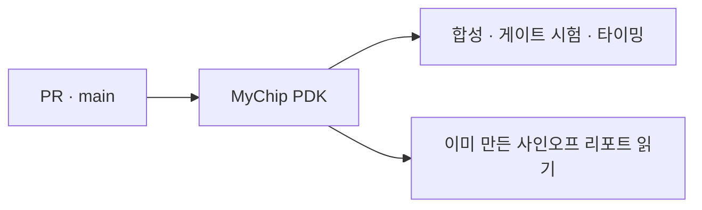
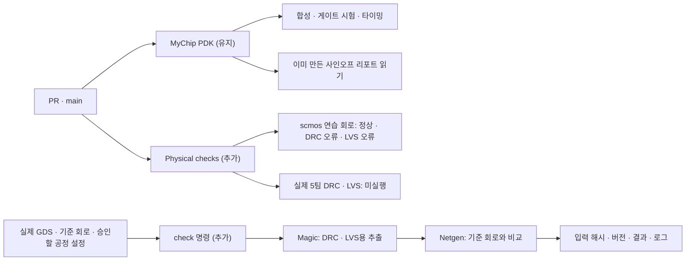

# SPEC 0016 Magic DRC와 Netgen LVS 실행 준비

- 상태: 구현. 실제 5팀 레이아웃 검사는 입력 자료를 받은 뒤 실행한다.
- 기준: `main` 642a6b5. 2026-11-24 현재 `mychip/`에 GDS와 트랜지스터 기준 회로가 없다. 사용자가 별도 기술파일·설정·레이아웃도 없다고 확인했다.
- 관련 규약: RFC 0001 HW01~HW06, RFC 0002 DOC01~DOC04·PR01·AUTO01.

## What

Magic의 DRC(도형의 폭·간격 등 검사)와 Netgen의 LVS(레이아웃에서 읽은 회로와 기준 회로 비교)를 실행하는 도구와 상세 사용서를 추가한다. PR에서는 공개 연습 공정 `scmos`의 작은 회로로 도구와 실패 판정이 작동하는지 확인한다. 이 결과를 5팀 칩의 DRC·LVS 통과로 쓰지 않는다.

실제 회로용 명령은 GDS, 기준 SPICE/CDL, Magic 기술파일·시작 설정, Netgen 설정과 각 입력의 SHA-256을 명시한 실행 명세를 받는다. 지정한 입력이 빠졌거나 해시가 다르면 실행 전에 실패한다. 실행한 입력·도구 버전·소요 시간·결과를 별도 폴더에 남긴다. 추출한 SPICE와 로그는 저장소에 커밋하지 않는다.

사용서는 설치, 입력 준비, DRC, LVS, 오류 찾기, 결과 보관, GitHub 확인, PEX의 C·R 추출과 성준님께 확인할 자료를 설명한다. Magic은 PEX 기능이 있으나 NSPL 공정에서 정확한 값을 얻으려면 해당 공정의 추출 규칙과 검증이 필요하다. Netgen은 PEX 도구가 아니다.

## Why

지금 `MyChip PDK`는 이미 만든 Calibre/Assura 리포트의 문구를 검사한다. Magic과 Netgen을 실제로 실행하는 단계는 없다. 사용법만 적고 판정기를 시험하지 않으면 연결이 틀린 회로를 통과로 표시할 수 있다. 반대로 레이아웃이 없는 상태에서 실제 칩 검사를 실행했다고 표시하면 검증 범위를 오해한다.

공개 GoodKook 저장소에는 ETRI050 Magic 기술파일과 Netgen 예제가 있다. 이것이 현재 4차 NSPL 키트와 같은 규칙·레이어·추출 계수인지, 제출처에서 인정하는지는 확인되지 않았다. 이름이 비슷하다는 이유로 채택하지 않는다. 기존 공식 사인오프 리포트 판정도 바꾸지 않는다.

## How

### 대상 파일과 동작

| 파일 | 변경 |
| --- | --- |
| `.github/workflows/physical.yml` | PR·main·손 실행에서 Ubuntu 도구 설치, 단위 시험과 연습 회로 검사. 실제 칩 검사는 미실행이라고 요약 |
| `scripts/run_physical.py` | `selftest`, `check`, `report`. Magic 실행, LVS용 SPICE 추출, Netgen 비교, JSON·한국어 요약 |
| `tests/physical/test_physical.py` | 입력·해시·판정 오류 및 누락 결과를 실패로 처리하는 시험 |
| `verification/physical/example.toml` | 실제 칩 실행 명세의 빈 예시. 채우기 전에는 실행 불가 |
| `docs/verification/magic-netgen-guide.md` | 재현 가능한 상세 사용서. 연습 공정과 실제 공정을 계속 구분 |
| `docs/ci.md`, `README.md`, `mychip/README.md` | 새 검사와 사용서 연결, 확인되지 않은 서버 존재를 단정한 문장 정정 |
| `docs/specs/README.md`, `docs/specs/index.json` | SPEC 등록 |

실제 검사는 우선 로컬 Linux/WSL 명령으로 제공한다. GitHub에 실제 칩 검사를 붙이려면 GDS와 공정 설정을 안전하게 전달하는 경로부터 합의해야 한다. 이 PR의 GitHub 검사는 도구 자체 시험이다. 학교 서버나 유료 도구가 이미 있다고 가정하지 않는다.

### 변경 전



### 변경 후



삭제 없음. RTL·기존 합성·타이밍·공식 사인오프 기준 변경 없음.

```diff
+ Physical checks: 연습 회로로 Magic·Netgen과 실패 판정 시험
+ python scripts/run_physical.py check --manifest /path/run.toml --out /path/result
  MyChip PDK: 기존 합성·타이밍·Calibre/Assura 리포트 검사 유지
```

### 판정과 실패 조건

- Magic은 지정한 기술파일이 실제로 로드됐는지 확인한다. GDS의 top이 없거나 도형이 비어 있으면 실패한다. 전체 계층을 검사하고 DRC 오류 타일 수와 원인·좌표를 남긴다.
- DRC가 실패해도 가능한 경우 LVS용 추출과 비교 결과를 함께 남긴다. 오류 수의 단위는 규칙 개수나 독립적인 결함 수가 아닌 Magic의 오류 타일 수다.
- LVS는 종료 코드만 보지 않는다. 비교 보고서의 최종 결과와 속성·핀 불일치를 확인한다. 빈 추출 회로, 읽기 실패, undefined/blackbox 경고, 불완전한 결과는 실패한다. 같은 잘못된 파일끼리의 비교를 막기 위해 입력 파일이 같으면 실패한다.
- 연습 회로는 정상 DRC·정상 LVS 통과, 폭 위반 DRC 실패, 기준 회로 변경 LVS 실패를 실제 도구로 확인한다. 하위 셀의 폭 위반도 잡아야 한다. PEX는 이 CI의 합격 항목이 아니며, 사용서에서 별도 절차로 설명한다.
- 타임아웃·예외·도구 부재는 실패이며 로그와 JSON에 이유를 남긴다. 이전 실행 폴더를 재사용하지 않아 오래된 성공 파일을 읽지 않는다.
- 실제 사용자가 고른 Tcl과 공정 계수의 타당성은 사람의 검토 대상이다. 이 도구는 공식 제작 승인이나 모든 물리 규칙의 검출을 보장하지 않는다.

### 검증 계획

1. `python scripts/policy.py check-docs`, `python -m unittest discover -s tests/policy -v`.
2. `python -m unittest discover -s tests/physical -v`.
3. WSL의 Magic·Netgen으로 `selftest`; Ubuntu 24.04 배포판 패키지로도 같은 시험.
4. 정상 입력 명세를 `check`로 실행하고, 입력 누락·틀린 해시·틀린 top·회로 불일치가 실패하는지 확인.
5. GitHub PR에서 새 workflow와 기존 검사의 결과 확인. 실행 시간·버전과 남은 미확정 사항을 PR과 사용서에 기록.
6. PDF 사용서를 만들어 모든 페이지의 한글·표·명령문 잘림을 확인한다. PDF는 배포용이며 수정 원본은 저장소 문서다.

### 로컬 실행 결과 (2026-11-24)

- 문서 검사 통과. Windows Python 3.13 정책 시험 50개 통과, 새 입력·판정 시험 16개 통과.
- WSL Ubuntu의 Magic 8.3.681·Netgen 1.5.323에서 자체 시험 6개 통과. 정상, 연결 오류, W/L 오류, GDS 핀 누락, 하위 셀 DRC, 없는 top을 구분했다.
- 실제 5팀 GDS 검사·NSPL PEX는 미실행이다. 공정 설정·레이아웃·기준 회로가 없다. Ubuntu 배포판 패키지와 GitHub 실행 결과는 PR에 별도로 기록한다.
- Ubuntu 24.04의 Netgen 1.5.133 보고서에는 최신판의 `Final result:` 머리말이 없다. 이 버전은 보고서의 마지막 비어 있지 않은 행이 정확히 `Circuits match uniquely.`인지 확인한다. 두 형식 모두 JSON의 top·소자 수·net·핀·속성 오류 검사를 함께 통과해야 한다.

흐름 변경: 있음

## RFC 확인

RFC 0001의 입출력·연산·리셋 계약은 바꾸지 않는다. RFC 0002 DOC01~DOC02에 따라 규약과 실행 계획을 분리하고 이 SPEC을 코드보다 먼저 작성한다. DOC03~DOC04에 따라 쉬운 설명, 변경 전후 그림과 diff를 제공한다. PR01에 따라 작업 브랜치에서 PR을 만들고 팀장·설계 담당자에게 리뷰를 요청한다. AUTO01에 따라 연습 회로 통과, 실제 칩 미실행, 공식 사인오프를 구분한다. 브랜치 보호는 추가하지 않는다.
