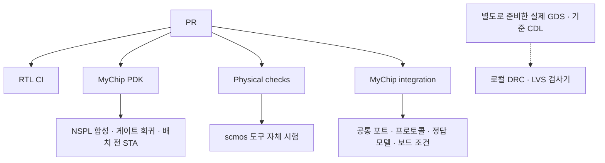
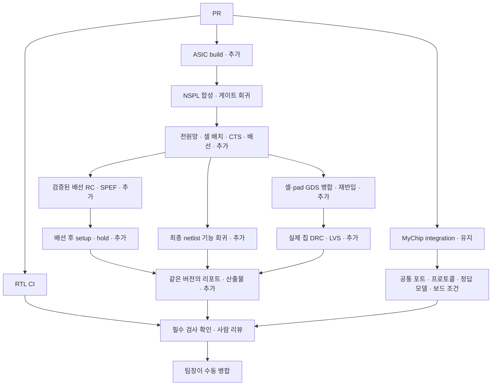

# SPEC 0017 RTL부터 GDS·검증·리포트까지 자동 실행

- 상태: 구현 실험 완료·원격 실행 차단(GitHub 결제/한도 안내). PR #8·#9 병합 후 `feat/rtl-to-gds`에서 구현. 공정 전체 검증·제작 제출은 미완료.
- 작성일: 2026-11-24. 기준: PR #8 `feat/magic-netgen-ci`의 `0a8241c`.
- 관련 규약: RFC 0001 HW01~HW06, RFC 0002 DOC01~DOC04·PR01·AUTO01.
- 채택 원칙: 1팀 방식과 후보 도구를 비교하고 더 적합한 방식을 고른다. 아래의 후보를 설치 성공만으로 확정하지 않는다.

## What

5팀 RTL을 입력하면 합성, 셀 배치, 클록 트리, 배선, GDS 생성, 기능·타이밍·물리 검사와 리포트 보관까지 이어지는 흐름을 만든다. 배치배선(P&R)은 셀의 위치와 배선을 정하는 과정이다. GDS는 제작할 도형을 담는 파일이다. 필요한 GDS를 사람이 별도로 만들어 넣는 현재 검사에서, CI가 직접 만들고 검사하는 구조로 확장한다.

먼저 **같은 작은 NSPL 회로로 Qflow와 OpenROAD를 비교**한다. 기존 Yosys 합성·게이트 회귀·OpenSTA 검사는 재사용 후보로 둔다. 비교 결과를 이 문서에 추가하고 선택한 도구로 5팀 코어, 이후 pad·전원을 포함한 전체 칩을 구현한다. 실행 도중 RTL·실행 코드·회귀 입력·공정/도구 설정이 바뀌면 섞인 결과로 판단해 실패시킨다. 필수 단계를 실행하지 못하면 전체 칩 통과로 표시하지 않는다.

| 범위 | 완료 결과 |
| --- | --- |
| 코어 | `v_ternary8_top`의 배선 완료 netlist·GDS와 해당 범위의 검사 결과 |
| 전체 칩 | 안내서의 `MPW_PAD_28pin`·SOP28에 맞는 pad·전원·코어 연결, 전체 chip GDS와 검사 결과 |
| 실행 기록 | 같은 RTL·PDK·제약에서 만든 파일의 해시, 도구 버전, 검사 결과, 소요 시간과 원본 보고서 |
| GitHub | 5팀 자체 검사와 기존 `MyChip integration`의 상태를 별도로 보여 주고 팀장이 리뷰 후 수동 병합 |

코어 GDS만 만들고 전체 칩 구현 완료라고 쓰지 않는다. 오픈소스 검사 통과와 제작 서비스의 최종 승인은 별도 항목이다. 안내서 3쪽은 SOP28·`MPW_PAD_28pin`을, 8쪽은 최종 DRC/LVS/PEX에 검증된 Calibre/Assura deck을 사용하고 다른 도구는 공정 지원을 확인하도록 설명한다. 오픈소스 경로의 공정 지원과 제출 인정 여부가 확인되기 전에는 제작 승인으로 표시하지 않는다.

## Why

작업 시작 시 `MyChip PDK`는 실제 NSPL 표준셀로 합성하고 게이트 수준 기능과 배치 전 타이밍을 검사한다. `Physical checks`는 작은 `scmos` 연습 회로로 Magic·Netgen과 판정기를 시험한다. 당시 실제 5팀 배치배선·GDS 생성·배선 RC 추출은 없었다. 이 상태에서 Checks가 모두 초록색이어도 완성된 칩을 검사한 결과는 아니다.

사용자가 원하는 것은 설계 수정마다 실제 구현 결과와 실패 원인을 받는 것이다. 1팀의 입력 양식·단계별 실행·결과 묶음은 참고할 가치가 있다. 다만 예제 검증, 실제 설계 구현, GitHub에서의 자동 실행은 구분해서 비교해야 한다. 기존 도구를 그대로 채택하거나 최신 도구로 교체하는 것 자체를 목표로 삼지 않는다.

## How

### 1. 1팀 자료에서 확인한 것

11월 21일 성과공유 페이지에 첨부된 `디지털1팀_성과공유회_1주차.pptx` 6장을 읽었다. 파일 SHA-256은 `de27d6fb1a31e978d15a0bfe2232742fbace8233f5a3777bd5bc854b6cc63384`다. 이후 저장소는 `4c6542af1a2943dde15cfcaf3e1927151e474f25` 기준으로 따로 확인했다. 발표 수치는 발표자의 보고이며 이 작업에서 같은 실행을 재현한 수치는 아니다.

| 시점·자료 | 확인된 범위 | 5팀에 적용할 판단 |
| --- | --- | --- |
| 발표 3쪽, A | 8비트 예제 합성·면적, 배치 전 hold 문제 보고 | 합성과 실제 배선 후 검사를 구분하는 설명 재사용 |
| 발표 4쪽, B | ICC2·Qflow 가이드, 16셀 예제 GDS의 단선·합선 0건 보고. 클록 트리·RC 검증은 다음 단계 | Qflow의 시작 자료로 활용. 전체 타이밍 검증 완료의 근거로 쓰지 않음 |
| 발표 5쪽, C | YAML 입력과 자동 실행기, 가짜 입력 12/12 자체 시험. 실제 netlist·SPEF 대기 | 입력 형식·실패 시험·결과 요약 방식 참고. 실제 회로 통과와 구분 |
| 이후 `04-qflow.md` | Qflow→Yosys/GrayWolf/QRouter, KLayout으로 실제 셀 GDS 병합. 해당 명령은 보관한 SDC를 읽지 않으며 CTS·RC·배선 후 STA가 미검증 | 같은 NSPL 예제를 재현할 출발점. 필수 단계의 부족분을 비교 시험에 포함 |
| 이후 `B04_CHIP_TOP.md` | Census8 전체 칩 결과는 Genus·Innovus 기반. 기능 회귀·SPEF·타이밍·GDS 결과가 있으나 공식 Calibre DRC/LVS 미실행을 명시 | 전체 칩 연결·독립 CDL·동일 버전 묶음 참고. 이 결과를 오픈소스 전용 성공 사례로 옮겨 적지 않음 |
| 1팀 GitHub workflow | 통합 검사·RTL 계약 검사 연결 확인 | 로컬 자동 실행 코드의 존재와 GitHub의 전체 P&R 자동 실행을 동일하게 보지 않음 |

가져올 내용은 단계별 입력과 출력, 실패 원인 설명, 같은 버전의 GDS·netlist·SPEF·SDC를 묶는 방법이다. 셀 모델 수정·pad 배치·공정 설정은 원문과 사용 조건을 검토하고 우리 회로로 확인한 뒤 사용한다.

### 2. 도구 비교와 선택 절차

| 단계 | 현재 또는 후보 | 비교할 이유와 남은 확인 |
| --- | --- | --- |
| RTL 기능 | cocotb + Icarus, Verilator lint | 기존 시험 재사용. P&R 도구 선택과 무관하게 유지 |
| 합성 | Yosys/ABC | 기존 NSPL 합성 재사용 후보. 최종 P&R이 실제 읽은 netlist와 일치하는지 검사 |
| P&R 후보 A | 1팀 Qflow 경로 | 같은 공정의 예제·가이드가 있어 시작 비용이 낮다. SDC 적용, CTS, hold 보정, 미배선 검사, RC 전달을 추가로 입증해야 함 |
| P&R 후보 B | OpenROAD + OpenROAD Flow Scripts(ORFS) | SDC 기반 합성·배치·CTS·배선·추출을 연결하는 구조가 있다. NSPL은 기본 제공 플랫폼으로 확인되지 않아 별도 공정 설정과 실증이 필요 |
| 상용 비교 기준 | 1팀의 Genus·Innovus, ICC2 가이드 | 결과 묶음과 검사 항목 참고. 이번 오픈소스 실행 경로의 필수 도구로 넣지 않음 |
| 최종 GDS·그림 | KLayout | 두 후보 공통 후보. 표준셀·pad의 실제 GDS 병합, layer map·DB 단위·top 확인 |
| DRC | KLayout 규칙 변환본 또는 Magic 기술파일 | NSPL 공식 규칙과 대응표·정상/위반 예제를 확인해 선택. 오류 0건만으로 규칙 전체 구현을 주장하지 않음 |
| LVS | KLayout 또는 Magic으로 회로 추출 → Netgen 비교 | 현재 NSPL 셀의 핀·소자·W/L·전원 인식이 되는 경로 선택. GDS와 독립적인 기준 CDL 필요 |
| 배선 RC 추출 | OpenRCX 우선 비교 후보 | 공정별 보정 자료가 필요. Qflow 선택 시에도 같은 수준의 실제 배선 추출 경로를 확보해야 함 |
| 배선 후 STA | OpenSTA | SPEF·최종 netlist·SDC·셀 지연을 함께 검사. 현재 TT·보수 계수 분석을 모든 PVT 조건의 검증으로 부르지 않음 |
| 기능 회귀·등가 | 기존 게이트 회귀, Yosys 등가 검사 후보 | 배치배선 중 버퍼·셀 변경 후 기능 확인. 등가 검사는 순차 회로·리셋·모델 지원을 실증한 뒤 필수 여부 결정 |

현재 자료만 보면 Qflow는 **같은 공정의 예제 재사용**에, OpenROAD는 **클록·타이밍을 포함한 전체 흐름 구성**에 장점이 있다. OpenROAD를 먼저 시험할 후보로 제안하되 아직 채택 확정은 아니다. 두 후보 모두 NSPL 전체 칩의 검증된 오픈소스 경로를 확보했다고 볼 수 없다.

비교는 다음 순서로 한다.

1. 동일한 8비트 레지스터 예제, RTL, 셀 목록, PDK 해시, 100 ns SDC, 부하, 코어 영역·핀·허용 배선층을 고정한다. 1팀 예제를 쓰면 출처·수정분을 기록한다.
2. Qflow 예제를 재현하고 OpenROAD에서도 같은 회로를 실행한다. 각 실행이 SDC를 실제 읽었는지, 순차소자에 클록이 도달하는지, 배선·전원 연결이 완료됐는지 확인한다.
3. 최종 GDS를 별도 프로세스로 다시 열고 실제 셀·핀·전원과 단선·합선, DRC·LVS를 검사한다. 작은 회로에서 통과해도 전체 공정 규칙 지원 여부는 별도 기록한다.
4. RC 자료가 준비된 범위에서 SPEF·setup·hold를 비교한다. 자료가 없으면 두 후보 모두 해당 항목은 미검증이다. 추정 RC로 만든 결과는 탐색용으로만 표시한다.
5. 동일 실행기의 캐시 없는 실행·캐시 있는 실행을 각각 3회 측정한다. 단계별 시간, 최대 메모리·디스크, 셀 수·면적·배선 길이·WNS/TNS, 실패 원인 찾기와 재실행 방법을 기록한다.
6. 필수 기능·배선·물리·타이밍 검사가 되는 후보 중 팀원이 유지할 수 있는 쪽을 선택한다. 빠르지만 필수 검사가 빠진 후보를 시간 점수로 승격하지 않는다. 둘 다 부족하면 부족한 공정 설정부터 해결하고 선택을 보류한다.

측정 표와 선택 근거를 이 SPEC에 추가한 다음 실제 5팀 구현 코드를 수정한다. 계획 단계에서는 실행 시간·면적 개선율을 예상 수치로 채우지 않는다.

#### 비교 실험 중간 결과: 2026-11-24

`compare-06`에서 같은 16셀 합성 netlist로 Qflow와 OpenROAD를 실행했다. Qflow는 합성 0.874초·배치 2.074초·배선 0.269초·GDS 재반입/연결 검사 3.583초였다. OpenROAD는 SDC 읽기·배치·CTS·전원망·배선에 5.759초가 걸렸다. OpenROAD 결과는 3개 클록 버퍼·8개 sink, 배선 도구 DRC 0건이며 최종 GDS에서 읽은 320개 MOS가 최종 netlist와 원본 CDL의 독립 기준 회로와 LVS 일치했다. 배치 영역과 실행 단계가 달라 이 시간을 같은 조건의 성능 우열로 해석하지 않는다. 반복·자원 측정과 실제 5팀 결과는 후속 기록으로 남긴다.

핀 접근 문제는 앞서 확인한 CONT/VIA1 표기 수정으로 넘겼다. 이후 MET2 전원선이 셀 CLK 핀의 유일한 접근점과 겹치는 short를 확인했다. MET2/MET3 링을 배치 영역 바깥에 두고 MET1 전원선을 링까지 이어 해결했다. 규칙·금속 도형을 삭제하거나 위반을 무시하지 않았다.

5팀의 우선 구현 경로는 **OpenROAD 명령을 실행하는 작은 Tcl 흐름**으로 정한다. SDC·CTS·배선이 같은 실행에서 연결되고 실제 GDS LVS도 확인했기 때문이다. ORFS 전체를 이식하는 작업은 필요할 때 비교하며 지금은 새 공정 설정에 필요한 명령·검사를 직접 관리한다. Qflow 예제는 비교·고장 재현용으로 남긴다. 배선 RC는 아직 추정값이며 공정 DRC 전체 지원도 미확인이다. 따라서 이 선택은 구현 경로의 선택이며 전체 칩 검증 완료 판정이 아니다.

5팀 첫 코어 구현은 논리 382셀·66FF, 합성 면적 222,912 µm²였다. filler 포함 GDS 1,679인스턴스에서 3,500개 MOS를 추출했으나 독립 LVS가 실패했다. 사용한 셀 16종을 원본 GDS/CDL로 각각 검사해 AOI21X1·OAI21X1·NOR2X1의 A/B 핀 대응 차이와 INVX8의 속성 불일치를 분리했다. 초기 대응은 이 네 셀을 새 ASIC 경로의 합성·구현에서 제외하는 것이다. ABC 매핑용 Liberty의 제한과 OpenROAD 셀 제한을 사용하고, 기존 PDK 검사 기본값·RTL·원본 PDK는 유지한다. LVS 핀·W/L 검사를 끄지 않는다. 클록 부하 보정용 셀의 연결되지 않은 **출력**은 기준 회로에서 고유한 미연결 node로 보존하며 입력 누락은 계속 실패시킨다.

추가로 물리 전용 filler를 제외한 34종 전체를 같은 추출기·Netgen으로 검사했다. 23종은 일치했고 11종은 이 경로에서 미확인 상태다. AND2X2·AOI21X1·BUFX4·INVX2·INVX4·INVX8·NOR2X1·OAI21X1·OAI22X1·OR2X2·TBUFX2를 새 ASIC 경로에서 제외한다. 이는 공개 셀 자체가 불량이라는 판정이 아니며, 현재 추출·비교 경로의 호환 범위를 제한한 것이다. 셀별 보고서와 도구·원본 해시를 근거로 유지한다. Netgen 종료 코드 0과 LVS 일치는 구분해 저장한다.

Ubuntu 24.04의 Yosys 0.33은 ABC `-dont_use` 옵션이 없다. 같은 제외 목록을 적용하기 위해 ABC에만 전달할 작업용 Liberty에서 해당 셀 블록을 제거한다. 지정 셀을 정확히 찾지 못하면 실패한다. 원본 Liberty와 STA·기능 모델은 유지하고, 합성 결과에 제외 셀이 남아 있으면 실패한다. OpenROAD에도 같은 제외 목록을 설정한다.

새 코어의 전체 LVS와 42,907작업 기능 회귀는 통과했다. 그러나 별도 KLayout 배선 규칙 검사에서 VIA1/CONT 간격·겹침 262개 마커를 확인했다. 원본 셀 38종의 VIA1 도형은 모두 0개이므로 새 배선에서 생긴 것이다. 공정 deck `9.VIA1.S`·`11.VIA2.S`의 서로 다른 cut 층 간격 0.6 µm·적층 금지를 파생 기술 LEF에 추가하고, 최종 GDS로 다시 검사한다. 배선 도구 자체 DRC 0건과 공정 규칙 검사는 별도 결과로 유지한다.

#### 코어·제안 SOP28 실행에서 확인한 범위

`ternary-05`는 코어·제안 SOP28 조립과 검사를 177.086초에 끝냈다. P&R 14.106초, 최종 netlist의 6개 기능 시험·42,907작업 회귀는 141.8초였다. 논리 452셀·66FF·247,564.8µm², 추출 MOS 3,790개가 독립 LVS 일치했다. 수정한 서로 다른 cut 층 간격 제한을 적용한 뒤 배선 도구 DRC와 독립 배선 규칙 일부 검사는 각각 0건이었다. TT 추정 setup/hold slack은 +49.145/+1.636ns다. 공정 보정 전 RC·TT 한 조건이며 기존 보수 계수 기반 PDK 타이밍 검사를 대체하지 않는다.

조립 결과는 원본 pad opening 28개 위치와 GPIO master 도형을 보존했다. 183개 탐침점과 996개 코어 금속 연결 성분에서 단선·합선·조립에 따른 합쳐짐/갈라짐이 없었다. GPIO의 저항·ESD 소자 전체 LVS나 공정 DRC 완료는 아니다. 미커밋 코드·로컬 Yosys 0.68 기반 한 번의 실행이며 통계·GitHub 성능으로 일반화하지 않는다.

`selftest.py`는 실제 KLayout 도형 7개를 만든다. 정상 DRC·정상 금속 연결 2개는 통과하고, 폭 위반·cut 적층·하위 셀 위반·없는 연결 탐침점·관측하지 않는 내부 금속 합선 5개는 반드시 실패해야 한다. 이 7개 시험은 통과했다. 빈 추출·소자 속성 오류·불완전 Netgen 보고서를 거부하는 기존 시험도 유지한다. 이것만으로 아직 옮기지 않은 공정 규칙의 정확도를 주장하지 않는다.

기본 PR workflow는 strict로 실행해 `unsupported`가 남으면 빨간색을 유지하고 산출물을 7일 보관한다. 수동 `experimental`은 정해 둔 공정 미확인 5개 항목(core는 RC·전체 DRC 2개) 외의 모든 필수 검사가 실행·통과한 경우에만 종료 코드 0을 허용한다. 필수 단계 누락·미실행·그 밖의 미지원은 실험에서도 실패한다. 검사 이름·JSON·보고서에 실험 상태를 유지한다. 공정 RC·전체 DRC·GPIO LVS/타이밍·핀맵이 미확인인 현재 전체 판정은 `incomplete`, `ready_for_submission`은 false다. 코어 실험·제안 핀맵 조립을 구현했지만 M3의 공식 핀맵·전원·보드 조건 승인과 제작 검증은 완료하지 않았다.

Ubuntu 24.04 배포판의 Yosys 0.33·ABC와 Netgen 1.5.133을 별도 폴더에 풀어 호환 실행도 확인했다. Netgen 시작 스크립트의 라이브러리 경로만 설치 위치에 맞췄고 비교 바이너리는 그대로 썼다. 이 실행은 437셀·66FF·247,334.4µm², 코어 3,892 MOS LVS 일치, 42,907작업 회귀 통과, 배선 규칙 일부와 조립 금속 연결 통과였다. 전체 256.202초이며 입력·도구·검사·증거 해시는 `verification/asic/experiment-20261124.json`에 기록한다. 이 파일은 과거 실험 기록이며 판정 입력으로 쓰지 않는다. 고정 도구 3개 패키지의 새 네트워크 다운로드·해시 확인·설치도 통과했다.

GitHub PR #10 실행은 실행기 할당 전에 계정 결제/사용 한도 안내로 차단됐다. workflow 문법이나 ASIC 단계가 실행·통과한 결과가 아니다. 원격 검증은 한도 문제 해결 후 재실행해야 한다. 코어와 제안 조립 경로의 로컬 구현은 확인했으며, 공정 RC·전체 DRC·GPIO 검증·핀맵·제출 승인까지 완료한 상태는 아니다.

### 3. NSPL 공정 설정에서 먼저 해결할 일

M0 사전 조사에서 `scripts/asic/audit_lef.py`로 원본 셀 LEF의 장애물 도형과 원본 GDS를 비교했다. 38개 셀 모두 LEF의 `OBS LAYER VIA1` 영역이 GDS `CONT`(31/0)와 정확히 같고 GDS `VIA1`(33/0)과는 달랐다. 이 표기는 실제 배선 via가 없는 핀 주변을 막을 수 있다. 파생 LEF에서는 이 도형을 삭제하지 않고 올바른 `CONT` 층으로 옮기는 방식을 시험한다. 변환 전에 원본 해시와 셀별 기하 일치를 검사하고, 금속·핀·실제 via 도형은 유지한다. 변환 전후 배선·GDS 연결·DRC/LVS 결과를 비교한 뒤 채택한다. 단위 시험이나 배선 성공만으로 공정 검증 완료로 표시하지 않는다.

공개 ETRI 저장소 `bf15d95b48308c38720cc1e5dcf4b2c0b1b9891f`와 현재 사용 중인 `NSPL_05CMOS_PDK_260820.tar.gz`를 확인했다. 아카이브 SHA-256은 `2e49115a08f6af96c1f8433130ad4316551b5eba9001a3133905b544166af954`다. 원본은 다운로드·캐시하고 저장소에 다시 커밋하지 않는다.

| 자료·실험 | 확인 결과 | 후속 작업 |
| --- | --- | --- |
| 현재 12T P&R 키트 | Liberty·LEF·GDS·CDL·Calibre PEX 예제와 상용 도구 스크립트 포함 | 셀·핀·단위·전원 이름 대응표, tap/filler/pad와 배선층 설정 작성 |
| 공개 Magic·Netgen 예제 | 구형 buffer를 새로 LVS용 추출해 8소자·7net 일치 재현 | 예제 성공을 현재 12T 키트 지원으로 확대하지 않음 |
| 현재 키트 INVX1 GDS를 공개 Magic 설정으로 읽은 시험 | `.10` 기술파일에서 DRC 오류 타일 49개, `.30`에서 55개. 추출 핀 복원도 필요 | 매핑·규칙·핀 문제 원인 분리. 공식 셀이 불량이라고 결론 내리지 않음 |
| 공개 Magic 추출 설정 | AMI0.5 표기의 계수 존재. 현재 NSPL R·C 정확도는 미확인 | 계수의 출처·유효 범위를 검증하기 전 NSPL PEX 정확도 주장 금지 |
| RC 자료 | 셀 34개의 Calibre PEX 출력은 있으나 검증된 NSPL OpenRCX 규칙은 찾지 못함 | 배선 패턴 기준 추출·공정 자료로 규칙 생성·오차 비교. 셀 PEX만으로 배선 전체를 보정할 수 있다고 가정하지 않음 |

OpenRCX는 배선 저항·용량을 추출해 SPEF로 내보내는 후보이다. Calibre/Assura deck, TLUplus, Magic PEX SPICE를 파일명만 바꾸어 OpenRCX 규칙이나 SPEF로 사용하지 않는다. 기준 추출 결과·배선 구조·corner가 없는 상태에서 임의의 계수를 넣고 정밀 추출로 표시하지 않는다.

위 Magic 실험은 공정 연결을 살펴본 사전 시험이며 후보 P&R 비교 결과가 아니다. GDS layer map과 셀 이름 매핑을 구분한다. 키트의 `std.map`을 이름만 보고 GDS layer map으로 사용하지 않는다. 원본·파생 설정의 경로·해시와 실행 명령·도구 버전을 M0 결과에 남긴다.

DRC 규칙은 공식 규칙별로 지원·미지원·변환 근거·위반 시험을 기록한다. LVS는 최종 mapped netlist와 원본 셀·pad CDL에서 기준 회로를 구성하고, GDS에서 별도로 추출한 회로와 비교한다. 같은 GDS 추출본을 양쪽에 넣지 않는다. filler 등 물리 전용 셀의 제외는 근거와 대상을 제한하고 검토한다. 소자나 W/L 비교를 일괄 무시하지 않는다.

### 변경 전



### 변경 후

아래는 후보 비교 후 구현할 목표 구조다. 이번 문서 PR에서 추가되는 실행 단계가 아니다.



기존 합성·게이트 시험·OpenSTA 코드는 재사용한다. 새 흐름 검증 후 중복 실행을 줄이는 시점과 기존 `MyChip PDK`의 역할을 별도 변경에 기록한다. `Physical checks`의 연습 회로는 도구 고장 검출용으로 남기며 실제 칩 검사와 이름을 구분한다. `MyChip integration`은 공유 계약 검사이며 모든 칩을 실제 연결한 공동 시뮬레이션이 이미 완성됐다고 가정하지 않는다.

구현한 실행 차이는 다음과 같다. 기본 strict 실행은 남은 공정 항목이 미확인이면 산출물을 보관한 뒤 1로 종료한다.

```diff
  python scripts/run_pdk.py check  # 현재: 합성·게이트 회귀·배치 전 STA
  python scripts/run_physical.py selftest --out 새폴더  # 현재: 도구 자체 시험
+ python scripts/run_asic.py --pdk NSPL키트경로 --target chip --out 새폴더
+ # 실제 배치배선 → 코어/제안 SOP28 GDS → 범위를 명시한 검사 → 리포트
+ # 공정 RC·전체 DRC·GPIO 검증·핀맵 미확인: incomplete, 종료 코드 1
```

### 6. 구현 파일과 역할

전체 칩은 원본 `MPW_PAD_28pin.gds`·GPIO GDS와 새 코어 GDS를 조립하는 실험 경로를 추가한다. 1팀과 같은 공통 13개 신호의 핀맵을 **검토 전 제안**으로 기록하고, 코어 핀을 GPIO 단자와 같은 높이·가로 위치에 배치해 단순한 경계 배선으로 잇는다. 원본 pad 위치·seal ring·GPIO 소자·필수 전원 레일을 보존한다. 코어의 모든 금속 연결 성분이 조립 후 서로 합쳐지지 않았는지 검사하고, pad·GPIO·코어·전원 탐침점을 대조한다. 이 검사를 GPIO 트랜지스터 전체 LVS라고 부르지 않는다.

제안 핀맵은 13개 신호와 15개 전원·접지 pad로 28개를 연결한다. 안내서의 사용 핀 25개 이하와의 해석·적용, 최종 핀맵은 팀장·설계 담당자 검토가 필요하다. 이를 맞추려고 임의로 필수 전원·ESD 구조를 삭제하지 않는다. 검토 전 조립본은 실험 결과로만 표시하며 제출 준비 판정은 실패한다. GPIO 지연·ESD/저항 소자 추출과 독립 기준 회로가 확인되기 전에는 전체 칩 타이밍·LVS를 완료로 표시하지 않는다.

| 파일·경로 | 구현할 내용 |
| --- | --- |
| `verification/asic/` | 선택한 도구·이미지 digest, NSPL 파일 해시·매핑·규칙 지원표, 코어·칩 설정, SDC·pad·전원 계획 |
| `scripts/run_asic.py`, `scripts/asic/` | Python으로 단계 실행·출력 검증·판정·리포트. 도구별 Tcl/설정 생성과 실행 |
| `.github/workflows/asic.yml` | Linux 환경·캐시·시간 제한, 위 명령 실행, 요약·artifact 보관. 판정 로직은 스크립트에서 수행 |
| `tests/asic/` | 정상 예제·의도적 오류, 보고서·해시·단계 누락과 도구 버전 차이 시험 |
| 기존 `scripts/run_pdk.py` 등 | 검증된 합성·모델 생성·회귀·타이밍 기능 재사용. 구체 변경 전 이 SPEC 범위 재확인 |
| `docs/verification/rtl-to-gds-guide.md` | 현재/계획 구분, 선택 절차와 결과 읽는 방법 |
| 기존 CI·P&R·Magic 가이드, README | 검사만 받는 설명에 직접 구현하는 목표와 역할 분담 추가 |

YAML은 GitHub의 실행 순서를, TOML은 회로·공정 입력을, Tcl은 EDA 명령을 담는다. Python은 실행과 실패 판정을 맡는다. 한 종류의 설정 파일에 전체 로직을 숨기지 않는다. CI에서 AI가 오류를 보고 임의로 회로나 규칙을 수정하는 기능은 넣지 않는다.

### 7. 단계별 검사 이름·판정·출력

처음에는 하나의 Linux job에서 순서대로 실행하고 단계 이름을 로그·JSON·요약에 남긴다. 큰 중간 DB를 job마다 주고받지 않는다. 전체 시간과 메모리를 측정한 뒤 분리 여부를 정한다.

| 검사 이름 | 필수 확인 | 주요 출력 |
| --- | --- | --- |
| `asic-input` | RTL·PDK·SDC·공정 설정·도구 버전·해시와 top 일치 | 입력 목록·지원 범위 |
| `asic-synth` | 미매핑 셀·black box·latch·루프·다중 구동 없음 | mapped netlist·면적·셀 수 |
| `asic-floorplan` | 코어·pad·핀·전원망·tap/filler 계획, 허용 영역·배선층 | 배치 전 DB·설정·그림 |
| `asic-place` | 겹침·배치 불가 셀·심한 혼잡, 전원 연결 확인 | 배치 DB·면적·혼잡 |
| `asic-cts` | 의도한 모든 순차소자에 클록 연결, skew·latency·전이 제한 | 클록 트리 보고서 |
| `asic-route` | 미배선·단선·합선 없음, 도구 내부 규칙 검사 | 최종 DB·DEF·netlist |
| `asic-gds` | 실제 셀·pad GDS 병합, top·핀·단위·레이어·전원, 별도 재반입 | 최종 GDS·전체/확대 그림 |
| `asic-drc` | 검토한 NSPL 규칙 위반 없음, 미지원 규칙 명시 | 규칙 지원표·오류 좌표 |
| `asic-lvs` | 독립 기준 회로와 소자·연결·핀·W/L 일치, 임의 black box 없음 | 추출 SPICE·기준 CDL·비교 보고서 |
| `asic-pex` | 검증된 NSPL 배선 RC 규칙, net·단위·corner·적용 범위 일치 | SPEF·추출 보고서 |
| `asic-sta` | 배선 후 setup·hold WNS ≥ 0·TNS = 0, 미제약 경로와 SPEF 적용 누락 확인 | 최악 경로·제약·annotation 보고서 |
| `asic-gate` | 최종 netlist로 기존 오류·리셋·경계·연속 작업 회귀 | 회귀 결과·실패 파형 |
| `asic-report` | 필수 단계·산출물·버전 일치, 누락 결과 없음 | JSON·한국어 Markdown/HTML·artifact |

표의 조건은 후속 구현의 합격 조건 제안이다. 지연을 넣은 기능 시뮬레이션은 SDF·셀 모델 지원을 작은 예제로 확인하고 별도 시험으로 추가한다. 미실행이면 보고서에 적고, 지연 없는 게이트 회귀를 SDF 시뮬레이션으로 표시하지 않는다. 칩 조립·연결 검사가 실패해도 독립적인 코어 LVS·기능 회귀는 계속 실행해 원인을 따로 남긴다. STA와 기능 회귀의 역할도 구분한다.

상태는 `pass`, `fail`, `not_run`, `unsupported`로 기록한다. 필수 항목은 전부 `pass`여야 그 대상이 통과한다. 입력 미비·미지원·실행 실패·빈 파일·기한 초과는 초록색으로 바꾸지 않는다. 앞 단계 실패로 실행할 수 없으면 `not_run`과 원인을 남긴다. 한 검사에서 위반이 있어도 독립적으로 실행 가능한 다른 검사와 보고서는 계속 만든다.

코어와 전체 칩 결과를 분리한다. 코어 통과·칩 미실행이면 전체 칩 완료는 아니다. 공정 규칙·RC 지원을 확인하기 전의 시험 실행은 `practice` 또는 `experimental`로 표시하며 최종 검사 완료에 합산하지 않는다. 미지원 규칙을 남긴 채 전체 DRC 통과로 표시하지 않는다.

### 8. 리포트와 GitHub 운영

- 첫 화면에 대상 `core/chip`, 커밋, 실행 범위, 전체 상태, 실패 단계와 이유를 적는다. 공식 제출 검토 상태도 별도 줄로 표시한다.
- 셀 수·면적·플립플롭·버퍼, 배치 밀도·미배선 수, DRC·LVS, RC corner, setup/hold WNS·TNS·제약 누락, 회귀 결과와 단계별 시간을 표로 보여 준다.
- GDS·최종 netlist·기준 CDL·추출 SPICE·SDC·SPEF·DEF·필요 DB·그림·원본 로그와 파일 해시를 같은 실행 묶음으로 보관한다. 용량·배포 조건에 따라 중간 DB 보관 여부를 정하고 누락을 기록한다.
- 로컬은 비어 있는 새 결과 폴더를 사용한다. GitHub는 실행 ID·재시도 번호로 구분하고 실패해도 가능한 보고서·artifact를 보관한다. 초기 보관 기간은 기존 검사와 같은 7일을 제안한다.
- GDS·PDK 원본·도구 DB를 Git에 커밋하지 않는다. 공유 허용 범위의 결과만 올리고 `mychip/`의 기존 제출 리포트 계약과 연습 결과를 섞지 않는다.
- 처음에는 GitHub Linux 실행기를 후보로 삼는다. 학교 서버·OCI 자원이 이미 있다고 가정하지 않는다. 도구 이미지·PDK 해시를 고정하고 캐시는 그 식별값으로 구분한다.
- 실제 전체 흐름을 검증한 뒤 PR에서 자동 실행한다. 이 SPEC PR의 문서 검사 통과는 ASIC 구현 통과가 아니다. 자동 PR 댓글이나 자동 병합은 추가하지 않는다.
- 브랜치 보호는 추가하지 않는다. 5팀 필수 검사와 integration 상태·경고·미실행 범위를 확인한 후 팀장이 리뷰·병합하는 협업 규칙으로 운영한다.

### 9. 구현 순서와 완료 증거

| 순서 | 수행할 일 | 다음 단계로 넘어갈 증거 |
| --- | --- | --- |
| M0 비교 준비 | NSPL 셀·층·핀·전원·DRC/LVS·RC 자료 정리. INVX1 등 작은 셀로 추출·매핑 확인 | 지원표, 정상·오류 예제, 남은 문제 목록 |
| M1 후보 비교 | 같은 8비트 예제의 Qflow·OpenROAD 실행 | 실제 결과 표·로그·시간·자원·부족분, 선택 근거를 이 SPEC에 추가 |
| M2 5팀 코어 | 선택한 경로로 `v_ternary8_top` 구현·회귀·물리·타이밍 검사 | 동일 버전의 코어 GDS·netlist·SPEF·검사 묶음. 부족한 RC/규칙이 있으면 실험 상태 유지 |
| M3 전체 칩 | SOP28·공식 pad 배치·전원·ESD·보드 I/O 제약 적용 | pad 포함 전체 chip GDS·독립 CDL·타이밍·기능·물리 검사 |
| M4 CI 연결 | 고정 Linux 환경, 캐시·실패 보관·요약 연결, 새 실행 재현 | 같은 커밋의 전체 필수 검사와 integration 결과. 팀원이 보고서로 재실행 가능 |

M1의 선택 결과 전에 OpenROAD 또는 Qflow를 최종 채택이라고 문서화하지 않는다. M3 전에는 chip top 이름·pad 핀 배치·전원 연결·사용 영역, I/O 지연·부하, 검사할 corner와 공정 규칙 범위를 팀장·설계 담당자와 검토한다. 안내서·RFC의 계약과 달라지는 결정은 별도 RFC 변경으로 명시한다. 기존 10 MHz와 지연 보수 계수는 초기 비교 기준이며 새 물리 설계의 최종 보증 조건이 아니다.

로컬 전체 흐름 시간은 아래에 기록한다. 외부 명령 일부의 최대 RSS를 기록하며 전체 실행의 동시 최대 메모리·전체 칩 물리 커버리지는 미측정이다. 기존 RTL 커버리지 96/98은 RTL 선택 항목의 수치이며 DRC 규칙 지원율이나 모든 입력의 검증률이 아니다. 연습 Magic·Netgen의 수 초 실행 시간으로 전체 P&R 시간을 예상하지 않는다. M1·M2 측정 후 사용자가 PR 실행 빈도와 자원 한도를 판단할 수 있도록 결과를 제시한다.

### 10. 검증 계획

초기 PR #9는 문서 검사만 했다. 이번 구현은 실제 P&R·GDS·코어 LVS·기능 회귀·배선 규칙 일부·칩 금속 연결과 오류 주입을 실행한다. 실제 결과와 미확인 항목을 분리해 기록한다.

후속 구현은 정상 예제 외에 다음 오류를 의도적으로 넣어 실패 판정을 확인한다.

| 오류 종류 | 반드시 잡을 사례 |
| --- | --- |
| 입력·버전 | 없는 LEF/Liberty·틀린 해시·top 불일치·이전 실행의 성공 파일·서로 다른 버전의 GDS/SPEF |
| 도형·셀 | 없는 GDS master·알 수 없는 레이어·틀린 단위·누락 pad·빈 top·미배선·전원 open/short |
| 클록·타이밍 | 누락 clock·CTS sink·SDC 미적용·제약 누락·SPEF 미적용 net·음수 setup/hold |
| 물리 검사 | 규칙별 폭·간격 위반, 하위 셀 위반, 핀 누락·회로 연결 변경·W/L 오류·빈 추출·black box |
| 실행·보고서 | 도구 중단·timeout·빈/불완전 보고서·성공 문구와 속성 오류 공존·버전별 보고서 차이·필수 단계 누락 |

실제 규칙·추출 계수의 타당성은 위 판정기 시험과 별도로 검토한다. 보고서 파서 시험 통과만으로 물리 정확도를 주장하지 않는다.

흐름 변경: 있음

## RFC 확인

RFC 0001의 연산 범위·통신·오류·리셋 규칙과 정답 모델은 바꾸지 않는다. pad를 포함한 새 top은 그 코어 계약을 유지하는 방향으로 계획한다. RFC 0002 DOC01~DOC02에 따라 이번 문서는 기획·비교·구현 계획이며 새로운 제출 규약을 확정하지 않는다. DOC03~DOC04에 따라 변경 전후 흐름과 diff를 제공하고 사실·후보·미검증을 구분한다. PR01·AUTO01에 따라 PR #8·#9를 병합한 main에서 새 작업 브랜치로 리뷰를 요청하고, 통과 범위를 정확히 기록한다. 브랜치 보호·직접 main push·자동 병합은 추가하지 않는다.

## 참고자료

- [11월 21일 성과공유 페이지](https://app.notion.com/p/2026-11-21-4186437817b6805ab123d0c264e48656), [1팀 진행 페이지·발표 파일](https://app.notion.com/p/Circuit-Team-01-3x3-Census-11-21-Progress-41b6437817b68194bb6dc452d5706107): 발표 3~5쪽.
- [1팀 Qflow 가이드](https://github.com/SNU-SSC-Lab/circuit-team-01/blob/4c6542af1a2943dde15cfcaf3e1927151e474f25/src/docs/tutorials/04-qflow.md), [전체 chip 결과와 한계](https://github.com/SNU-SSC-Lab/circuit-team-01/blob/4c6542af1a2943dde15cfcaf3e1927151e474f25/src/projects/census8/docs/B04_CHIP_TOP.md), [후속 P&R 과제](https://github.com/SNU-SSC-Lab/circuit-team-01/blob/4c6542af1a2943dde15cfcaf3e1927151e474f25/src/projects/census8/docs/PNR_NEXT_STEPS.md).
- [공개 ETRI 키트 기준 커밋](https://github.com/GoodKook/ETRI-0.5um-CMOS-MPW-Std-Cell-DK/tree/bf15d95b48308c38720cc1e5dcf4b2c0b1b9891f), [Magic 기술파일](https://github.com/GoodKook/ETRI-0.5um-CMOS-MPW-Std-Cell-DK/blob/bf15d95b48308c38720cc1e5dcf4b2c0b1b9891f/tech/SCN3ME_SUBM.10.ETRI.tech), [Netgen 설정](https://github.com/GoodKook/ETRI-0.5um-CMOS-MPW-Std-Cell-DK/blob/bf15d95b48308c38720cc1e5dcf4b2c0b1b9891f/tech/etri050_setup.tcl).
- [ORFS 사용 흐름](https://openroad-flow-scripts.readthedocs.io/en/latest/user/UserGuide.html), [새 공정 연결에 필요한 자료](https://openroad-flow-scripts.readthedocs.io/en/latest/contrib/PlatformBringUp.html): 일반 기능 설명이며 NSPL 성공 증거는 아님.
- [OpenRCX](https://openroad.readthedocs.io/en/latest/main/src/rcx/README.html), [RC 규칙 보정](https://openroad.readthedocs.io/en/latest/main/src/rcx/doc/calibration.html), [KLayout LVS](https://www.klayout.de/doc-qt5/manual/lvs_overview.html).
- 김태완, 「My Chip 설계 실습 안내서」, 2026-10-18, 3·6~8·20~23쪽. 사용자 제공 PDF이며 저장소에 재배포하지 않는다.
