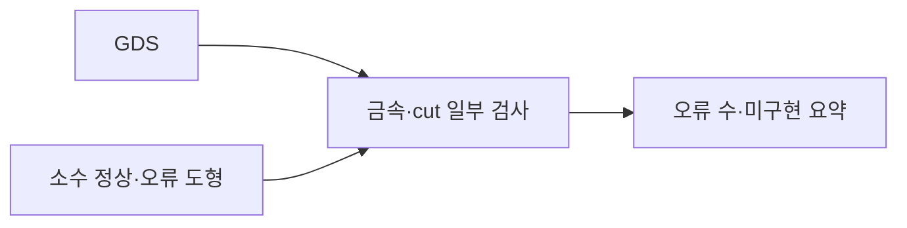
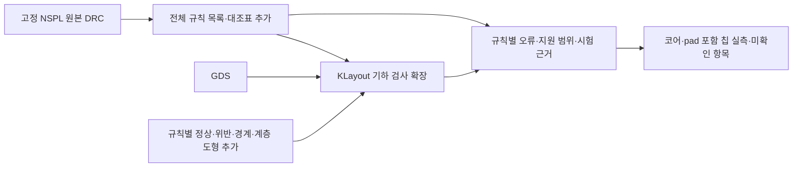

# SPEC 0018 공개 NSPL DRC 규칙 대조와 시험 확장

- 상태: 구현·로컬 시험 완료, 원본 도구 교차 대조·전체 공정 검증은 미완료. PR #10 `feat/rtl-to-gds`의 0523b7f 위에 쌓는다.
- 작성일: 2026-11-24.
- 관련 규약: RFC 0001 HW01~HW06, RFC 0002 DOC01~DOC04·PR01·AUTO01.

## What

공개 NSPL 260820 키트의 Calibre DRC 원본 전체를 목록으로 만들고, 현재 KLayout 검사와 규칙 번호별로 대조한다. 규칙마다 구현·부분 구현·미구현과 시험 근거를 구분한다. 기하 연산으로 옮길 수 있는 항목의 구현과 정상·위반·경계·계층 시험을 확장한다. 담당자에게 전달할 자료 요청문도 별도 문서로 정리한다.

전체 규칙 목록을 만들었다는 사실과 모든 규칙을 정확히 구현했다는 사실을 구분한다. 기존 `asic-drc`의 미확인 판정과 제작 준비 false는 유지한다. RTL·연산·통신·리셋·정답 모델을 바꾸지 않는다.

## Why

기존 검사는 금속·contact·via 일부 규칙만 실행한다. 같은 번호를 가진 공정 원본 규칙에서 어떤 조건이 빠졌는지 한눈에 확인하기 어렵고, 정상 예제와 일부 오류만으로 전체 공정 지원을 판단할 수 없다. 특히 넓은 금속·well의 전위·tap·원본에서 꺼진 규칙·seal ring 예외를 구분해야 한다.

자료 요청도 공개 키트에 이미 있는 파일과 실제로 받아야 할 산출물을 구분해야 한다. 원회로가 OpenAccess 형식이라는 이유만으로 회로가 없다고 표현하지 않는다.

## How

### 입력과 원칙

- Calibre DRC v1.1 원본의 경로·SHA-256과 규칙 본문 해시·원본 줄 번호를 기록한다. 원본과 다른 파일이면 목록 검사를 실패시킨다.
- 주석 처리된 규칙은 활성 규칙으로 세지 않는다. 본문 속 주석·중괄호·비슷한 이름 때문에 목록이 잘못 늘거나 빠지지 않는지 시험한다.
- 공개 KLayout 변환본도 참고하되 원본과의 구현 차이를 기록한다. 주석 해제나 전역 예외로 통과를 만들지 않는다.
- 단위·레이어·유도 도형·조건을 원본과 대조한다. 같은 수치의 일반 폭/간격 검사라도 원본의 적용 영역·연결 조건을 생략하면 부분 구현이다.
- 미구현은 원인을 적는다. 우리 코드 작업, 기준 결과 대조, 원본 의미 확인, 외부 승인·지원 요청을 구분한다.
- PDK 원본과 GDS는 커밋하지 않는다. 원본 해시·대응표·시험 코드·실측 요약만 보관한다.

### 변경 전



### 변경 후



```diff
  python scripts/asic/selftest.py --out 새폴더
+ python scripts/asic/drc_catalog.py --pdk NSPL키트 --out 새폴더
+ python scripts/asic/drc_selftest.py --out 새폴더
  # 전체 공정 DRC 및 제출 승인은 여전히 별도 확인
```

### 구현 범위와 파일

`verification/asic/drc-rules.json`은 활성·비활성 규칙의 출처, 대응 검사, 부족한 조건과 시험 목록을 담는다. `scripts/asic/drc_catalog.py`는 원본 목록·해시·누락을 검증하고 사람이 읽는 대응표를 만든다. `scripts/asic/drc.py`와 필요한 보조 모듈은 확장 검사를 실행한다. `drc_selftest.py`와 시험 도형 생성기는 규칙별 실패를 실제 KLayout에서 확인한다. `tests/asic/`는 목록·판정의 누락 거부와 형식을 시험한다.

`.github/workflows/asic.yml`에 목록·확장 시험을 연결하고 실패해도 증거를 보관한다. 전체 코어/제안 칩 GDS에 새 검사를 실행해 새로 발견한 위반과 공정 원본 해석 문제를 분리한다. 독립적으로 가능한 검사는 계속 실행하며, 불완전한 결과는 성공으로 바꾸지 않는다.

`docs/verification/nspl-drc-rule-audit.md`에 대조·실측·남은 작업을 정리하고 `docs/verification/pdk-support-request.md`에 담당자 요청문을 작성한다. 요청문은 공개 키트로 확인한 사실과 추가 지원이 필요한 질문을 나눈다. 발송은 하지 않는다.

### 확인한 실행 결과

Calibre 활성 209개·비활성 7개를 목록화했다. 96개 기하 검사의 정상·위반·경계·계층 등 427개 시험을 실제 KLayout에서 통과했다. 기존 7개 도형 시험도 유지했다. 구현된 범위에서 코어와 제안 SOP28 GDS의 오류는 각각 0개였으며, 미이식 113개와 전역 플래그·원본 교차 대조 때문에 전체 DRC는 미완료로 유지한다.

공개 Assura 원본의 offGrid/ID도 대조하고 이름이 다른 항목을 따로 남긴다. 이름 대조를 동등성 증거로 쓰지 않는다. FVTN/FVTP grid, pad 최소 폭/사각 치수, 금속 antenna 활성 상태의 차이를 확인했다. 원본의 의도를 임의 수정하지 않고 담당자 요청문에 질문으로 남겼다.

기존 routing 프로필은 `drc_routing.py`로 분리해 유지하고 새 확장 프로필은 `drc_geometry.py`에서 실행한다. workflow는 기존 검사 뒤 별도 core/chip 감사 단계와 보고서를 추가한다. source inventory와 기하 검사 0건의 종료 코드 0은 전체 공정 DRC 통과가 아니며 JSON의 미완료 판정은 유지한다.

### 합격 조건과 검증

1. 활성 원본 규칙을 빠짐없이 목록화하고 중복·누락·해시 변경을 거부한다. 원본 비활성 규칙도 따로 보여 준다.
2. 추가 구현마다 대상 규칙의 정상·위반을 확인한다. 수치 경계·맞닿음·겹침·계층 위반을 포함하고 다른 오류가 우연히 발생한 것을 목표 규칙 검출로 세지 않는다.
3. 현재 코어·제안 SOP28 GDS의 규칙별 오류 좌표와 한계를 저장한다. 오류를 없애려고 원본 셀·공정 숫자·전역 waiver를 바꾸지 않는다.
4. 문서·정책·ASIC 시험과 PR 형식 검사, 실제 KLayout 확장 시험을 실행한다. ASIC 기능을 바꾸지 않으므로 전체 RTL 회귀는 새 기능 영향이 있거나 실패가 생길 때 실행한다.
5. GitHub 실행기 한도가 여전히 막혀 있으면 로컬 결과와 원격 미실행을 구분한다.

흐름 변경: 있음

## RFC 확인

RFC 0001의 회로 계약과 정답 모델은 유지한다. RFC 0002 DOC01~DOC04에 따라 이 문서는 작업 기획이며 새로운 제작 규칙을 확정하지 않는다. 원본 규칙의 해석과 도구 한계를 기록하며 번호별 시험을 전체 공정 정확도 보증으로 표현하지 않는다. PR01·AUTO01에 따라 PR #10 위의 새 브랜치에서 검토를 받고 main 직접 push·임의 merge·훅 우회는 하지 않는다.
