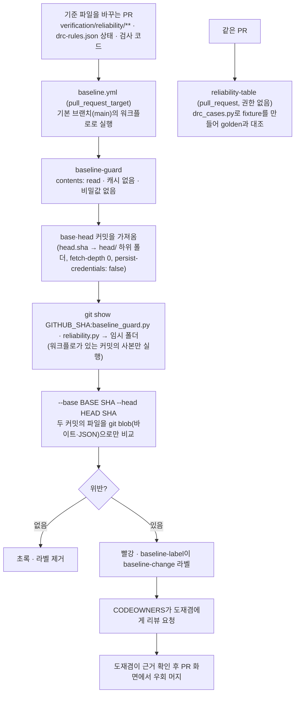
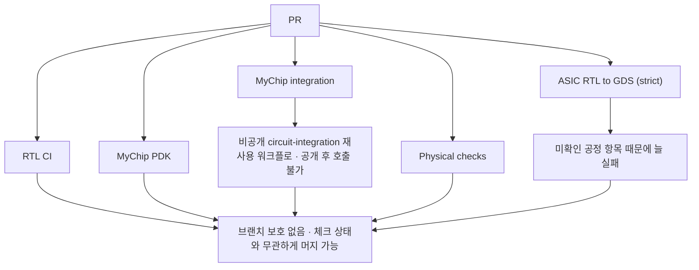
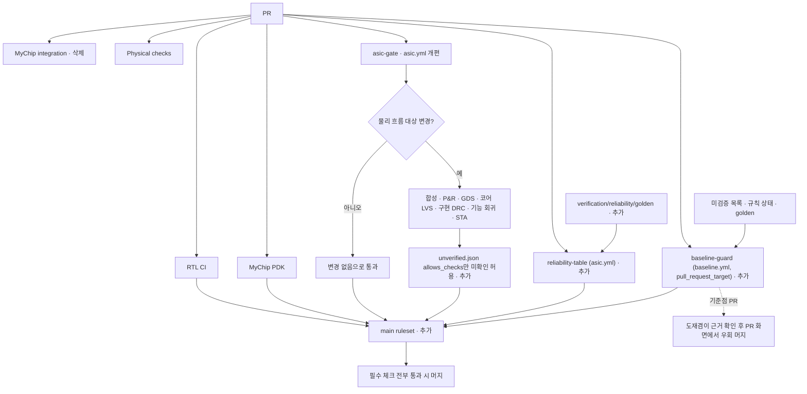

# SPEC 0019 머지 게이트와 신뢰성 대응표

- 상태: 구현. 설계 승인(2026-11-28) 후 PR #11 `feat/nspl-drc-rule-tests`의 `303bcb6` 위 `feat/merge-gate`에서 스크립트·대응표·워크플로를 구현했다. 로컬 검사 결과와 GitHub 실행 기록(PR #12)은 "2026-11-28 실행 결과"에 나눠 적었다. 2026-11-28 #10 → #11 → #12 순서로 main에 merge commit으로 합쳤고, 같은 날 main ruleset을 걸고 확인 PR 세 개로 끝단을 확인했다("2026-11-28 main 적용과 끝단 확인").
- 작성일: 2026-11-28.
- 관련 규약: RFC 0001 HW01~HW06, RFC 0002 DOC01~DOC04·PR01·AUTO01.

## What

RTL을 고칠 때마다 PR에서 오픈소스 흐름 전체(합성 → P&R → GDS → DRC·LVS → 기능·타이밍 시험)를 실행하고, **필수 검사를 전부 통과해야만 main에 머지**되게 한다. P&R은 셀 배치와 배선, GDS는 제작할 도형 파일이다.

오픈소스 도구의 판정을 믿을 수 있다는 근거는 **상용 도구 결과와의 신뢰성 대응표**로 남긴다. 상용 도구는 PR마다 쓰지 않는다. 기준점에서만 사람이 수동으로 실행해 대응표를 갱신한다. 기준점은 규칙 묶음 이식·도구 버전 변경·제출 직전처럼 상용 결과를 다시 받아야 하는 시점이다.

| 목표 | 완료 결과 |
| --- | --- |
| 1. main 보호 | main에 저장소 ruleset을 걸고 아래 게이트 검사를 필수 체크로 지정 |
| 2. 회귀 게이트 | 현재 검증된 범위에서 하나라도 나빠지면 머지를 막음 |
| 3. 신뢰성 대응표 | 단계별로 "오픈소스 판정 ↔ 상용 판정"의 고정 근거 파일(golden)과 출처를 저장소에 둠. CI는 PR마다 이 근거와 다시 맞춰 봄 |
| 4. 미검증 목록 | 파일로 관리. PR에서 늘어날 수 없고, 항목을 빼려면 대응표 근거를 같은 PR에 넣어야 함 |
| 5. 기준점 절차 | 상용 재실행 절차를 문서로 고정해 다음 사람이 같은 방법으로 근거를 갱신 |

같은 작업에서 `.github/workflows/integration.yml`(`MyChip integration`)을 삭제하고 관련 문서를 고친다. 이유는 How 1절에 적는다.

### 하지 않는 것

- 상용 도구를 CI에서 자동 실행하지 않는다. 학교 서버는 우리 것이 아니고 계정도 빌린 것이다.
- `ready_for_submission`을 통과시키는 작업이 아니다. 제출 준비 판정은 머지 게이트와 별개로 유지한다.
- 남은 113개 DRC 규칙·antenna·PEX 보정 자체는 하지 않는다. 이 SPEC은 그 작업이 들어올 자리와 규칙을 만든다. PEX는 배선 저항·용량 추출이다. (antenna는 SPEC 0020이 이 자리에 넣었다.)
- circuit-integration 저장소 쪽 변경은 이 저장소 작업에 넣지 않는다.

### 기술적으로 돌아가도 실패로 보는 것

- 늘 빨간 게이트. 사람들이 우회하게 된다. 게이트에는 지금 통과 가능한 검사만 넣고, 미완료 항목은 미검증 목록으로 보낸다.
- 오픈소스 도구 결과를 다시 정답으로 저장하는 순환 근거. golden 파일은 상용 도구 출력이나 원본 규칙 문서에서만 온다.
- 초록색을 만들려고 검사를 끄거나 기준을 낮추는 변경이 조용히 들어가는 것. 기준 파일 변경은 별도 검사로 드러낸다.
- 공개 저장소에 학교 서버 주소·계정·로그를 남기는 것.

## Why

사용자 요청은 "앞으로 RTL을 고칠 때 CI가 정상적으로 다 돌아가야 머지", "우리가 reliability를 보장하는 작업을 해야지"이다.

SPEC 0017·0018로 실제 5팀 코어와 제안 SOP28 GDS를 만들고 검사하는 흐름(`asic.yml`, `scripts/asic/`)이 생겼다. 그러나 지금은 `asic (strict)`가 미확인 공정 항목 때문에 늘 실패하고, 브랜치 보호가 없어 어떤 검사가 빨갛든 머지할 수 있다. RTL 변경으로 레이아웃이 깨져도 막는 장치가 없다.

또 KLayout·Netgen·OpenROAD 같은 오픈소스 도구의 "오류 0건"이 상용 도구에서도 같은 판정인지 저장소에 근거가 없다. 2026-11-28 기준으로 학교 서버의 Calibre로 실행한 DRC fixture 427개와 v2 칩 결과가 처음 생겼다(How 2절. 같은 날 둘러싸기 경계 fixture 24개, 실제 형상 변형본, LVS·STA·SPICE 결과가 더해졌다). 이 결과를 고정 근거로 남기고 PR마다 다시 맞춰 보면, 도구 신뢰 근거가 PR 사이에서 조용히 사라지는 것을 막을 수 있다.

`MyChip integration`은 이 저장소가 2026-11-28 공개로 전환된 뒤 동작할 수 없다. 공개 저장소는 비공개 circuit-integration의 재사용 워크플로를 호출할 수 없어 매 PR ❌가 된다. 늘 빨간 체크는 위의 실패 기준과 같다.

## How

### 제약

- 저장소는 2026-11-28부터 공개다. Free 플랜이지만 공개 저장소라 branch protection·ruleset과 GitHub 호스팅 실행기를 무료로 쓴다. 비밀값(secrets)은 0개이고 앞으로도 두지 않는다.
- 실행기는 GitHub 호스팅(`ubuntu-24.04`)만 쓴다. 자체 호스팅 실행기는 이 팀 저장소에 쓰지 않는다.
- 실제 RTL→GDS 흐름(`asic.yml`, `scripts/asic/`)은 아직 draft PR #10(`feat/rtl-to-gds` → main)과 #11(`feat/nspl-drc-rule-tests` → #10)에만 있다. ruleset은 이 둘과 이 작업이 main에 들어온 뒤에 건다.
- 5팀 작업 규칙(SPEC 작성, `policy.py review`, 훅, PR 본문 What·Why·How, main 직접 push 금지)을 그대로 따른다.
- PDK는 공개 tarball `NSPL_05CMOS_PDK_260820.tar.gz`(sha256 `2e49115a08f6af96c1f8433130ad4316551b5eba9001a3133905b544166af954`)를 CI에서 받는다. 키트 원본은 저장소에 넣지 않는다.
- KLayout은 현재 0.28.16이다. 0.30.x 전환은 별도 작업이며, 전환하면 대응표 DRC 칸을 다시 맞춰야 한다.

### 접근 방식 비교

| 안 | 내용 | 판단 |
| --- | --- | --- |
| **A. 회귀 게이트 + 대응표 (선택)** | PR마다 오픈소스 흐름 전체를 실행. 현재 검증 범위에서 나빠지지 않으면 통과. 신뢰성은 상용 결과와의 고정 대응표로 보증 | 지금 운영 가능하고, 검증 범위가 넓어질 때 같은 틀에 칸만 채우면 된다 |
| B. 완전 게이트 | 공정 전체 검증(strict)을 통과해야 머지 | 현재 아무것도 머지할 수 없다. 늘 빨간 게이트 |
| C. 가벼운 게이트 | RTL CI·합성만 PR 조건, 레이아웃은 야간 | RTL 변경으로 레이아웃이 깨져도 머지된다. 공개 저장소라 실행 시간을 아낄 이유도 없다 |

사용자가 A를 골랐다. 합성·P&R을 PR마다 돌리는 이유는 DRC·LVS를 이번 RTL로 새로 만든 GDS에 돌려야 변경을 검사하기 때문이다. 로컬 실측 약 4분이며 비용이 없다. 대응표는 PR별 실행을 대신하지 않는다. 대응표는 "오픈소스가 OK면 상용도 OK"라는 도구 신뢰 근거다.

### 1. 머지 게이트 (필수 체크)

| 워크플로 (파일) | 필수 체크(job `name:`) | 내용 | 통과 조건 | 상태 |
| --- | --- | --- | --- | --- |
| `RTL CI` (`ci.yml`) | `pr-policy`, `policy-unit (ubuntu-24.04)`, `policy-unit (windows-2022)`, `rtl` | PR 규칙·정책 단위 시험·RTL 린트·시뮬레이션 | 기존 그대로 | main에 있음 |
| `MyChip PDK` (`pdk.yml`) | `pdk (pr)` | 합성·OpenSTA·게이트 수준 시험 | 기존 그대로 | main에 있음 |
| `ASIC gate` (`asic.yml` 개편) | `asic-gate` | RTL → OpenROAD P&R → GDS → 코어 LVS → 구현된 DRC 규칙(`drc_audit.py` 코어·칩)·antenna(`asic-antenna`·`asic-chip-antenna`, SPEC 0020) → 최종 netlist 기능 회귀 → STA | 코어 LVS 일치, 구현 DRC 규칙 오류 0, antenna 위반 0, 기능 회귀 통과, setup/hold slack ≥ 0(추정 RC 기준), 미검증 목록 `allows_checks` 밖의 검사는 모두 실행·통과 | 구현. 로컬 통과. GitHub(PR #12) 실행 2분 52초~4분 13초 |
| `ASIC gate` (`asic.yml`) | `reliability-table` | DRC fixture·변형본의 KLayout 판정을 Calibre golden과 다시 대조, pending golden 묶음 확인 | `verified` 규칙이 모든 fixture golden과 일치하고 golden fixture가 하나도 사라지지 않음, 변형본 불일치 0, pending golden이 정의와 1:1 | 구현. 로컬 통과. GitHub(PR #12) 실행 8~13분(변형본 대조 포함, 실행마다 다름) |
| `Baseline guard` (`baseline.yml`, 신규) | `baseline-guard` | 기준 브랜치와 비교해 기준 파일·규칙 상태·미검증 목록·검사 코드 변경 검사(PR 코드는 실행하지 않음) | 3절 규칙. 위반이 있으면 실패하고 도재겸이 PR 우회로 머지 | 구현. 로컬 통과. GitHub 실행 없음(main에 `baseline.yml`이 없어 이 PR에서는 돌지 않음) |

**ruleset에 그대로 쓸 필수 체크 이름**(8개, job의 `name:`과 같다): `pr-policy`, `policy-unit (ubuntu-24.04)`, `policy-unit (windows-2022)`, `rtl`, `pdk (pr)`, `asic-gate`, `reliability-table`, `baseline-guard`. `baseline-label`(라벨 붙이기)과 `physical-selftest`(scmos 연습 회로)는 필수가 아니다.

- 게이트 판정은 `--experimental` 의미를 공식화한 것이다. `python scripts/run_asic.py ... --target chip --gate`는 `verification/reliability/unverified.json` 항목의 `allows_checks`를 모두 모은 집합(지금 `asic-drc`, `asic-pex`, `asic-chip-lvs`, `asic-chip-timing`, `asic-pinmap`)에 든 검사만 `unsupported`로 남아도 종료 코드 0을 낸다. `fail`·`not_run`·목록 밖의 `unsupported`·검사 누락·실행 오류는 모두 1이다. `--experimental`은 코드에 고정한 같은 5개(`flow.UNQUALIFIED_DEFAULT`)를 쓰는 수동 실험용으로 남겼고, 옵션이 없으면 strict(아무것도 허용하지 않음)다. `ready_for_submission: false`·`status: incomplete`는 그대로 리포트에 남는다.
- 물리 흐름은 PR이 `src/`, `mychip/constraints/`, `scripts/`, `verification/`, `tests/asic/`, `tests/physical/`, `tests/rtl/`, `requirements-ci.txt`, `.github/workflows/asic.yml` 중 하나를 바꿀 때만 돈다(`git diff --name-only 기준SHA HEAD`). main push와 수동 실행은 항상 돈다. 그 밖의 PR(문서만 바꾼 PR 등)에서는 `asic-gate`가 단계를 건너뛰고 요약에 "물리 흐름 대상 변경 없음"을 쓴 뒤 통과한다. 필수 체크가 대기 상태로 남지 않게 job은 항상 생성하고 워크플로에 `paths:` 필터를 두지 않는다. `tests/` 세 폴더는 원래 계획 목록에 없었지만 `asic-gate`가 실행하는 시험이라 더했다. (구현자 판단)
- `reliability-table`의 fixture 대조(`drc_selftest.py` → `reliability.py check`)와 `check-pending`은 매 PR 실행한다(수 분). 변형본 대조 `reliability.py check-mutations`는 키트를 받아 1차 695개와 2차 키트 셀 604개 GDS를 다시 만들고 KLayout DRC를 돌려 GitHub 실행기에서 약 8~13분 걸린다(PR #12 실측, 실행마다 다름. 로컬 12 CPU에서 두 golden 422초). 그래서 `scripts/asic/drc*.py`, `scripts/asic/mutate*.py`, `scripts/asic/reliability.py`, `verification/reliability/golden/`, `verification/asic/drc-rules.json`, `.github/workflows/asic.yml`을 바꾼 PR과 main push에서만 실행하고, 건너뛸 때는 요약에 이유를 쓴다. (구현자 판단)
- 보호 방식: main에 **저장소 ruleset**을 건다. PR 필수, 위 필수 체크 통과 필수, 브랜치 최신 상태 필수, 리뷰 승인 수 0(사람 승인보다 CI를 게이트로 삼는다).
- **기준 파일의 승인자는 도재겸(Dojaegyum) 한 명이다.** 우회 권한(bypass)은 저장소 admin 역할에만, **PR 화면에서만** 준다(`bypass_mode: pull_request`). ruleset은 우회 대상을 사람이 아니라 역할로만 지정할 수 있다. 2026-11-28 확인한 admin은 Dojaegyum, pearsj1128, hjan04, snu-ssc 네 계정이고, 도재겸이 네 계정 모두 우회할 수 있는 상태로 두기로 정했다. 기준점 PR의 우회 머지는 도재겸이 PR 화면에서 직접 한다. 근거 파일·미검증 목록을 바꾸는 기준점 PR은 `baseline-guard`가 막고, 도재겸이 근거를 확인한 뒤 PR에서 우회 머지한다. 우회 머지는 PR 기록에 남는다. **우회 머지는 `baseline-guard`만 실패하고 나머지 필수 체크가 모두 통과한 PR에만 한다.**
- 그 밖의 PR에서 우회는 쓰지 않는다. 우회 머지가 기준점 PR이 아닌 곳에 쓰였는지는 PR 기록으로 확인할 수 있다.
- **golden 출처 커밋 보존:** golden·README·이 SPEC은 기능 브랜치 커밋(`303bcb6`, `2476d87`, `756b384`, `5b1f8bf`, `84eb91b` 등)을 출처로 가리킨다. 그래서 #11 → #10 → main → 이 PR은 merge commit으로 병합하고, 이 브랜치는 rebase하지 않고 main을 merge해 갱신한다.
- `integration.yml` 삭제: 칩 연결 검사는 circuit-integration 야간 작업이 이 저장소를 읽어 맡는다(이 야간 작업은 2026-11-26부터 결제 문제로 일시 중지되어 재개 전까지는 연결 검사가 없다. 재개 후 매일 실행). `README.md`의 CI 목록·맨 위 폴더 규칙 설명, `mychip/README.md`, `pdk.yml` 머리 주석, `docs/verification/rtl-to-gds-guide.md`의 `MyChip integration` 언급, SPEC 0017 그림의 `MyChip integration · 유지`를 고치고, SPEC 0013에 폐지 메모를 남긴다.

#### 기준점 PR 흐름 (`baseline-guard`, 라벨, CODEOWNERS)



- **위협 모형.** 저장소는 공개이고 fork PR도 열 수 있다. `pull_request_target`은 2025-12-08 이후 PR의 base가 어느 브랜치든 **기본 브랜치(main)**의 워크플로 파일과 `GITHUB_SHA`(main 끝 커밋)로, base 저장소 문맥에서 실행된다. 이 job에서 PR 코드가 한 줄이라도 돌면 실행기에서 권한을 얻어 캐시를 오염시키는 등 다른 필수 체크를 속일 수 있다(2026-11-28 리뷰에서 `drc_cases.py`의 `match` 패턴으로 AST 검사를 우회하는 방법이 확인됨). 그래서 `baseline-guard`는 **PR 코드를 실행하지 않는다.** head는 작업 폴더가 아닌 `head/` 하위 폴더로 checkout하고, guard 단계의 모든 명령은 임시 폴더에서 실행한다(작업 폴더가 PR 트리면 `python`이 PR의 `secrets.py` 같은 파일을 먼저 불러온다. 2026-11-28 재검토에서 확인). guard와 `reliability.py`는 워크플로가 있는 커밋(`$GITHUB_SHA`, main 끝 커밋)에서 꺼내 `python -I -E -s`로 실행하고, base와 head는 `git show`·`git ls-tree`로 읽은 내용(바이트·JSON·파일 목록)으로만 비교한다. 출력의 workflow 명령을 막는 토큰도 Python 없이 `/dev/urandom`에서 만든다. head의 guard로 대신 실행하는 경로는 없다.
- guard가 데이터로 보는 것: `verification/reliability/` 아래 모든 파일, `verification/asic/drc-rules.json`의 규칙 상태(`unported → ported`만 허용, `verified`로 올리거나 뒤로 가면 위반), 미검증 목록·대응표 판정, 그리고 base에 guard가 있으면 `baseline_guard.py`·`reliability.py`·`asic.yml`·`baseline.yml`·`ci.yml`·`pdk.yml`(필수 체크를 만드는 워크플로)·`.github/CODEOWNERS`의 해시. base에 기준 파일이 없으면(최초 도입) 아무것도 실행하지 않고 위반 없음으로 본다.
- **fixture 정의 파일과 `scripts/asic/` 목록은 실행하지 않고 데이터로만 본다(보조 장치).** `reliability-table`은 설계상 PR 코드를 실행한다. `drc_fixture_test.py`가 `drc_cases.py`를, `check-pending`이 `drc_cases_pending*.py`를 `reliability.py`와 같은 프로세스로 불러오고, DRC 시험 도구(`drc_fixture_test.py`·`drc_geometry.py`·`drc_antenna.py`·`drc_ports.py`·`drc.py`)도 PR 쪽 파일이다. 그래서 시험 도구를 고친 PR은 그 job 안에서 자기 결과를 꾸밀 수 있다. 이것은 받아들인 남은 위험이다. 보호 범위를 정리하면: (1) `baseline-guard`가 변경 자체를 위반으로 잡는 파일 — `verification/reliability/**`, `drc-rules.json`의 규칙 상태, fixture 정의 파일의 정의 밖 코드, `scripts/asic/` 바로 아래의 새 폴더·링크·표준 이름 파일, 그리고 `baseline_guard.py`·`reliability.py`·`asic.yml`·`baseline.yml`·`ci.yml`·`pdk.yml`·`.github/CODEOWNERS`. (2) 도재겸에게 리뷰 요청만 가는 파일(CODEOWNERS) — DRC 시험 도구(`drc_fixture_test.py`·`drc_selftest.py`·`drc_geometry.py`·`drc_antenna.py`·`drc_ports.py`·`drc.py`), fixture 정의 파일, 흐름 판정 코드(`flow.py`·`run_asic.py`·`drc_audit.py`·`report.py`), `.github/workflows/**`. (3) 둘 다 아닌 파일 — 그 밖에 CI가 실행하는 PR 코드(RTL·시험·`scripts/` 나머지). PR 코드를 실행해 검사하는 CI는 그 코드가 결과를 꾸미는 것을 원리상 막을 수 없다. 사람 리뷰와 기준점 대조가 이 범위를 맡는다. 보조 장치로 `baseline-guard`는 fixture 정의 파일을 `ast.parse`로 바이트 그대로만 읽어(실행·컴파일 없음) 새로 생기거나 바뀐 파일이 fixture 정의 밖의 일을 하면 위반으로 본다: UTF-8이 아닌 인코딩 선언; 이름 허용 목록 밖의 이름(파일 안에서 정의하지 않은 이름과, 지금 다섯 파일이 쓰는 내장 이름 `ValueError`·`all`·`any`·`dict`·`enumerate`·`int`·`isinstance`·`len`·`list`·`map`·`max`·`min`·`print`·`range`·`round`·`set`·`sorted`·`str`·`tuple`과 순수 값 내장 `abs`·`zip`·`sum`·`float`·`bool`·`reversed`·`divmod`·`pow` 밖의 내장 이름. `help`·`getattr`·`type` 등은 파일이 같은 이름을 정의해도 위반이고, `site`가 넣는 `help`·`exit`·`quit`·`license`·`credits`·`copyright`는 실행 환경과 무관하게 항상 위반); import(pending 파일은 `math`·`collections`·`json`·`reliability`와 같은 커밋의 다른 pending 파일만, `as` 별칭·자기 자신 import 금지); pending 파일에서 그 모듈을 허용한 속성(`reliability.case_sha256`·`fixture_name`, `math.floor`·`sqrt`, `collections.Counter`, `json.loads`·`dumps`, 다른 pending 모듈은 `cases`·`records`·`cases_with_meta`) 밖으로 쓰는 것; `match`·`class`·`lambda`·`global`(drc_cases.py); 밑줄 이름(drc_cases.py: `_`로 시작하는 모든 이름과 함수 이름, pending 파일: `__name__`을 뺀 `__`로 시작하는 이름. 지역 이름 `_n`은 허용); 내부 속성(`_`로 시작하는 속성, 두 모드 모두); 속성 대입·삭제; 문법 오류; 512 KiB 초과. 또 `git ls-tree`로 `scripts/asic/` 바로 아래에 새로 생긴 폴더(패키지)·심볼릭 링크·`__pycache__`·컴파일된 모듈·표준 라이브러리나 `pya`와 같은 이름의 `.py`를 위반으로 본다. 같은 폴더의 `import`가 다른 코드를 읽게 되기 때문이다. `drc_fixture_test.py`와 pending `records()`는 fixture를 JSON으로 한 번 바꿔(`json.loads(json.dumps(...))`) 해시와 GDS가 같은 값을 보게 한다. `drc-rules.json`에 같은 규칙 id가 두 번 있어도 위반이다(`reliability.py`도 오류로 멈춘다).
- 메시지에 들어가는 파일 이름·id는 PR이 정한 값이라 줄바꿈·제어 문자를 이스케이프하고 역따옴표를 바꾼다. 워크플로는 결과를 `::stop-commands::` 사이에서 출력해 워크플로 명령으로 해석되지 않게 한다.
- fixture 정의를 실행해야 알 수 있는 검사(verified 규칙의 golden fixture가 사라짐, 정의가 바뀌거나 golden 없이 fixture가 더해짐, Calibre가 거부한 fixture만 남음, verified 규칙이 0개)는 권한 없는 `pull_request` job `reliability-table`의 `reliability.py check`가 맡는다. golden을 기준 집합으로 삼아, verified 규칙의 golden fixture 해시는 모두 이번 `selftest.json`에 있어야 하고 이번 fixture는 모두 golden이 있어야 한다.
- `--base`는 이벤트가 준 base 브랜치 끝 커밋(`pull_request.base.sha`)이다. 그 뒤 base가 더 나아갔으면 ruleset의 "브랜치 최신 상태 필수"가 PR을 다시 맞추게 하므로 오래된 기준과의 비교로 머지되지 않는다.
- `baseline-label` job(필수 아님)은 `pull-requests: write` 권한만 갖고 PR 코드를 checkout·실행하지 않는다. guard 결과가 위반이면 `baseline-change` 라벨을 붙이고(라벨이 없으면 먼저 만든다), 위반이 없으면 뗀다. 실행 실패면 라벨을 그대로 둔다. `pull_request_target`에서는 fork PR도 base 저장소 토큰을 받으므로 보통 성공한다. 라벨 API가 실패해도(권한 정책 변경, 일시 오류 등) `continue-on-error`라 체크를 막지 않는다.
- `.github/CODEOWNERS`는 `verification/reliability/**`, `verification/asic/drc-rules.json`, `scripts/asic/baseline_guard.py`, `scripts/asic/reliability.py`, `scripts/asic/drc_cases.py`, `scripts/asic/drc_cases_pending*.py`, `scripts/asic/drc_fixture_test.py`, `scripts/asic/drc_selftest.py`, `scripts/asic/drc_geometry.py`, `scripts/asic/drc_antenna.py`, `scripts/asic/drc_ports.py`, `scripts/asic/drc.py`, `scripts/asic/flow.py`, `scripts/run_asic.py`, `scripts/asic/drc_audit.py`, `scripts/asic/report.py`, `.github/workflows/**`, `.github/CODEOWNERS`를 바꾸는 PR에 도재겸(`Dojaegyum`) 리뷰를 요청한다. ruleset은 code owner 승인을 요구하지 않는다. 리뷰 요청일 뿐이다.
- 최초 도입 PR(이 작업)에서는 `baseline-guard`가 돌지 않는다. `pull_request_target`은 기본 브랜치(main)의 워크플로를 쓰는데 main에 아직 `baseline.yml`이 없기 때문이다. 이 작업이 main에 들어간 뒤의 PR부터 보고된다.
- **Task 8(ruleset) 전 확인할 것:** 실제 PR에서 빨간 `baseline-guard`가 머지를 막고, 초록 `baseline-guard`가 필수 체크를 채우는지 확인한다(`pull_request_target`의 체크가 PR head 커밋의 필수 체크로 인정되는지). 인정되지 않으면 대안: guard job이 `statuses: write` 권한으로 PR head SHA에 commit status를 직접 올린다(PR 코드는 여전히 실행하지 않는다). 또 GitHub는 2026-12-02부터 공개 저장소의 `pull_request_target`을 기본 차단한다. 저장소 Actions 설정의 이벤트 정책에서 `baseline.yml` 파일만 지정해 허용해야 `baseline-guard`가 돈다(허용 전에는 필수 체크가 채워지지 않아 모든 PR이 막힌다). actions/checkout을 v7 이상으로 올리면 fork PR의 head checkout에 `allow-unsafe-pr-checkout`이 필요하다. guard는 head를 데이터로만 읽으므로 그때 켜도 된다.
- `--run-fixtures`는 로컬 전용 옵션이다. 믿을 수 있는 작업 사본에서만 두 커밋의 `drc_cases.py`를 별도 프로세스(`python -I`, 빈 환경, 시간 제한)로 실행해 fixture 비교까지 한다. 자식 프로세스는 `-X utf8`로 소스를 읽는다. 그 앞의 AST 검사(위 drc_cases.py 엄격 규칙과 같음)는 보조 장치이며 샌드박스가 아니다. CI는 이 옵션을 쓰지 않는다.

### 2. 신뢰성 대응표

저장소에 `verification/reliability/`를 두었다.

```
verification/reliability/
  table.md              사람이 읽는 대응표 (table.json에서 reliability.py render로 만듦)
  table.json            같은 내용의 기계 판독 원본
  unverified.json       미검증 목록 (id, 내용, 이유, 빠지려면 필요한 근거, allows_checks, 관련 문서)
  CHECKPOINT.md         상용 재실행 절차
  golden/
    drc-fixtures-20261128/   fixture 427개의 Calibre 판정(대상 규칙 발동·위반 수·대상 밖 발동 규칙), fixture 정의 해시, deck 해시, 도구 버전
    drc-fixtures-20261128b/  둘러싸기 규칙 fixture 24개(0427~0450, 일부 겹침·겹침 없음·안쪽 섬·바깥 근접)의 Calibre 판정
    drc-mutations-20261128/  키트 셀 변형본 695개의 형상 해시와 Calibre 발동 규칙(81개는 Calibre 입력 거부)
    drc-mutations-20261128b/ 2차 변형본 800개(키트 셀 604 + 코어 창 196, 모두 Calibre 검사)
    drc-unported-20261128/   pending golden: 미구현 113개 규칙·전역 플래그·ANT deck 12개 검사의 fixture 857개 Calibre 판정(ANT 102개는 옮겨짐, 파일은 그대로)
    ant-fixtures-20261128/   키트 ANT deck 12개 검사 fixture 102개의 Calibre 판정(위 pending golden에서 항목 그대로 옮김, SPEC 0020)
    chip-openflow-20261128/  오픈소스 흐름 코어·SOP28 칩의 Calibre DRC·ANT·LVS 요약과 같은 GDS의 KLayout 판정
    chip-v2-20261128/        v2 칩 GDS 해시, Calibre DRC/ANT/LVS 요약, Genus/Innovus/Tempus 요약
    lvs-20261128/            코어·SOP28 칩·표준셀 34종·GPIO 9종 Calibre LVS
    sta-20261128/            같은 입력의 OpenSTA ↔ Tempus slack 비교
    spice-20261128/          ngspice ↔ Spectre 비교
    pex-reference-20261128/  Calibre xRC 기준 자료의 해시(파일은 저장소 밖)
```

대응표 행은 `table.json`이 원본이다. 아래는 2026-11-28 판정 요약이며 숫자는 `table.json`과 같다.

| 행 (`id`) | 단계 | 판정 | 근거 요약 | CI가 PR마다 확인하는 것 |
| --- | --- | --- | --- | --- |
| `drc-fixtures` | DRC 규칙 판정 | 일치 | 구현 96개 규칙의 fixture 451개 중 449개 대상 규칙 발동 여부 일치, 2개(0169·0170) Calibre 입력 거부로 제외 | `reliability-table`: fixture를 다시 만들어 `verified` 규칙의 KLayout 판정이 두 fixture golden과 같은지(`reliability.py check`) |
| `drc-mutations` | DRC 실제 형상 변형본 | 일치 | 1차 609개 × 96개 규칙 = 58,464 판정 불일치 0(81개 거부·빈 셀 5개 제외), 2차 798개 × 96개 = 76,608 판정 불일치 0(빈 셀 2개 제외) | 경로 필터에 걸린 PR과 main push에서 키트 부분을 다시 만들어 대조(`check-mutations`). 코어 창 196개는 기준점 전용 |
| `drc-unported` | DRC 미구현 규칙 | 근거 없음 | 113개 규칙 + ACUTE·NONSIMPLE fixture 755개의 Calibre golden 확보, KLayout 판정 없음 | 판정 대조 없음. 정의와 golden이 1:1인지(`check-pending`) |
| `drc-chip-v2` | DRC 실제 칩 (v2, 상용 흐름) | 일치 | seal ring 없음 0 ↔ 0, 있음 0 ↔ 1(`1.PWL.bad1`, KLayout 미구현) | 없음. v2 GDS는 저장소 밖(11-27 결정), 기준점에서만 |
| `drc-chip-openflow` | DRC 실제 칩 (오픈소스 흐름) | 일치 | 코어·SOP28 칩 KLayout 0 ↔ Calibre 0 | `asic-gate`가 PR마다 새 GDS의 구현 규칙 DRC 0건 확인. Calibre 대조는 기준점에서만 |
| `lvs-core` | LVS 코어 | 일치 | 같은 GDS에서 Netgen 일치, Calibre CORRECT | `asic-gate`가 PR마다 오픈소스 LVS |
| `lvs-cells` | LVS 표준셀 | 불일치 | Calibre 34/34 CORRECT, 우리 Netgen 23종 일치·11종 확인 못 함(원인은 우리 설정 쪽) | 없음(미검증 `std-cell-netgen-11`) |
| `lvs-chip` | LVS 칩·pad | 일치 | 같은 GDS에서 Calibre 칩 LVS CORRECT ↔ 오픈소스 연결 검사 단선·합선 0 + 코어 Netgen 일치. 오픈소스 쪽 패드 내부 LVS는 없음 | 연결 검사·코어 LVS는 `asic-gate`. `asic-chip-lvs`는 미검증 허용 |
| `spice` | SPICE 시뮬레이션 | 일치 | ngspice ↔ Spectre 최대 상대오차 과도 1.5%, DC 3.67%, 측정값 0.62%, GPIO 과도 0.92% | 없음(기준점에서만) |
| `synth` | 합성 | 근거 없음 | Genus 325셀 결과 있음, 동치 미확인 | 미검증 `synth-vs-genus` |
| `pnr-sta` | P&R·STA | 일치(STA 계산만) | 같은 입력에서 OpenSTA ↔ Tempus 끝점 72개 slack 차 setup 최대 0.253 ns, hold 최대 0.353 ns. 흐름의 `estimated.spef`는 RC 0 | 없음. 흐름 STA는 배선 RC 0(`wire-rc-zero`), `asic-chip-timing`은 미검증 허용 |
| `pex` | PEX | 근거 없음 | Calibre xRC 기준 자료 확보, OpenRCX 보정·대조 전 | 미검증 `pex`, `wire-rc-zero` |
| `antenna` | antenna | 일치 | KLayout antenna 검사 12개(SPEC 0020)가 Calibre ANT fixture 102개와 모두 일치, 칩 3건(GDS 4개) KLayout 0 ↔ Calibre 0 | `reliability-table`: ANT fixture를 다시 판정해 golden과 대조. `asic-gate`: 코어·칩 antenna 0건(`asic-antenna`·`asic-chip-antenna`, 미확인 허용 없음) |

DRC 규칙 판정 칸의 기준은 Calibre `v2023.4_17.10`, 키트 DRC deck sha256 `6c01207311236d148dc183576fa8f5156e1a21d40a19609322c810fa919c4f0f`(`scripts/asic/drc_catalog.py`의 `SOURCE_SHA`와 같은 파일)이다. Calibre가 거부한 2개는 `0169-OFFGRID_MET1-finer-dbu`, `0170-OFFGRID_MET1-incompatible-dbu`이며, 원인은 규칙 파일 정밀도(1000)와 fixture 데이터베이스 정밀도가 다르다는 Calibre 오류다. 이 2개는 불일치나 근거 없음으로 세지 않고 사유가 붙은 제외로 보여 준다.

- **golden은 상용 출력이나 원본 규칙 문서에서만 만든다.** 오픈소스 결과로 golden을 만들거나 덮어쓰지 않는다.
- golden에는 판정에 필요한 요약(대상 규칙 판정·위반 수·대상 밖 발동 규칙과 수·도구 버전·입력 해시)만 둔다. 마커 좌표는 golden에 넣지 않았다. 좌표가 필요해지면(마커를 게이트에 쓸 때) 저장소 밖 원본 결과에서 다시 가져온다. 서버 주소·계정·경로·원본 로그는 넣지 않는다.
- **DRC fixture 대조의 게이트 기준은 대상 규칙의 발동 여부(위반 있음/없음)뿐이다.** 마커 수와 대상 밖 규칙 발동(Calibre에서 50개 규칙)은 golden에 기록하고 리포트로만 보여 준다. 이미 0242(KLayout 4 · Calibre 1)와 0408(1 · 2)이 수에서 다르고, 대상 밖 발동은 아직 대조한 적이 없기 때문이다. 대상 밖 발동 중 KLayout 구현 규칙에 해당하는 것은 다음 기준점에서 대조한 뒤 게이트로 올린다. (구현자 판단)
- golden은 **fixture 파일 내용 해시**로 묶는다. 생성기가 바뀌어 fixture 해시가 달라지면 그 fixture는 golden이 없는 것으로 본다(3절의 규칙 상태로 처리). (구현자 판단)
- **실제 형상 변형본 golden**(`drc-mutations-20261128/`): 키트 표준셀·GPIO 셀의 도형 하나를 옮기기·키우기·줄이기·지우기로 바꾼 GDS 695개를 Calibre로 GDS마다 한 번씩 검사한 결과다. `scripts/asic/mutate.py`(seed 20261128, 셀당 6개)가 같은 형상을 다시 만들고, golden은 GDS 바이트 대신 **형상 해시**(층별 다각형 좌표의 sha256)로 묶는다. `reliability.py check-mutations`는 형상 해시가 golden과 같은 GDS마다 `verified` 규칙의 발동 여부를 Calibre와 비교하고, 하나라도 다르거나 형상 해시가 다르면 실패한다. Calibre가 거부한 81개(자기 교차 다각형)와 최상위 셀이 빈 5개는 사유가 붙은 제외다. 첫 대조에서 `ENC … OVERLAP`(둘러싸는 층에 일부만 겹친 도형도 위반)을 KLayout 구현이 놓친 13건이 나와 같은 작업에서 고쳤다. 고친 판정은 "안쪽 도형의 변이 둘러싸는 층 경계를 가로지른다(변의 일부는 안, 일부는 밖)"이며, 둘러싸는 층 도형이 안쪽 도형 안에 통째로 있거나 바깥에 가까이 있는 경우는 위반이 아니라는 것을 fixture `0427`~`0450`의 Calibre 결과(`drc-fixtures-20261128b/`)로 확인했다. (구현자 판단)
- **2차 변형본 golden**(`drc-mutations-20261128b/`): `scripts/asic/mutate_v2.py`(seed 20261129)가 키트 셀과 오픈소스 흐름 코어 GDS의 30×30 µm 창을 한 번씩 고친 800개다(병합 의미로 편집해 Calibre 거부 0). 코어 GDS는 우리 RTL로 만든 결과라 저장소에 없고 RTL이 바뀌면 달라지므로, CI는 키트 셀 604개만 다시 만들어 비교하고 코어 창 196개는 `not_regenerated`(기준점 전용)로 수와 이유만 적는다. 같은 코어 GDS(sha256 일치)를 `--core-gds`로 주면 창도 비교한다. 일치로도 실패로도 세지 않는 것은 이 경우뿐이다. (구현자 판단)
- **pending golden**(`drc-unported-20261128/`, `meta.pending: true`): 아직 KLayout으로 옮기지 않은 113개 규칙·전역 플래그(ACUTE·NONSIMPLE)·ANT deck 12개 검사의 fixture 857개(DRC 755 + ANT 102)를 Calibre로 판정한 결과다. 정의는 `scripts/asic/drc_cases_pending.py`에 있다. KLayout 판정이 없으므로 대조하지 않고, `reliability.py check`도 이 파일을 읽지 않는다. `reliability-table`의 `check-pending`은 golden 항목과 fixture 정의가 1:1이고 해시가 같은지, Calibre가 판정한 fixture에서 정의의 기대값(`fail`)이 Calibre와 같은지만 확인한다. Calibre가 입력을 거부한 0225·0226(자기 교차)은 사유가 붙은 제외다. 규칙을 옮길 때 이 golden이 그 규칙의 첫 근거가 된다. 옮긴 규칙의 항목은 파일을 고치지 않고 새 fixture golden으로 복사하며, `check-pending`은 pending 파일에 남은 그 항목을 `moved`로 센다(2026-11-28 ANT 102개, `ant-fixtures-20261128/`).
- 대응표 칸의 판정은 "일치 / 불일치 / 근거 없음(미검증)" 세 가지다. 수치 비교(타이밍 차이 등)는 기록만 하고, 허용 오차는 팀이 정할 때까지 게이트 조건으로 쓰지 않는다. 허용 오차를 근거 없이 정하면 조용한 기준 완화와 같아지기 때문이다. (구현자 판단)

### 3. 미검증 목록과 DRC 규칙 상태

- 현재 항목(10개, `unverified.json`): `drc-unported-rules`, `drc-global-flags`, `gpio-internal-lvs`(ETRI 검증 셀로 처리, 근거 QnA #1125·#952), `std-cell-netgen-11`, `synth-vs-genus`, `pnr-sta-vs-innovus-tempus`, `sdc-portability`, `pex`, `wire-rc-zero`, `pinmap-25`. 처음 계획한 "오픈소스 LVS↔Calibre LVS 대조"는 같은 GDS의 코어·칩 Calibre LVS 결과로 빠졌고, 패드 내부는 `gpio-internal-lvs`에 남았다. `antenna`는 KLayout 검사와 Calibre 대조로 빠졌다(SPEC 0020).
- 각 항목은 id, 내용, 이유, 빠지려면 필요한 근거, `allows_checks`(이 항목 때문에 `unsupported`로 남아도 되는 흐름 검사), 관련 문서를 가진다. `asic-gate`는 모든 항목의 `allows_checks`를 합친 집합만 허용한다. 모르는 검사 이름이 있으면 `--gate`가 시작하지 않는다.
- **DRC는 규칙 단위 상태로 관리한다.** `unported`(미구현) → `ported`(KLayout 구현, 자체 시험 통과, Calibre 근거 없음) → `verified`(그 규칙의 모든 fixture가 해시가 맞는 Calibre golden과 판정 일치). 현재 96개는 `verified`, 113개는 `unported`. 키트 ANT deck 12개 검사는 같은 파일의 `antenna_rules`에 같은 상태로 두며 모두 `verified`다(SPEC 0020). 상태는 `verification/asic/drc-rules.json`의 구현 여부와 `golden_compared`로 정한다. 새 규칙을 옮기는 PR이 Calibre 재실행 없이 머지될 수 있어야 하고(기준점은 묶음 단위), 동시에 이미 검증된 규칙이 조용히 근거를 잃는 것은 막아야 하기 때문이다. (구현자 판단)

뒤로 가는 변경을 막는 규칙은 두 검사가 나눠 맡는다. `baseline-guard`(`scripts/asic/baseline_guard.py`, pull_request_target)는 PR 코드를 실행하지 않고 파일 내용만 비교한다(1절 위협 모형). fixture 정의를 실행해야 하는 규칙은 `reliability-table`의 `reliability.py check`(pull_request)가 맡는다.

- 상태는 앞으로만 간다. `unported → ported`는 허용한다. `ported → verified`는 golden과 함께 들어오는 기준점 PR이므로 `baseline-guard`가 위반으로 알리고 도재겸이 근거를 확인한다. 규칙이 사라지거나 상태가 내려가거나 verified 규칙이 0개가 되어도 위반이다.
- CI는 상용 도구 출력과 손으로 쓴 파일을 구별할 수 없으므로 `verification/reliability/` 아래 파일의 추가·수정·삭제는 모두 `baseline-guard` 위반이다. 미검증 목록에 항목이 생기거나 빠지거나, 항목의 `allows_checks`가 늘거나, 대응표 행이 사라지거나 `match`에서 내려가거나 새로 `match`가 되어도 위반이다.
- 기준 브랜치에 guard가 있으면 `baseline_guard.py`·`reliability.py`·`baseline.yml`·`asic.yml`·`ci.yml`·`pdk.yml`·`.github/CODEOWNERS` 변경도 `baseline-guard` 위반이다. base 쪽 파일을 git이 읽지 못하면(경로 없음이 아닌 git 오류) 실행 오류로 실패한다. guard가 스스로 약해지는 것을 막는다.
- **fixture 근거가 줄면 `reliability-table`이 실패한다.** golden을 기준 집합으로 삼아, verified 규칙의 golden fixture가 이번 `selftest.json`에서 사라지거나(생성기 수정, 도형 최소화로 해시가 바뀐 경우 포함), golden 없는 fixture가 verified 규칙에 생기거나, Calibre가 거부한 fixture만 남거나, verified 규칙이 하나도 없으면 실패한다. 그런 변경은 기준점 PR에서 새 golden과 함께 들어와야 한다.
- 도구 버전 변경(KLayout 0.30 등)처럼 정당하게 항목이 늘거나 상태가 뒤로 가야 하는 경우도 실패한다. 이런 PR은 이유를 PR 본문에 적고 도재겸이 PR 우회로 머지한다(1절).

### 4. 기준점 절차 (`CHECKPOINT.md`)

- 언제: (1) 새 DRC 규칙 묶음을 옮겼을 때, (2) 도구 버전을 바꿨을 때(KLayout 0.30 등), (3) 제출 직전 최종 GDS.
- 누가: 프로젝트 담당자 승인 하에 수동 실행. 학교 서버는 계정 주인 동의와 접근 창구가 있을 때만 쓴다.
- 방법: 입력 묶음(fixture tarball·GDS)과 해시를 먼저 만들고, 상용 도구를 무수정 deck으로 실행한다. 결과 요약을 golden 형식으로 만들어 PR로 넣는다. 서버에는 흔적을 남기지 않는다(권한 700 임시 폴더, HOME 지정, 종료 후 삭제, SSH 키 제거).
- 2026-11-28 실행이 첫 사례다. 그때 입력한 fixture 묶음의 sha256은 `a125b25350f984c46dde3d9c73f172bd085508ac540eddb35b86709e18a394d8`, 생성 커밋은 `303bcb6`이다.

### 변경 전



### 변경 후



`Physical checks`(`physical.yml`, scmos 연습 회로, job `physical-selftest`)는 필수 체크에서 빼고 유지한다. 실제 칩이 아닌 도구 고장 검출용이기 때문이다. (구현자 판단)

```diff
  # PR마다: strict 실행, 미확인 공정 항목이 있으면 종료 코드 1 (늘 빨강)
- python scripts/run_asic.py --pdk NSPL키트경로 --target chip --out 새폴더
  python scripts/run_asic.py --pdk NSPL키트경로 --target chip --out 새폴더 --experimental  # 수동 실험, 유지
+ # asic-gate (PR마다, 경로 필터)
+ python scripts/run_asic.py --pdk NSPL키트경로 --openroad OpenROAD --target chip --out 새폴더 --gate  # unverified.json allows_checks만 unsupported 허용
+ python scripts/asic/drc_audit.py --pdk NSPL키트경로 --gds 새폴더/v_ternary8_top.gds --top v_ternary8_top --out 새폴더2   # 칩도 같은 방법
+ # reliability-table (PR마다)
+ python scripts/asic/drc_selftest.py --out 새폴더3
+ python scripts/asic/reliability.py check --selftest 새폴더3/selftest.json --golden verification/reliability/golden --out 새폴더4  # fixture golden 전부
+ python scripts/asic/reliability.py check-pending --golden verification/reliability/golden
+ python scripts/asic/reliability.py check-mutations --kit NSPL키트경로 --out 새폴더5  # 경로 필터·main push, golden/drc-mutations-*/ 전부
+ # baseline-guard (pull_request_target, 워크플로 커밋의 사본, PR은 데이터로만)
+ (cd 임시폴더 && python -I -E -s 임시폴더/baseline_guard.py --base 기준SHA --head PR_head_SHA --root 작업폴더/head)
```

```diff
  # scripts/asic/flow.py
- UNQUALIFIED = {'asic-pex', 'asic-drc', 'asic-chip-lvs', 'asic-chip-timing', 'asic-pinmap'}
- def exit_status(checks, error=None, target='core', experimental=False):
+ UNQUALIFIED_DEFAULT = frozenset({'asic-pex', 'asic-drc', 'asic-chip-lvs', 'asic-chip-timing', 'asic-pinmap'})
+ def load_allowed(path=UNVERIFIED): ...   # 모든 항목의 allows_checks 합집합, 모르는 검사 이름이면 ValueError
+ def exit_status(checks, error=None, target='core', allowed=frozenset()):
+ def estimated_sta(log): ...             # setup·hold worst slack이 둘 다 있고 둘 다 >= 0이어야 pass
```

### 구현 파일과 역할

| 파일·경로 | 구현한 내용 |
| --- | --- |
| `scripts/asic/reliability.py` | fixture 정의 해시, Calibre 결과 요약을 golden으로 가져오기(`import`, `import-mutations`), KLayout 판정과 golden 대조(`check`: golden을 기준 집합으로 verified 규칙의 fixture가 사라지거나 바뀌거나 더해지면 실패, `check-mutations`), pending golden 묶음 확인(`check-pending`), 규칙 상태 계산, 대응표 `table.md` 생성(`render`) |
| `scripts/asic/drc_fixture_test.py` | fixture 결과 기록에 fixture 정의 해시와 `drc-rules.json`의 규칙 상태 수(`rule_states`)를 남김 |
| `scripts/asic/drc_audit.py` | 감사 결과에 구현 규칙의 상태 수(`rule_states`)를 남김. 이 GDS의 Calibre 대조는 기준점에서만 |
| `scripts/asic/drc_catalog.py` | 규칙 대조표(`docs/verification/nspl-drc-rule-matrix.md`)의 확장 검사 칸을 unported·ported·verified 상태로 표시 |
| `scripts/asic/report.py` | `summary.md`에 종료 코드 판정 방식(gate·experimental·strict)과 미확인으로 남아도 되는 검사 목록을 적음 |
| `scripts/asic/mutate.py` | 키트 셀 변형본 생성(seed 고정)과 형상 해시 |
| `scripts/asic/mutate_v2.py` | 2차 변형본 생성(키트 셀 + 선택적으로 코어 창, seed 고정)과 형상 검사 |
| `scripts/asic/drc_geometry.py`, `scripts/asic/drc_cases.py` | 둘러싸기 규칙에 deck의 `ENC … OVERLAP` 의미(일부만 겹친 도형도 위반) 추가, 일부 겹침·겹침 없음·안쪽 섬·바깥 근접 fixture 추가 |
| `scripts/asic/drc_cases_pending.py` | 미구현 규칙 fixture 정의(pending golden과 1:1) |
| `scripts/asic/baseline_guard.py` | 기준 커밋과 PR head의 규칙 상태·미검증 목록·golden·검사 코드를 파일 내용으로만 비교해 우회가 필요한 변경을 실패시킴. PR 코드는 실행하지 않음(`--run-fixtures`는 로컬 전용) |
| `scripts/asic/flow.py`, `scripts/run_asic.py` | `--gate`가 `unverified.json`의 `allows_checks`로 판정. `--experimental`은 고정 목록 `UNQUALIFIED_DEFAULT`로 유지. `asic-estimated-sta` 판정 함수 분리 |
| `verification/reliability/**` | 대응표·미검증 목록·golden·기준점 절차 |
| `verification/asic/drc-rules.json` | 구현 96개 규칙의 golden 대조 여부(`golden_compared`)와 남은 일(`remaining`) |
| `.github/workflows/asic.yml` | 워크플로 `ASIC gate`, job `asic-gate`(경로 필터, OpenROAD 실행 라이브러리 apt 설치와 `ldd` 확인)와 `reliability-table` |
| `.github/workflows/baseline.yml` | 워크플로 `Baseline guard`, job `baseline-guard`(pull_request_target, 워크플로 커밋의 guard 사본이 base·head를 데이터로만 비교)와 `baseline-label` |
| `.github/CODEOWNERS` | 기준 파일·`drc-rules.json`·guard·워크플로·CODEOWNERS 변경에 도재겸 리뷰 요청(필수 승인 아님, 1절 기준점 PR 흐름) |
| `.github/workflows/integration.yml` | 삭제 |
| `tests/asic/**` | 대조·규칙 상태·guard·게이트 종료 코드·STA 판정 시험 |
| `README.md`, `mychip/README.md`, `.github/workflows/pdk.yml`, `docs/verification/rtl-to-gds-guide.md`, `docs/specs/0017-rtl-to-gds.md`, `docs/specs/0013-mychip-integration.md` | `MyChip integration` 폐지 반영 |

ruleset 설정 JSON은 저장소에 커밋하지 않고 적용 후 내용을 이 SPEC에 기록한다.

### 결정된 것

- A안(회귀 게이트 + 대응표). 사용자 선택.
- 저장소 공개 전환. 사용자 지시, 2026-11-28 완료.
- 상용 도구는 기준점에서만 수동 실행. CI 자동 실행 없음.
- `integration.yml` 삭제와 관련 문서 정리. circuit-integration 관리 쪽 요청, 사용자 동의.
- 기준 파일 승인자는 도재겸 한 명. 사용자 결정. 우회 권한은 admin 역할 네 계정에 열려 있는 상태로 둔다(2026-11-28 사용자 결정). 기준점 PR의 우회 머지는 도재겸이 PR 화면에서 하고 에이전트는 하지 않는다(2026-11-28 사용자 결정).
- v2 칩 GDS는 저장소에 넣지 않는다(11-27 결정 유지).

### 구현자 판단 (검토 요청)

설계자가 정하고 사용자 검토를 요청한 항목이다. 승인된 설계에 포함됐지만 근거가 바뀌면 다시 논의한다.

1. ruleset + admin PR 한정 우회로 "도재겸만 승인"을 구현한다. 에이전트가 만드는 PR도 Dojaegyum 계정으로 올라가 본인 승인(CODEOWNERS 리뷰)이 불가능하기 때문이다. ruleset의 PR 한정 우회가 "도재겸만 승인"을 기록이 남는 방식으로 구현한다.
2. 리뷰 승인 수 0.
3. DRC fixture 게이트는 대상 규칙의 발동 여부만 비교한다. 수·좌표·대상 밖 발동은 기록만 한다.
4. golden은 fixture 내용 해시로 묶는다.
5. DRC 규칙 상태 `unported → ported → verified`, 뒤로 가는 변경은 차단한다.
6. 수치(타이밍 등) 차이는 기록만 하고, 허용 오차는 팀이 정할 때까지 게이트에 쓰지 않는다.
7. 실제 칩 DRC 대조는 기준점에서만 한다.

### 구현 단계에서 정할 것

- 정한 것: `asic.yml`의 job 분할(`asic-gate`, `reliability-table`)과 변경 경로 필터(1절), golden 세부 스키마(각 golden 폴더의 `README.md`와 `CHECKPOINT.md` 5절), `physical.yml`은 필수에서 빼고 유지(1절), 이 작업은 #11 위에 쌓음.
- 끝난 것: #11 → #10 → 이 작업 순서로 merge commit 병합(2026-11-28), ruleset 적용과 그 내용 기록, GitHub 실행기의 `check-mutations` 시간(PR #14, `reliability-table` 9분 23초).
- 남은 것: 2026-12-02 전 저장소 Actions 이벤트 정책에서 `baseline.yml`의 `pull_request_target` 허용(1절).

### 합격 조건과 검증

1. 문서만 바꾼 PR에서 모든 필수 체크가 보고되고 초록으로 끝난다. `asic-gate`는 물리 흐름을 건너뛰고 "물리 흐름 대상 변경 없음"을 요약에 쓴다. 필수 체크가 대기 상태로 남지 않는다.
2. RTL을 바꾼 PR에서 `asic-gate`가 물리 흐름 전체를 실행한다. 미검증 목록 밖의 항목이 실패·미실행이면 실패한다.
3. golden 판정을 손으로 바꾼 PR은 `baseline-guard`와 `reliability-table`이 모두 실패한다.
4. `verified` 규칙의 fixture 정의를 바꾸거나 fixture를 추가·삭제한 PR은 `reliability-table`이 실패한다(golden 기준 대조).
5. 미검증 목록에 항목을 추가하거나 뺀 PR은 `baseline-guard`가 실패한다(빼는 근거는 도재겸이 확인하고 우회 머지).
6. Calibre가 거부한 fixture 2개는 불일치나 근거 없음이 아니라 사유가 붙은 제외로 보인다.
7. 정상 경우와 위 실패 경우를 `tests/asic/`의 단위 시험으로 확인하고, 실제 PR에서 체크가 보고되는 모습을 확인해 이 SPEC의 실행 결과에 기록한다. 로컬 시험 통과와 원격 실행 결과를 구분해 적는다.

### 2026-11-28 실행 결과

**로컬(WSL Ubuntu 24.04, Python 3.12.3, KLayout 0.28.16, OpenROAD는 `setup_tools.py` 고정본).** `feat/merge-gate` 작업 사본을 새로 clone한 폴더에서 CI와 같은 명령을 실행했다.

| 명령 | 결과 |
| --- | --- |
| `python -m unittest discover -s tests/asic -v` | 181개 통과(보안 수정 뒤, 처음 커밋 때 172개)(KLayout 없는 Windows에서는 9개 건너뜀, WSL에서는 1개 건너뜀) |
| `python -m unittest discover -s tests/policy -v`, `python scripts/policy.py check-docs` | 50개 통과, 문서 검사 통과 |
| `run_asic.py --target chip --gate` | 종료 코드 0, 전체 상태 `incomplete`. `unsupported` 5개(`asic-drc`, `asic-pex`, `asic-chip-lvs`, `asic-chip-timing`, `asic-pinmap`)는 모두 `allows_checks` 안. 그 밖의 검사 모두 통과, 추정 setup/hold slack +49.145/+1.636 ns. 약 2분 |
| `drc_audit.py` 코어·칩 | 둘 다 오류 마커 0, 종료 코드 0. 구현 규칙 상태 verified 96 · ported 0 |
| `drc_selftest.py` → `reliability.py check` | fixture 451개 통과. 96개 규칙 일치, fixture 449 일치 · 0 불일치 · 0 근거 없음 · 2 제외. 종료 코드 0 |
| `reliability.py check-pending` | pending golden 857개 = 정의 857개, 2개 제외(Calibre 거부). 통과 |
| `reliability.py check-mutations --kit` | 두 golden 통과, 종료 코드 0. 1차: 비교 609 · 불일치 0 · 제외 86(Calibre 거부 81 + 빈 셀 5). 2차: 비교 602(키트 셀) · 불일치 0 · 제외 2(빈 셀) · 기준점 전용 196(코어 창). 12 CPU에서 422초 |
| `baseline.yml`의 guard 단계 셸(그대로 꺼내 실행, 보안 수정 뒤) | guard 사본은 워크플로 커밋에서 꺼냄. 기준 `feat/nspl-drc-rule-tests`(303bcb6)·`main`: 기준 파일 없음, 위반 0, 종료 0. 기준 `e7ca94d`(guard 있음): 위반 10개(기준 파일·검사 코드 변경, 대응표 새 `match` 행), `result=violations`, 종료 1. 기준 = 자기 자신: 위반 0. 첫 줄에 파일을 쓰는 `drc_cases.py`와 golden README 수정을 넣은 PR head: 위반 1개(README), 표시 파일 생기지 않음(PR 코드 실행 없음) |
| `asic.yml` 경로 판단 셸 | 문서만: `asic-gate` 건너뜀·변형본 건너뜀. RTL: 흐름 실행·변형본 건너뜀. `drc_cases.py`: 둘 다 실행. 기준 SHA를 못 찾으면 실행 |

**GitHub(PR #12, ubuntu-24.04 GitHub 호스팅 실행기).** 위 로컬 결과와 별개로, 브랜치를 올린 draft PR에서 실행한 기록이다.

| 커밋 | `asic-gate` | `reliability-table` |
| --- | --- | --- |
| `af1158c` | 3분 27초 | 8분 11초(변형본 대조 포함) |
| `33d5781` | 2분 52초 | 12분 31초(변형본 대조 포함) |
| `45ed31c` | 4분 13초 | 8~13분(실행마다 다름) |

다른 체크: `rtl` 약 3분, `pdk (pr)` 약 5분, `physical-selftest` 30초 안팎. `baseline-guard`는 main에 `baseline.yml`이 없어 이 PR에서는 돌지 않았다(1절).

흐름 변경: 있음

### 2026-11-28 main 적용과 끝단 확인

**병합.** #11(`df75df4`) → #10(`f5d2101`) → main을 `feat/merge-gate`에 합침(`e40b661`, 필수 체크 8개 통과) → #12(`5515c17`). 모두 merge commit이고 기능 브랜치는 지우지 않았다(golden이 기능 브랜치 커밋을 가리킨다).

**ruleset.** 이름 `main merge gate`, 상태 active. 대상 `~DEFAULT_BRANCH`. 아래 내용으로 `gh api -X POST repos/SNU-SSC-Lab/circuit-team-05/rulesets`에 넣었다.

```json
{
  "name": "main merge gate", "target": "branch", "enforcement": "active",
  "conditions": {"ref_name": {"include": ["~DEFAULT_BRANCH"], "exclude": []}},
  "bypass_actors": [{"actor_id": 5, "actor_type": "RepositoryRole", "bypass_mode": "pull_request"}],
  "rules": [
    {"type": "deletion"}, {"type": "non_fast_forward"},
    {"type": "pull_request", "parameters": {"required_approving_review_count": 0, "dismiss_stale_reviews_on_push": false,
      "require_code_owner_review": false, "require_last_push_approval": false, "required_review_thread_resolution": false}},
    {"type": "required_status_checks", "parameters": {"strict_required_status_checks_policy": true, "do_not_enforce_on_create": false,
      "required_status_checks": [
        {"context": "pr-policy", "integration_id": 15368}, {"context": "policy-unit (ubuntu-24.04)", "integration_id": 15368},
        {"context": "policy-unit (windows-2022)", "integration_id": 15368}, {"context": "rtl", "integration_id": 15368},
        {"context": "pdk (pr)", "integration_id": 15368}, {"context": "asic-gate", "integration_id": 15368},
        {"context": "reliability-table", "integration_id": 15368}, {"context": "baseline-guard", "integration_id": 15368}]}}
  ]
}
```

`integration_id` 15368은 GitHub Actions 앱이다. 다른 앱이나 토큰이 같은 이름의 commit status를 올려 필수 체크를 채우지 못하게 고정했다. `actor_id` 5는 admin 역할이다.

**끝단 확인 PR(GitHub, 확인 후 닫음).** `pull_request_target`으로 도는 `baseline-guard`는 PR head 커밋의 check run으로 붙었고(GitHub Actions 앱), 그래서 필수 체크로 인정된다. `statuses: write` 대안은 필요 없었다.

| PR | 바꾼 것 | 결과 |
| --- | --- | --- |
| #13 | `docs/ci.md` 한 줄 | 필수 체크 8개 모두 생성·통과. `asic-gate` 12초, 요약 "물리 흐름 대상 변경 없음". 머지 상태 `CLEAN`(ruleset 적용 뒤) |
| #14 | `golden.json` fixture `0001-OFFGRID_CHIPBOUNDARY-positive-half-grid`의 `calibre` `fired`→`clean` | `baseline-guard` 실패("기준 파일 … 수정되었습니다", "우회 머지가 필요합니다"), `baseline-change` 라벨. `reliability-table` 실패(불일치 1, 변형본 대조 포함 9분 23초). `asic-gate`도 실패(단위 시험 `test_import_real_batch`가 golden의 fired 수 253을 고정). 머지 상태 `BLOCKED` |
| #15 | `src/adder12.v` 맨 위 주석 한 줄 | `asic-gate`가 물리 흐름 전체 실행 후 통과(전체 3분 30초, 빌드·게이트 판정 1분 53초). 나머지 체크 모두 통과. 머지 상태 `CLEAN` |

## RFC 확인

RFC 0001의 연산 범위·통신·오류·리셋 규칙과 정답 모델은 바꾸지 않는다. 이 작업은 RTL을 바꾸지 않고 검사와 머지 조건만 추가한다.

RFC 0002 DOC01~DOC02에 따라 이 문서는 기획·구현 계획이며 새 제출 규약을 확정하지 않는다. 구현 상태와 로컬·원격 실행 결과를 나눠 적고, 실행하지 않은 검사를 통과로 적지 않는다. DOC03~DOC04에 따라 사실(2026-11-28 Calibre 실행 결과)·결정·구현자 판단·미정 사항을 나눠 적고, 변경 전후 그림과 핵심 diff를 둔다.

PR01·AUTO01은 바꾸지 않는다. ruleset은 PR01의 "main 직접 push 금지"를 GitHub 쪽에서 강제하는 장치이며, AUTO01이 말한 대로 로컬 훅과 별개다. 리뷰 승인 수 0은 GitHub가 머지 조건으로 요구하는 승인 수일 뿐이며, PR01의 팀장·담당자 리뷰 요청과 "에이전트가 임의로 merge하지 않는다"는 규칙은 그대로 따른다. 모든 PR은 지금처럼 팀장과 관련 담당자에게 리뷰를 요청한다. 이것은 리뷰 요청이며 GitHub가 강제하는 필수 승인 수가 아니다. 우회 머지는 도재겸이 사람으로서 PR 화면에서 하는 것이며 에이전트가 하지 않는다.

PR01은 "RFC·정답 모델·기대 결과를 함께 바꾸는 PR은 팀장이 승인한 후 병합한다"고 정한다. 팀장은 김령교다(`README.md`). 기준 파일(golden·대응표·미검증 목록·규칙 상태)만 바꾸는 기준점 PR은 도구 비교 근거를 바꾸는 것이며, RFC나 정답 모델을 바꾸지 않으므로 이 조항의 대상이 아니다. 그런 PR은 이 SPEC대로 도재겸이 근거를 확인한 뒤 PR 우회로 머지한다. 기준 파일과 RFC나 정답 모델을 함께 바꾸는 PR은 둘 다 필요하다: PR01에 따른 팀장(김령교)의 승인, 그리고 `baseline-guard` 위반에 대한 도재겸의 근거 확인과 PR 우회 머지. SPEC 0017 8절의 "브랜치 보호는 추가하지 않는다"는 이 SPEC으로 방향을 바꾼다. 그 문장은 규약이 아니라 SPEC 0017의 계획이었다.
