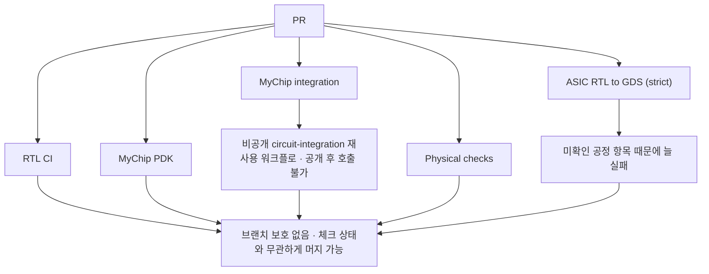
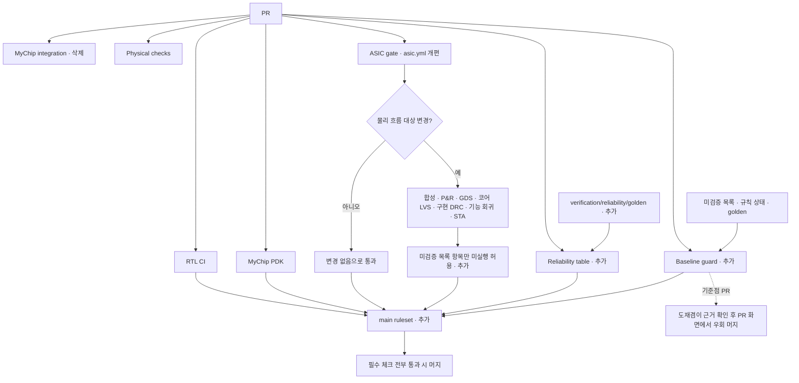

# SPEC 0019 머지 게이트와 신뢰성 대응표

- 상태: 계획. 설계 승인(2026-11-28) 후 구현 전이다. 이 문서에 적은 스크립트·파일·워크플로·ruleset은 아직 없다. PR #11 `feat/nspl-drc-rule-tests`의 `303bcb6` 위 `feat/merge-gate`에서 구현한다.
- 작성일: 2026-11-28.
- 관련 규약: RFC 0001 HW01~HW06, RFC 0002 DOC01~DOC04·PR01·AUTO01.

## What

RTL을 고칠 때마다 PR에서 오픈소스 흐름 전체(합성 → P&R → GDS → DRC·LVS → 기능·타이밍 시험)를 실행하고, **필수 검사를 전부 통과해야만 main에 머지**되게 한다. P&R은 셀 배치와 배선, GDS는 제작할 도형 파일이다.

오픈소스 도구의 판정을 믿을 수 있다는 근거는 **상용 도구 결과와의 신뢰성 대응표**로 남긴다. 상용 도구는 PR마다 쓰지 않는다. 기준점에서만 사람이 수동으로 실행해 대응표를 갱신한다. 기준점은 규칙 묶음 이식·도구 버전 변경·제출 직전처럼 상용 결과를 다시 받아야 하는 시점이다.

| 목표 | 완료 결과 |
| --- | --- |
| 1. main 보호 | main에 저장소 ruleset을 걸고 아래 게이트 검사를 필수 체크로 지정 |
| 2. 회귀 게이트 | 현재 검증된 범위에서 하나라도 나빠지면 머지를 막음 |
| 3. 신뢰성 대응표 | 단계별로 "오픈소스 판정 ↔ 상용 판정"의 고정 근거 파일(golden)과 출처를 저장소에 둠. CI는 PR마다 이 근거와 다시 맞춰 봄 |
| 4. 미검증 목록 | 파일로 관리. PR에서 늘어날 수 없고, 항목을 빼려면 대응표 근거를 같은 PR에 넣어야 함 |
| 5. 기준점 절차 | 상용 재실행 절차를 문서로 고정해 다음 사람이 같은 방법으로 근거를 갱신 |

같은 작업에서 `.github/workflows/integration.yml`(`MyChip integration`)을 삭제하고 관련 문서를 고친다. 이유는 How 1절에 적는다.

### 하지 않는 것

- 상용 도구를 CI에서 자동 실행하지 않는다. 학교 서버는 우리 것이 아니고 계정도 빌린 것이다.
- `ready_for_submission`을 통과시키는 작업이 아니다. 제출 준비 판정은 머지 게이트와 별개로 유지한다.
- 남은 113개 DRC 규칙·antenna·PEX 보정 자체는 하지 않는다. 이 SPEC은 그 작업이 들어올 자리와 규칙을 만든다. PEX는 배선 저항·용량 추출이다.
- circuit-integration 저장소 쪽 변경은 이 저장소 작업에 넣지 않는다.

### 기술적으로 돌아가도 실패로 보는 것

- 늘 빨간 게이트. 사람들이 우회하게 된다. 게이트에는 지금 통과 가능한 검사만 넣고, 미완료 항목은 미검증 목록으로 보낸다.
- 오픈소스 도구 결과를 다시 정답으로 저장하는 순환 근거. golden 파일은 상용 도구 출력이나 원본 규칙 문서에서만 온다.
- 초록색을 만들려고 검사를 끄거나 기준을 낮추는 변경이 조용히 들어가는 것. 기준 파일 변경은 별도 검사로 드러낸다.
- 공개 저장소에 학교 서버 주소·계정·로그를 남기는 것.

## Why

사용자 요청은 "앞으로 RTL을 고칠 때 CI가 정상적으로 다 돌아가야 머지", "우리가 reliability를 보장하는 작업을 해야지"이다.

SPEC 0017·0018로 실제 5팀 코어와 제안 SOP28 GDS를 만들고 검사하는 흐름(`asic.yml`, `scripts/asic/`)이 생겼다. 그러나 지금은 `asic (strict)`가 미확인 공정 항목 때문에 늘 실패하고, 브랜치 보호가 없어 어떤 검사가 빨갛든 머지할 수 있다. RTL 변경으로 레이아웃이 깨져도 막는 장치가 없다.

또 KLayout·Netgen·OpenROAD 같은 오픈소스 도구의 "오류 0건"이 상용 도구에서도 같은 판정인지 저장소에 근거가 없다. 2026-11-28 기준으로 학교 서버의 Calibre로 실행한 DRC fixture 427개와 v2 칩 결과가 처음 생겼다(How 2절). 이 결과를 고정 근거로 남기고 PR마다 다시 맞춰 보면, 도구 신뢰 근거가 PR 사이에서 조용히 사라지는 것을 막을 수 있다.

`MyChip integration`은 이 저장소가 2026-11-28 공개로 전환된 뒤 동작할 수 없다. 공개 저장소는 비공개 circuit-integration의 재사용 워크플로를 호출할 수 없어 매 PR ❌가 된다. 늘 빨간 체크는 위의 실패 기준과 같다.

## How

### 제약

- 저장소는 2026-11-28부터 공개다. Free 플랜이지만 공개 저장소라 branch protection·ruleset과 GitHub 호스팅 실행기를 무료로 쓴다. 비밀값(secrets)은 0개이고 앞으로도 두지 않는다.
- 실행기는 GitHub 호스팅(`ubuntu-24.04`)만 쓴다. 자체 호스팅 실행기는 이 팀 저장소에 쓰지 않는다.
- 실제 RTL→GDS 흐름(`asic.yml`, `scripts/asic/`)은 아직 draft PR #10(`feat/rtl-to-gds` → main)과 #11(`feat/nspl-drc-rule-tests` → #10)에만 있다. ruleset은 이 둘과 이 작업이 main에 들어온 뒤에 건다.
- 5팀 작업 규칙(SPEC 작성, `policy.py review`, 훅, PR 본문 What·Why·How, main 직접 push 금지)을 그대로 따른다.
- PDK는 공개 tarball `NSPL_05CMOS_PDK_260820.tar.gz`(sha256 `2e49115a08f6af96c1f8433130ad4316551b5eba9001a3133905b544166af954`)를 CI에서 받는다. 키트 원본은 저장소에 넣지 않는다.
- KLayout은 현재 0.28.16이다. 0.30.x 전환은 별도 작업이며, 전환하면 대응표 DRC 칸을 다시 맞춰야 한다.

### 접근 방식 비교

| 안 | 내용 | 판단 |
| --- | --- | --- |
| **A. 회귀 게이트 + 대응표 (선택)** | PR마다 오픈소스 흐름 전체를 실행. 현재 검증 범위에서 나빠지지 않으면 통과. 신뢰성은 상용 결과와의 고정 대응표로 보증 | 지금 운영 가능하고, 검증 범위가 넓어질 때 같은 틀에 칸만 채우면 된다 |
| B. 완전 게이트 | 공정 전체 검증(strict)을 통과해야 머지 | 현재 아무것도 머지할 수 없다. 늘 빨간 게이트 |
| C. 가벼운 게이트 | RTL CI·합성만 PR 조건, 레이아웃은 야간 | RTL 변경으로 레이아웃이 깨져도 머지된다. 공개 저장소라 실행 시간을 아낄 이유도 없다 |

사용자가 A를 골랐다. 합성·P&R을 PR마다 돌리는 이유는 DRC·LVS를 이번 RTL로 새로 만든 GDS에 돌려야 변경을 검사하기 때문이다. 로컬 실측 약 4분이며 비용이 없다. 대응표는 PR별 실행을 대신하지 않는다. 대응표는 "오픈소스가 OK면 상용도 OK"라는 도구 신뢰 근거다.

### 1. 머지 게이트 (필수 체크)

| 필수 체크 | 내용 | 통과 조건 | 상태 |
| --- | --- | --- | --- |
| `RTL CI` (기존 `ci.yml`) | PR 규칙·정책 단위 시험·RTL 린트·시뮬레이션 | 기존 그대로 | main에 있음 |
| `MyChip PDK` (기존 `pdk.yml`, pr tier) | 합성·OpenSTA·게이트 수준 시험 | 기존 그대로 | main에 있음 |
| `ASIC gate` (신규, `asic.yml` 개편) | RTL → OpenROAD P&R → GDS → 코어 LVS → 구현된 DRC 규칙 → 최종 netlist 기능 회귀 → STA | 코어 LVS 일치, 구현 DRC 규칙 오류 0, 기능 회귀 통과, setup/hold slack ≥ 0(추정 RC 기준), 미검증 목록 외 항목은 모두 실행·통과 | 계획. #10/#11 머지 후 |
| `Reliability table` (신규) | 대응표의 golden과 현재 오픈소스 도구 결과를 다시 대조 | 대응표 모든 칸이 "일치" 유지 | 계획 |
| `Baseline guard` (신규) | 미검증 목록·대응표·임계값 파일 변경 검사 | 미검증 목록 항목 증가 금지. 항목 삭제·임계값 완화는 근거 파일 동반 필수 | 계획 |

- 게이트 판정은 지금의 `--experimental` 의미를 공식화한 것이다. **미검증 목록에 적힌 항목만** 미실행을 허용하고, 그 밖의 실패·미실행은 모두 막는다. `ready_for_submission: false`·`status: incomplete`는 그대로 리포트에 남는다.
- 물리 흐름은 RTL·제약·흐름 스크립트·PDK 고정값·대응표가 바뀐 PR에서만 실제로 돈다. 문서만 바뀐 PR에서는 같은 이름의 체크가 "변경 없음"으로 통과한다. 필수 체크가 대기 상태로 남지 않게 job은 항상 생성하고 단계만 건너뛴다.
- 보호 방식: main에 **저장소 ruleset**을 건다. PR 필수, 위 필수 체크 통과 필수, 브랜치 최신 상태 필수, 리뷰 승인 수 0(사람 승인보다 CI를 게이트로 삼는다).
- **기준 파일의 승인자는 도재겸(Dojaegyum) 한 명이다.** 우회 권한(bypass)은 저장소 admin 역할에만, **PR 화면에서만** 준다(`bypass_mode: pull_request`). 현재 admin은 Dojaegyum뿐이다. 근거 파일·미검증 목록을 바꾸는 기준점 PR은 `Baseline guard`가 막고, 도재겸이 근거를 확인한 뒤 PR에서 우회 머지한다. 우회 머지는 PR 기록에 남는다.
- 그 밖의 PR에서 우회는 쓰지 않는다. 우회 머지가 기준점 PR이 아닌 곳에 쓰였는지는 PR 기록으로 확인할 수 있다.
- `integration.yml` 삭제: 칩 연결 검사는 circuit-integration 야간 작업이 이 저장소를 읽어 계속 맡는다. `README.md`의 CI 목록·맨 위 폴더 규칙 설명, `mychip/README.md`, `pdk.yml` 머리 주석, `docs/verification/rtl-to-gds-guide.md`의 `MyChip integration` 언급, SPEC 0017 그림의 `MyChip integration · 유지`를 고치고, SPEC 0013에 폐지 메모를 남긴다.

### 2. 신뢰성 대응표

저장소에 `verification/reliability/`를 둔다. 아래 파일은 모두 계획이며 아직 없다.

```
verification/reliability/
  table.md              사람이 읽는 대응표 (단계·근거·범위·갱신일)
  table.json            CI가 읽는 같은 내용
  unverified.json       미검증 목록 (항목, 이유, 막힌 조건)
  golden/
    drc-fixtures-20261128/   Calibre 427개 결과 요약(규칙별 발동 수·마커 좌표), 입력 fixture 해시, deck 해시, 도구 버전
    drc-fixtures-20261128b/  둘러싸기 규칙 fixture 24개(0427~0450, 일부 겹침·겹침 없음·안쪽 섬·바깥 근접)의 Calibre 결과
    drc-mutations-20261128/  키트 셀 변형본 695개의 형상 해시와 Calibre 발동 규칙(81개는 Calibre 입력 거부)
    chip-v2-20261128/        v2 칩 GDS 해시, Calibre DRC/ANT/LVS 요약, Genus/Innovus/Tempus 요약
  CHECKPOINT.md         상용 재실행 절차
```

| 단계 | 오픈소스(PR마다) | 상용 기준(기준점) | 현재 근거 | CI가 PR마다 확인하는 것 |
| --- | --- | --- | --- | --- |
| DRC 규칙 판정 | KLayout 구현 규칙 | Calibre v2023.4, 키트 deck 무수정 | 427개 fixture 판정 425 일치·2 Calibre 거부, v2 칩 거짓 위반 0 | fixture를 다시 만들어 KLayout 판정이 golden Calibre 판정과 같은지 (수 초) |
| DRC 실제 칩 | KLayout | Calibre | v2 칩 0건 ↔ 0건, seal ring 판 `1.PWL.bad1` 1건은 미구현 | PR마다 확인하지 않는다. v2 GDS는 저장소에 넣지 않는다는 11-27 결정(결과는 로컬 보관)을 따르므로, 이 칸은 기준점에서만 다시 대조하고 요약·해시만 golden에 둔다 |
| LVS | KLayout 추출 + Netgen | Calibre LVS | v2 칩 Calibre CORRECT. 오픈소스 쪽 같은 GDS 대조 없음 | 대조 작업 완료 전까지 미검증 목록 |
| 합성 | Yosys | Genus | Genus 325셀 결과 있음. 동치 미확인 | 미검증 목록 (기준점에서 같은 RTL의 두 netlist를 같은 시험·형식 동치로 대조) |
| P&R·STA | OpenROAD + OpenSTA | Innovus + Tempus | v2 코어 OpenSTA(SPEF) setup +38.4 / hold +1.41 ns. 같은 조건 비교 없음 | 미검증 목록 |
| PEX | OpenRCX | Quantus | 없음 | 미검증 목록 |
| antenna | (미구현) | Calibre ANT | v2 칩 0 | 미검증 목록 |

DRC 규칙 판정 칸의 기준은 Calibre `v2023.4_17.10`, 키트 DRC deck sha256 `6c01207311236d148dc183576fa8f5156e1a21d40a19609322c810fa919c4f0f`(`scripts/asic/drc_catalog.py`의 `SOURCE_SHA`와 같은 파일)이다. Calibre가 거부한 2개는 `0169-OFFGRID_MET1-finer-dbu`, `0170-OFFGRID_MET1-incompatible-dbu`이며, 원인은 규칙 파일 정밀도(1000)와 fixture 데이터베이스 정밀도가 다르다는 Calibre 오류다. 이 2개는 불일치나 근거 없음으로 세지 않고 사유가 붙은 제외로 보여 준다.

- **golden은 상용 출력이나 원본 규칙 문서에서만 만든다.** 오픈소스 결과로 golden을 만들거나 덮어쓰지 않는다.
- golden에는 판정에 필요한 요약(규칙별 수·마커 좌표·판정·도구 버전·입력 해시)만 둔다. 서버 주소·계정·경로·원본 로그는 넣지 않는다.
- **DRC fixture 대조의 게이트 기준은 대상 규칙의 발동 여부(위반 있음/없음)뿐이다.** 마커 수·좌표와 대상 밖 규칙 발동(Calibre에서 50개 규칙)은 golden에 기록하고 리포트로만 보여 준다. 이미 0242(KLayout 4 · Calibre 1)와 0408(1 · 2)이 수에서 다르고, 대상 밖 발동은 아직 대조한 적이 없기 때문이다. 대상 밖 발동 중 KLayout 구현 규칙에 해당하는 것은 다음 기준점에서 대조한 뒤 게이트로 올린다. (구현자 판단)
- golden은 **fixture 파일 내용 해시**로 묶는다. 생성기가 바뀌어 fixture 해시가 달라지면 그 fixture는 golden이 없는 것으로 본다(3절의 규칙 상태로 처리). (구현자 판단)
- **실제 형상 변형본 golden**(`drc-mutations-20261128/`): 키트 표준셀·GPIO 셀의 도형 하나를 옮기기·키우기·줄이기·지우기로 바꾼 GDS 695개를 Calibre로 GDS마다 한 번씩 검사한 결과다. `scripts/asic/mutate.py`(seed 20261128, 셀당 6개)가 같은 형상을 다시 만들고, golden은 GDS 바이트 대신 **형상 해시**(층별 다각형 좌표의 sha256)로 묶는다. `reliability.py check-mutations`는 형상 해시가 golden과 같은 GDS마다 `verified` 규칙의 발동 여부를 Calibre와 비교하고, 하나라도 다르거나 형상 해시가 다르면 실패한다. Calibre가 거부한 81개(자기 교차 다각형)와 최상위 셀이 빈 5개는 사유가 붙은 제외다. 첫 대조에서 `ENC … OVERLAP`(둘러싸는 층에 일부만 겹친 도형도 위반)을 KLayout 구현이 놓친 13건이 나와 같은 작업에서 고쳤다. 고친 판정은 "안쪽 도형의 변이 둘러싸는 층 경계를 가로지른다(변의 일부는 안, 일부는 밖)"이며, 둘러싸는 층 도형이 안쪽 도형 안에 통째로 있거나 바깥에 가까이 있는 경우는 위반이 아니라는 것을 fixture `0427`~`0450`의 Calibre 결과(`drc-fixtures-20261128b/`)로 확인했다. (구현자 판단)
- 대응표 칸의 판정은 "일치 / 불일치 / 근거 없음(미검증)" 세 가지다. 수치 비교(타이밍 차이 등)는 기록만 하고, 허용 오차는 팀이 정할 때까지 게이트 조건으로 쓰지 않는다. 허용 오차를 근거 없이 정하면 조용한 기준 완화와 같아지기 때문이다. (구현자 판단)

### 3. 미검증 목록과 DRC 규칙 상태

- 현재 들어갈 항목: 남은 113개 DRC 규칙·전역 플래그, antenna, GPIO/ESD 내부 LVS(ETRI 검증 셀로 처리, 근거 QnA #1125·#952), 오픈소스 LVS↔Calibre LVS 대조, 합성 대응, P&R·STA 대응, PEX, 핀맵 25핀 조건(수업 쪽 확인).
- 각 항목은 id, 내용, 이유, 빠지려면 필요한 근거, 관련 문서를 가진다.
- **DRC는 규칙 단위 상태로 관리한다.** `unported`(미구현) → `ported`(KLayout 구현, 자체 시험 통과, Calibre 근거 없음) → `verified`(그 규칙의 모든 fixture가 해시가 맞는 Calibre golden과 판정 일치). 현재 96개는 `verified`, 113개는 `unported`. 상태는 `verification/asic/drc-rules.json`의 구현 여부와 `golden_compared`로 정한다. 새 규칙을 옮기는 PR이 Calibre 재실행 없이 머지될 수 있어야 하고(기준점은 묶음 단위), 동시에 이미 검증된 규칙이 조용히 근거를 잃는 것은 막아야 하기 때문이다. (구현자 판단)

`Baseline guard` 규칙:

- 상태는 앞으로만 간다. `unported → ported`는 허용, `ported → verified`는 golden 동반 시 허용.
- **뒤로 가는 변경은 막는다.** `verified` 규칙의 fixture 해시가 바뀌거나(생성기 수정, 도형 최소화) golden이 사라지면 실패한다. 그런 변경은 기준점 PR에서 새 golden과 함께 들어와야 한다.
- DRC 이외 항목(LVS·합성·STA·PEX·antenna 등)은 목록에 새 항목이 생기면 실패한다. 항목이 빠지면 같은 PR에 대응표 근거 파일이 추가됐는지 확인한다.
- 도구 버전 변경(KLayout 0.30 등)처럼 정당하게 항목이 늘거나 상태가 뒤로 가야 하는 경우도 `Baseline guard`는 실패한다. 이런 PR은 이유를 PR 본문에 적고 도재겸이 PR 우회로 머지한다(1절).

### 4. 기준점 절차 (`CHECKPOINT.md`)

- 언제: (1) 새 DRC 규칙 묶음을 옮겼을 때, (2) 도구 버전을 바꿨을 때(KLayout 0.30 등), (3) 제출 직전 최종 GDS.
- 누가: 프로젝트 담당자 승인 하에 수동 실행. 학교 서버는 계정 주인 동의와 접근 창구가 있을 때만 쓴다.
- 방법: 입력 묶음(fixture tarball·GDS)과 해시를 먼저 만들고, 상용 도구를 무수정 deck으로 실행한다. 결과 요약을 golden 형식으로 만들어 PR로 넣는다. 서버에는 흔적을 남기지 않는다(권한 700 임시 폴더, HOME 지정, 종료 후 삭제, SSH 키 제거).
- 2026-11-28 실행이 첫 사례다. 그때 입력한 fixture 묶음의 sha256은 `a125b25350f984c46dde3d9c73f172bd085508ac540eddb35b86709e18a394d8`, 생성 커밋은 `303bcb6`이다.

### 변경 전



### 변경 후



`Physical checks`(`physical.yml`, scmos 연습 회로)는 필수 체크에서 제외하고 유지하는 것을 제안한다(구현 단계에서 정할 것).

```diff
  # PR마다: strict 실행, 미확인 공정 항목이 있으면 종료 코드 1 (늘 빨강)
- python scripts/run_asic.py --pdk NSPL키트경로 --target chip --out 새폴더
  python scripts/run_asic.py --pdk NSPL키트경로 --target chip --out 새폴더 --experimental  # 수동 실험, 유지
+ # PR마다: 게이트 실행
+ python scripts/run_asic.py --pdk NSPL키트경로 --target chip --out 새폴더 --gate          # 미검증 목록 항목만 미실행 허용
+ python scripts/asic/reliability.py check --selftest selftest.json --golden verification/reliability/golden --out 새폴더  # 아래 fixture golden 전부
+ python scripts/asic/reliability.py check-mutations --golden verification/reliability/golden/drc-mutations-20261128/golden.json --kit NSPL키트경로 --out 새폴더
+ python scripts/asic/baseline_guard.py --base origin/main
```

위 `+` 명령은 계획이다. 정확한 옵션 이름은 구현 PR에서 확정하고 이 SPEC에 반영한다.

### 구현 파일과 역할 (모두 계획)

| 파일·경로 | 구현할 내용 |
| --- | --- |
| `scripts/asic/reliability.py` | fixture 정의 해시, Calibre 결과 요약을 golden으로 가져오기, KLayout 판정과 golden 대조, 규칙 상태 계산, 대응표 `table.md` 생성 |
| `scripts/asic/drc_fixture_test.py` | fixture 결과 기록에 fixture 정의 해시를 함께 남김 |
| `scripts/asic/mutate.py` | 키트 셀 변형본 생성(seed 고정)과 형상 해시 |
| `scripts/asic/drc_geometry.py`, `scripts/asic/drc_cases.py` | 둘러싸기 규칙에 deck의 `ENC … OVERLAP` 의미(일부만 겹친 도형도 위반) 추가, 일부 겹침·겹침 없음 fixture 추가 |
| `scripts/asic/baseline_guard.py` | 기준 브랜치와 PR의 규칙 상태·미검증 목록·golden을 비교해 뒤로 가는 변경을 실패시킴 |
| `scripts/asic/flow.py`, `scripts/run_asic.py` | 지금 코드에 고정된 미확인 허용 목록(`flow.UNQUALIFIED`)을 `unverified.json`에서 읽고 게이트 실행 옵션 추가. `--experimental`은 유지 |
| `verification/reliability/**` | 대응표·미검증 목록·golden·기준점 절차 |
| `verification/asic/drc-rules.json` | 구현 96개 규칙의 golden 대조 여부(`golden_compared`) 기록 |
| `.github/workflows/asic.yml` | `ASIC gate`로 개편, 변경 경로 판단, `Reliability table` job 추가 |
| `.github/workflows/` 새 파일 | `Baseline guard` job (PR에서만 실행) |
| `.github/workflows/integration.yml` | 삭제 |
| `tests/asic/**` | 대조·규칙 상태·guard·게이트 종료 코드 시험 |
| `README.md`, `mychip/README.md`, `.github/workflows/pdk.yml`, `docs/verification/rtl-to-gds-guide.md`, `docs/specs/0017-rtl-to-gds.md`, `docs/specs/0013-mychip-integration.md` | `MyChip integration` 폐지 반영 |

ruleset 설정 JSON은 저장소에 커밋하지 않고 적용 후 내용을 이 SPEC에 기록한다.

### 결정된 것

- A안(회귀 게이트 + 대응표). 사용자 선택.
- 저장소 공개 전환. 사용자 지시, 2026-11-28 완료.
- 상용 도구는 기준점에서만 수동 실행. CI 자동 실행 없음.
- `integration.yml` 삭제와 관련 문서 정리. circuit-integration 관리 쪽 요청, 사용자 동의.
- 기준 파일 승인자는 도재겸 한 명. 사용자 결정.
- v2 칩 GDS는 저장소에 넣지 않는다(11-27 결정 유지).

### 구현자 판단 (검토 요청)

설계자가 정하고 사용자 검토를 요청한 항목이다. 승인된 설계에 포함됐지만 근거가 바뀌면 다시 논의한다.

1. ruleset + admin PR 한정 우회로 "도재겸만 승인"을 구현한다. 에이전트가 만드는 PR도 Dojaegyum 계정으로 올라가 본인 승인(CODEOWNERS 리뷰)이 불가능하기 때문이다. ruleset의 PR 한정 우회가 "도재겸만 승인"을 기록이 남는 방식으로 구현한다.
2. 리뷰 승인 수 0.
3. DRC fixture 게이트는 대상 규칙의 발동 여부만 비교한다. 수·좌표·대상 밖 발동은 기록만 한다.
4. golden은 fixture 내용 해시로 묶는다.
5. DRC 규칙 상태 `unported → ported → verified`, 뒤로 가는 변경은 차단한다.
6. 수치(타이밍 등) 차이는 기록만 하고, 허용 오차는 팀이 정할 때까지 게이트에 쓰지 않는다.
7. 실제 칩 DRC 대조는 기준점에서만 한다.

### 구현 단계에서 정할 것

- `asic.yml`의 job 분할, 캐시 키, 변경 경로 필터의 정확한 목록.
- golden 파일의 세부 스키마.
- #10/#11을 먼저 머지할지, 이 작업을 #11 위에 쌓을지의 순서.
- 기존 `physical.yml`(scmos 연습)의 필수 체크 여부. 제안: 필수에서 제외하고 유지.

### 합격 조건과 검증

1. 문서만 바꾼 PR에서 모든 필수 체크가 보고되고 초록으로 끝난다. `ASIC gate`는 물리 흐름을 건너뛰고 "변경 없음"을 요약에 쓴다. 필수 체크가 대기 상태로 남지 않는다.
2. RTL을 바꾼 PR에서 `ASIC gate`가 물리 흐름 전체를 실행한다. 미검증 목록 밖의 항목이 실패·미실행이면 실패한다.
3. golden 판정을 손으로 바꾼 PR은 `Baseline guard`와 `Reliability table`이 모두 실패한다.
4. `verified` 규칙의 fixture 정의를 바꾸거나 fixture를 추가한 PR은 `Baseline guard`가 실패한다.
5. 미검증 목록에 항목을 추가한 PR은 실패하고, 항목을 뺀 PR은 같은 PR에 대응표 근거 파일이 없으면 실패한다.
6. Calibre가 거부한 fixture 2개는 불일치나 근거 없음이 아니라 사유가 붙은 제외로 보인다.
7. 정상 경우와 위 실패 경우를 `tests/asic/`의 단위 시험으로 확인하고, 실제 PR에서 체크가 보고되는 모습을 확인해 이 SPEC의 실행 결과에 기록한다. 로컬 시험 통과와 원격 실행 결과를 구분해 적는다.

흐름 변경: 있음

## RFC 확인

RFC 0001의 연산 범위·통신·오류·리셋 규칙과 정답 모델은 바꾸지 않는다. 이 작업은 RTL을 바꾸지 않고 검사와 머지 조건만 추가한다.

RFC 0002 DOC01~DOC02에 따라 이 문서는 기획·구현 계획이며 새 제출 규약을 확정하지 않는다. 구현 상태는 계획이며, 실행하지 않은 검사를 통과로 적지 않는다. DOC03~DOC04에 따라 사실(2026-11-28 Calibre 실행 결과)·결정·구현자 판단·미정 사항을 나눠 적고, 변경 전후 그림과 핵심 diff를 둔다.

PR01·AUTO01은 바꾸지 않는다. ruleset은 PR01의 "main 직접 push 금지"를 GitHub 쪽에서 강제하는 장치이며, AUTO01이 말한 대로 로컬 훅과 별개다. 리뷰 승인 수 0은 GitHub가 머지 조건으로 요구하는 승인 수일 뿐이며, PR01의 팀장·담당자 리뷰 요청과 "에이전트가 임의로 merge하지 않는다"는 규칙은 그대로 따른다. 모든 PR은 지금처럼 팀장과 관련 담당자에게 리뷰를 요청한다. 이것은 리뷰 요청이며 GitHub가 강제하는 필수 승인 수가 아니다. 우회 머지는 도재겸이 사람으로서 PR 화면에서 하는 것이며 에이전트가 하지 않는다.

PR01은 "RFC·정답 모델·기대 결과를 함께 바꾸는 PR은 팀장이 승인한 후 병합한다"고 정한다. 팀장은 김령교다(`README.md`). 상용 도구 결과 golden만 추가하거나 갱신하는 기준점 PR은 도구 비교 근거를 바꾸는 것이며, RFC나 정답 모델을 바꾸지 않으므로 이 조항의 대상이 아니다. 그런 PR은 이 SPEC대로 도재겸이 근거를 확인한 뒤 PR 우회로 머지한다. RFC나 정답 모델도 함께 바꾸는 PR은 PR01에 따라 팀장(김령교)의 승인을 받은 후 병합한다. SPEC 0017 8절의 "브랜치 보호는 추가하지 않는다"는 이 SPEC으로 방향을 바꾼다. 그 문장은 규약이 아니라 SPEC 0017의 계획이었다.
