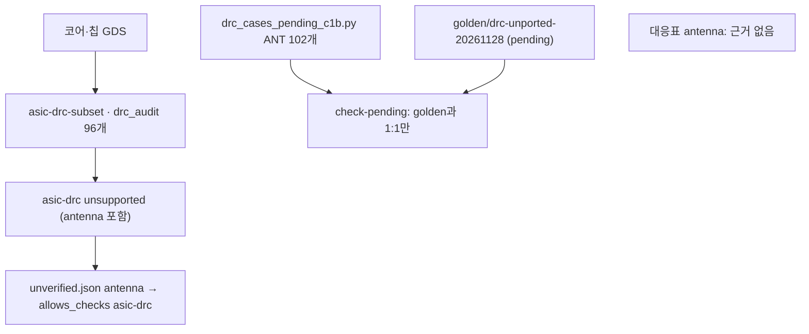
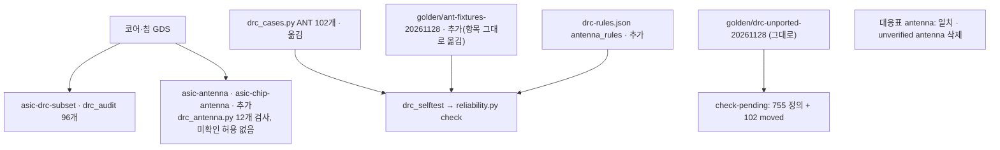

# SPEC 0020 키트 ANT deck antenna 검사 이식

- 상태: 구현·로컬 검증. `feat/merge-gate`(SPEC 0019) 위의 `feat/antenna-check`.
- 작성일: 2026-11-28.
- 관련 규약: RFC 0001 HW01~HW06, RFC 0002 DOC01~DOC04·PR01·AUTO01.

## What

키트의 별도 Calibre ANT deck(`Calibre/ANT/NSPL_0p5um_Analog_CMOS_2P3M_5V_V1.1_ANT.cal`, sha256 `80dc257e6778121ab9a61a444d0e82c79999dc785d8e6aa5a6a2a5318c7b94b5`)의 검사 12개(RULECHECK)를 KLayout으로 옮긴다(`scripts/asic/drc_antenna.py`). 이미 받아 둔 Calibre 판정(fixture 102개)과 맞춰 보고, 흐름의 필수 검사로 넣는다.

| 결과 | 내용 |
| --- | --- |
| antenna 검사 | `ANT_01`·`ANT_02_1~3`·`ANT_03_1~3`·`ANT_04`·`ANT_05_1~2`·`ANT_06_01~02`. deck 문장 그대로 넷마다 계산 |
| Calibre 대조 | fixture 102개 모두 대상 검사 발동 여부 일치. 칩 GDS 4개(오픈소스 흐름 코어·SOP28 칩, v2 칩 두 판) KLayout 0 ↔ Calibre ANT 0 |
| 흐름 | 필수 검사 `asic-antenna`(코어)·`asic-chip-antenna`(칩). 미검증 목록의 `antenna` 항목을 닫아 미확인 허용이 없다 |
| 대응표 | `antenna` 행 근거 없음 → 일치 |

DRC deck 안의 `3.PL1.ANT`(미구현 113개 중 하나)는 이 작업 범위가 아니다.

## Why

SPEC 0019의 대응표에서 antenna는 "근거 없음"이었다. Calibre 판정(2026-11-28 C1b 묶음)은 있었지만 KLayout 쪽 검사가 없어 흐름은 antenna를 `asic-drc` 미확인에 묻어 두었다. 게이트 공정(antenna 비율이 크면 제작 중 게이트 산화막이 손상됨)을 PR마다 실제로 확인하고, 그 판정이 Calibre와 같다는 근거를 남기려는 것이다.

## How

### deck 의미 그대로 계산

KLayout의 `antenna_check`는 쓰지 않는다. deck은 검사마다 연결(CONNECT) 순서가 달라 같은 함수로 표현할 수 없다.

- **보호 다이오드 넓이는 그 줄 위의 CONNECT만 쓴다**(`DRC INCREMENTAL CONNECT YES`, 69번째 줄). `ANT_02_x`·`ANT_03_1`·`ANT_05_x`는 POLY가 연결되기 전에 `ACTIVE_DIODE* = NET AREA ALL_SD >= 0.202`를 정한다. `ANT_03_2`·`ANT_03_3`·`ANT_06_0x`는 POLY가 연결된 뒤에 정한다.
- 비율의 넷은 그 블록의 CONNECT 전부다. `*_WO_DIODE`(다이오드 넓이 0인 넷)·`*_WITH_DIODE`(0보다 큰 넷)로 잴 층을 고른다.
- `ANT_02_x`·`ANT_03_x`는 맨 위 층 하나의 둘레만 잰다(층별 검사, 누적 아님). `ANT_03_3`은 deck 그대로 M6 식(다이오드 넓이 × 8000 + 30000)을 쓴다.
- `ANT_05_x`의 `!AREA(diode)`, 모든 식의 `!!AREA(GATE)`(게이트 넓이 0이면 0)를 그대로 둔다.
- 넓이·둘레는 정수 dbu로 재서 정밀도(1/dbu, deck `PRECISION 1000`)로 나눈다. 식은 deck의 연산 순서 그대로 배정밀도로 계산하고 `>`로 비교한다. 이 방식에서만 `ANT_06` 등호 경계(Calibre 위반 124)가 위반이 되고, 나머지 10개 검사의 등호 경계는 위반이 아니다. 곱셈(`× 1e-6`)으로 바꾸면 `ANT_06` 경계가 Calibre와 달라진다.

| 검사 | deck 줄(헤더·식) | 넷 연결 | 식 |
| --- | --- | --- | --- |
| `ANT_01` | 73·76 | GATE-POLY | `0.25 P(POLY) / Ag > 200` |
| `ANT_02_1` | 88·91 | M1(+ALL_SD·POLY by CONT), GATE | M1, 다이오드 없음: `0.525 P / Ag > 400` |
| `ANT_02_2` | 104·107 | M2-M1 by VIA1 + 위 | M2, 다이오드 없음: `0.525 P / Ag > 400` |
| `ANT_02_3` | 121·124 | M3-M2 by VIA2 + 위 | M3, 다이오드 없음: `0.870 P / Ag > 400` |
| `ANT_03_1` | 136·141 | `ANT_02_1`과 같음 | M1, 다이오드 있음: `0.525 P - Ag(400 Ad + 2200) > 0` |
| `ANT_03_2` | 154·159 | `ANT_02_2`과 같음(다이오드는 POLY 연결 뒤) | M2: 같은 식 |
| `ANT_03_3` | 174·179 | `ANT_02_3`과 같음(다이오드는 POLY 연결 뒤) | M3: `0.870 P - Ag(8000 Ad + 30000) > 0` |
| `ANT_04` | 187·190 | CONT_ANTENNA-POLY by CONT, GATE-POLY | `A(CONT AND POLY) / Ag > 10` |
| `ANT_05_1` | 203·206 | VIA1-M1 + M1 넷 | 다이오드 없음: `A(VIA1) / Ag > 20` |
| `ANT_05_2` | 220·223 | VIA2-M2 + M2 넷 | 다이오드 없음: `A(VIA2) / Ag > 20` |
| `ANT_06_01` | 236·247 | `ANT_05_1`과 같음(다이오드는 POLY 연결 뒤) | `A(VIA1) - Ag(83.33 Ad + 75) > 0` |
| `ANT_06_02` | 261·272 | `ANT_05_2`과 같음(다이오드는 POLY 연결 뒤) | `A(VIA2) - Ag(83.33 Ad + 75) > 0` |

유도 층은 deck 61~67번째 줄 그대로다(`POLY = POLY1 OR POLY2`, `GATE = ACTIVE_ALL AND POLY`, `ALL_SD = ACTIVE_ALL NOT POLY`, `ACTIVE_ALL`은 CAP·BJT·DIODE 표시층을 뺀 N+/P+ ACT). 계층은 평평하게 펴서 넷을 만든다(`LayoutToNetlist`, 한 셀). 위반 수는 위반한 넷의 수다(Calibre는 결과 다각형 수를 세므로 수는 다르다. 판정에는 발동 여부만 쓴다).

### 기존 방식을 그대로 따름

- fixture 102개는 `drc_cases_pending_c1b.py`에서 `drc_cases.py`로 옮겼다. 코드는 그대로이고 이름만 `drc_cases.py` 규칙(밑줄 없음)에 맞췄다. 102개의 `case_sha256`은 Calibre가 읽은 정의와 같다. `ANT_06` 등호 경계 2개는 Calibre 판정(`fail=True`)으로 고친 정의다.
- golden은 고치지 않는다. pending golden(`drc-unported-20261128/golden.json`)에서 ANT 항목 102개를 그대로 새 폴더 `golden/ant-fixtures-20261128/golden.json`으로 옮겼다. `check-pending`은 pending golden에 남은 이 항목을 `moved`로 센다: pending 정의가 없고(`MOVED_RULES`), fixture golden에 같은 해시·규칙·Calibre 판정이 있어야 한다.
- `drc-rules.json`에 `sources.calibre_ant`와 `antenna_rules`(12개, `implementation: antenna_port`, `golden_compared: true`)를 더했다. 상태 체계(unported → ported → verified)와 guard·`reliability.py check`의 실패 조건(golden fixture 사라짐, golden 없는 fixture, 제외만 남음, verified 0개)이 그대로 ANT 검사에도 걸린다. 변형본 대조(`check-mutations`)는 DRC deck 결과만 있으므로 ANT 검사를 넣지 않는다.
- `drc_catalog.py`는 키트 ANT deck의 해시와 12개 검사의 줄·본문 해시를 `antenna_rules`와, 구현(`drc_antenna.RULES`)의 줄 번호와 맞춘다. ANT deck은 `ANT_02_3`·`ANT_03_3` 머리줄이 들여쓰기되어 있어 이 deck만 들여쓴 머리줄을 읽는다.
- `baseline_guard.py`는 `antenna_rules`도 규칙 상태로 읽고, 처음부터 verified로 들어오는 새 규칙을 위반으로 알린다.

### 변경 전



### 변경 후



```diff
  # scripts/asic/flow.py
  CORE_CHECKS = {..., 'asic-drc-subset',
+                'asic-antenna',
                 ...}
  CHIP_CHECKS = {'asic-chip-gds', 'asic-chip-connectivity',
+                'asic-chip-antenna',
                 'asic-chip-lvs', ...}
+ antenna('asic-antenna', out/(top+'.gds'), top, 'antenna.json')          # SSC_DRC_PROFILE=antenna drc.py
+ antenna('asic-chip-antenna', out/'ternary8_sop28.gds', 'ternary8_sop28', 'chip-antenna.json')

  # scripts/asic/reliability.py
- def verified_rules(catalog):
+ def verified_rules(catalog, antenna=True):   # check: DRC + ANT, check-mutations: antenna=False

  # 단독 실행
+ SSC_DRC_PROFILE=antenna SSC_GDS=GDS SSC_TOP=셀 SSC_DRC_OUT=결과.json klayout -b -r scripts/asic/drc.py
```

### 파일

| 파일 | 내용 |
| --- | --- |
| `scripts/asic/drc_antenna.py` | 12개 검사(deck 줄 번호, 연결, 식). `evaluate`·`user_units`는 KLayout 없이 시험 가능 |
| `scripts/asic/drc.py` | profile `antenna` |
| `scripts/asic/drc_cases.py`, `drc_cases_pending.py` | ANT fixture 102개 이동, `MOVED_RULES` |
| `scripts/asic/drc_fixture_test.py` | ANT fixture는 `drc_antenna.check`로 판정 |
| `scripts/asic/reliability.py` | `catalog_rules`, `verified_rules(antenna=)`, `check-pending`의 `moved` |
| `scripts/asic/drc_catalog.py`, `verification/asic/drc-rules.json` | ANT deck 해시·12개 검사 대조, 대조표에 ANT 절 |
| `scripts/asic/baseline_guard.py` | `antenna_rules` 상태, 새 verified 규칙 위반 |
| `scripts/asic/flow.py` | `asic-antenna`, `asic-chip-antenna` |
| `verification/reliability/**` | `golden/ant-fixtures-20261128/`, 대응표 `antenna` 행, 미검증 `antenna` 삭제 |
| `tests/asic/test_antenna.py` 외 | 등호 경계 통과·위반, 다이오드 선택, 계층 넷(형제 셀·회전·반사 인스턴스·게이트 둘), 흐름 필수 여부 |

### 합격 조건과 검증

1. fixture 102개 모두 KLayout 판정 = Calibre 판정. Calibre 입력 거부는 없다(제외 0).
2. 흐름의 코어·칩 GDS에서 antenna 0건. 같은 GDS의 Calibre ANT도 0건(기준점 기록).
3. `unverified.json`에 `antenna`가 없고, `--gate`가 `asic-antenna`·`asic-chip-antenna`의 `unsupported`를 허용하지 않는다.
4. `reliability.py check`가 ANT 12개 검사를 verified 규칙으로 대조한다. 기존 시험과 새 단위 시험이 통과한다.
5. 이 PR은 golden·미검증 목록·규칙 상태·검사 코드를 바꾸므로 `baseline-guard`가 실패한다(기준점 PR, 도재겸 우회 머지).

### 2026-11-28 실행 결과 (로컬)

| 명령 | 결과 |
| --- | --- |
| 프로토타입(C1b 정의 그대로 GDS) | 102개 대상 검사 일치, 대상 밖 검사 발동도 102개 모두 Calibre와 같음 |
| 칩 GDS 4개 | 모두 0건(sha256은 `golden/ant-fixtures-20261128/README.md`). 코어 4초, 칩 약 25초 |

흐름·CI 명령의 실행 결과는 PR 본문에 적는다.

흐름 변경: 있음

## RFC 확인

RFC 0001의 연산·통신·오류·리셋 규칙과 정답 모델은 바꾸지 않는다. RTL을 바꾸지 않고 검사만 더한다.

RFC 0002 DOC01~DOC04에 따라 이 문서는 구현 계획과 결과 기록이며 제작 규약을 정하지 않는다. antenna 0건과 Calibre 일치는 키트 ANT deck 범위의 근거일 뿐 제출 승인이 아니다. 사실(Calibre 결과)과 구현 판단(deck 해석)을 나눠 적었다. PR01·AUTO01에 따라 기능 브랜치에서 PR로 검토받고, 기준 파일 변경은 SPEC 0019대로 도재겸이 근거를 확인한 뒤 우회 머지한다. 에이전트는 머지하지 않는다.
