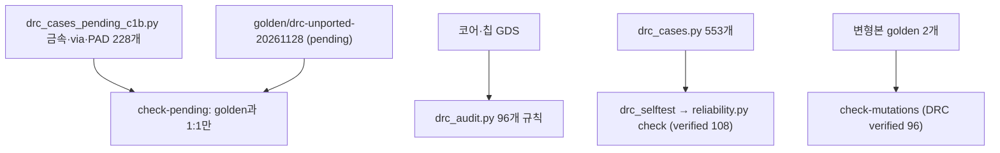
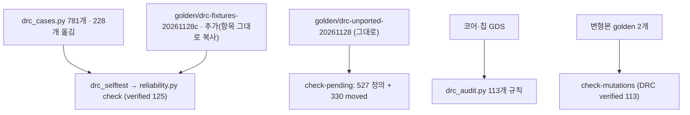

# SPEC 0021 DRC 미이식 규칙 묶음 1 (금속·via·PAD)

- 상태: 구현·로컬 검증. `main`(SPEC 0020 antenna 포함) 위의 `feat/drc-port-batch1`.
- 작성일: 2026-11-28.
- 관련 규약: RFC 0001 HW01~HW06, RFC 0002 DOC01~DOC04·PR01·AUTO01.

## What

키트 Calibre DRC deck의 미이식 규칙 113개 중 금속·via·PAD 규칙 17개를 KLayout으로 옮긴다. 이미 받아 둔 Calibre 판정(fixture 228개, 2026-11-28 C1b 묶음)과 실제 형상 변형본 두 golden에서 모두 Calibre와 같아 17개 모두 `verified`다.

| 규칙 | deck 줄 | 내용 |
| --- | --- | --- |
| `8.MET1.S1`·`10.MET2.S1`·`12.MET3.S1` | 908·998·1089 | 좁은 금속(폭 < 10 µm)끼리 간격 0.8·1.0·1.0 |
| `8.MET1.S2`·`10.MET2.S2`·`12.MET3.S2` | 913·1003·1094 | 넓은 금속(폭 ≥ 10 µm)과 같은 층 금속 간격 1.0·1.2·1.2 |
| `9.VIA1.E1~E4`·`11.VIA2.E1~E4` | 952~967·1042~1057 | 아래·위 금속의 좁은/넓은 부분이 via를 0.6 둘러쌈 |
| `9.VIA1.S2`·`11.VIA2.S2` | 945·1035 | 3×3 이상 via 배열 안 간격 0.8 |
| `13.PAD.P` | 1114 | PAD 사이 틈(19.99 µm씩 키워 메워지는 틈)이 있으면 위반 |

| 결과 | 수 |
| --- | --- |
| verified DRC 규칙 | 96 → 113 (ANT 12개 포함 125) |
| 미이식 DRC 규칙 | 113 → 96 |
| fixture (`drc_cases.py`) | 553 → 781 |
| pending 정의 (`drc_cases_pending*.py`) | 755 → 527 (+ moved 330) |

나머지 96개의 순서와 묶음은 저장소 밖 계획 문서에 두었다. 이 SPEC은 묶음 1만 다룬다.

## Why

ETRI 담당자는 제출 칩 레이아웃을 개략적으로 확인하지만, MyChip 제출 GDS의 DRC를 다시 돌리지는 않는다(2026-11-28 운영기관 회신). 제출본 DRC는 전부 팀 책임이다. 학교 서버의 Calibre는 언젠가 못 쓰게 되므로, 그 전에 KLayout 판정이 Calibre와 같다는 근거를 규칙마다 쌓아야 한다.

금속·via·PAD는 우리 흐름이 PR마다 새로 그리는 층이다(배선, 전원망, 칩 조립). 넓은 전원선은 `WITH WIDTH >= 10` 구분에 바로 걸린다. 지금까지 routing 검사(`drc_routing.py`)는 넓은 금속을 근사로만 나눴고, 확장 검사(`drc_audit.py`)에는 이 규칙들이 없었다. 그래서 칩 위험이 가장 큰 묶음을 먼저 옮긴다.

## How

### deck 의미 (fixture가 덮는 범위)

아래 해석은 C1b fixture 228개(사각형·T·U·L자 꼬리·홈·꼭짓점 맞닿음)와 변형본 두 golden에서 Calibre와 같다는 뜻이다. 그 밖의 형상에서도 deck과 같다는 근거는 아직 없다(아래 "Calibre로 확인하지 않은 형상").

- **`MET1UP10 = WITH WIDTH MET1 >= 10`.** WITH WIDTH는 다각형 전체가 아니라 부분을 고른다. 20 µm 판에 붙은 2 µm 꼬리는 좁은 쪽(`UN10`)이다(C1b `0014`·`0030`·`0128`에서 Calibre 확인). 넓은 부분은 열림(opening: 반 폭만큼 줄였다가 다시 키움)으로 구한다. 줄이는 양은 5 µm보다 1 dbu 작게 해서, 폭 10.00 µm는 넓은 쪽, 9.99 µm는 좁은 쪽이 된다(C1b width-10.00·9.99 fixture). `UN10`은 금속에서 `UP10`을 뺀 나머지다.
- **S1**: `UN10`의 1층 간격(기존 `space`).
- **S2**: `EXT MET1UP10 MET1 < v`. `UP10`의 모든 변에는 같은 자리에 `MET1` 변이 있다. KLayout의 기본 차폐(shielding)는 이 겹친 변 때문에 틈 건너편 변을 가려 모든 S2 fixture에서 0건이었다. Calibre EXT는 deck이 `EXCLUDE SHIELDED`를 쓰지 않으면 차폐 없이 잰다(구현자 판단, S2 위반 fixture 27개를 Calibre가 모두 낸 것으로 확인). 그래서 새 kind `separation_unshielded`로 차폐 없이 잰다. 기존 verified 규칙의 `separation`은 바꾸지 않았다.
- **E1~E4**: 기존 `enclosure`(OVERLAP 포함)를 `UN10`·`UP10`에 쓴다. via가 넓은/좁은 경계에 걸치면 두 규칙 모두 위반이다(`0128` 등, Calibre 같음).
- **S2(via)**: `ARRAY_VIA1 = SIZE (SIZE VIA1 BY 0.8) BY 2.4 UNDEROVER`, `ARRAY1 = VIA1 AND ARRAY_VIA1`의 1층 간격. 키운 묶음이 정확히 4.8 µm이면 사라진다(`3x3-s0.40-degenerate`, Calibre 0).
- **13.PAD.P**: `PAD INTERACT ((SIZE PAD BY 19.99 OVERUNDER) NOT PAD)`. 새 kind `interacting`.

### Calibre로 확인하지 않은 형상 (2026-11-28 리뷰)

넓은 부분을 정사각형 열림으로 구하는 방식은 맨해튼 사각형·T·U·L·십자·홈에서 "폭"의 뜻과 같다. 다음 형상에서는 Calibre `WITH WIDTH`·`EXT`와 다를 수 있고, fixture가 없다. 다음 서버 묶음에서 Calibre 정답을 받는다. 지금 흐름(OpenROAD 맨해튼 배선, 키트 셀)과 칩 4개·변형본 1,495개에는 이런 형상에서 넓은 쪽 규칙이 발동한 예가 없다.

| 형상 | KLayout 지금 판정 | Calibre와 다를 수 있는 점 |
| --- | --- | --- |
| 두 20 µm 판이 대각선으로 5×5 µm만 겹친 좁은 목(오목 꼭짓점 사이 유클리드 거리 7.07 µm) | 목 전체를 넓은 쪽(`UP10`)으로 봄. 목에 놓인 VIA1은 E1·E2 모두 0건 | Calibre가 폭을 유클리드 거리로 재면 목은 좁은 쪽이고, 목의 via는 넓은/좁은 경계에 걸쳐 OVERLAP 위반일 수 있다. 놓침 쪽 위험 |
| 45° 넓은 선, 예각 끝(평행사변형) | 예각 끝이 sizing에서 잘려 좁은 쪽 조각이 됨. 단독으로는 S1·S2 0건 | 예각 끝을 넓은/좁은 어느 쪽으로 보는지, 그 끝의 via·이웃 선에 E·S 규칙이 어느 쪽으로 걸리는지 |
| 좁은 쪽 꼬리 안의 구멍(넓은/좁은 경계에서 0.1 µm) | `UP10` 경계 변과 구멍 변 0.9 µm를 S2 1건으로 잡음 | Calibre 두 층 EXT는 다른 층 안에 들어간 변을 기본으로 재지 않을 수 있다(그러면 0건). 지나치게 잡는 쪽 |
| 넓은/좁은 경계에 변만 닿은 via | 꼬리 쪽이면 E1만, 판 쪽이면 E2만 발동 | deck 해석과 같을 것으로 보지만 fixture가 없다 |

같은 형상의 좌표는 저장소 밖 이식 계획(다음 서버 묶음 후보)에 있다. Calibre가 목을 좁은 쪽으로 보면 열림을 유클리드 쪽으로 고치고 해당 규칙을 다시 대조한다.

### 판정할 수 없는 입력은 실패 (fail closed)

- `drc_geometry.check`는 0.01 µm grid 한 칸이 2 dbu보다 작으면(dbu > 0.005 µm) `ValueError`를 낸다. 정수 dbu 크기 조절로는 10.00과 9.99를 가를 수 없기 때문이다. 이 오류는 모든 규칙의 판정을 막는다(`drc_audit.py`는 실패로 끝난다). 0.001 µm(흐름·키트)와 0.0005 µm는 그대로다.
- **datatype 0이 아닌 도형.** deck의 `LAYER MET1i 32`는 모든 datatype을 읽는다. 확장 검사는 datatype 0만 읽으므로, top 아래 deck 층 번호의 다른 datatype에 다각형이 있으면 `ValueError`다(antenna와 같은 처리, SPEC 0020 리뷰). 텍스트 라벨은 도형이 아니므로 세지 않는다. 확장 검사 전체(기존 verified 96개 포함)에 걸린다. 키트 GPIO·PAD GDS, 변형본 두 묶음 1,495개, 칩 GDS 4개에는 해당 도형이 없어 기존 판정은 바뀌지 않는다(2026-11-28 확인).
- **빈 입력.** deck이 정의한 층 번호 전체(datatype 0)에 다각형이 하나도 없으면 `ValueError`다(모든 도형이 deck 밖 층 번호에 있는 GDS). 0건을 깨끗한 배치로 읽지 않는다. 이 층 번호에는 CHIPBOUNDARY(0)·NODRC(58)·LVSD(60) 같은 표시층도 들어 있으므로, 표시층에만 도형이 있는 GDS는 오류가 아니라 판정을 받는다(모든 규칙 0건, 같은 GDS에서 Calibre도 0건으로 본다). 표시층을 빼면 층 0만 쓰는 `OFFGRID_CHIPBOUNDARY` fixture가 입력 오류가 되므로 빼지 않았다. 공정층이 하나도 없는 칩을 막는 검사는 필요하면 `drc_audit.py` 쪽에 따로 둔다.
- 맞닿기만 한 연결은 이 묶음과 관계없다. 이 묶음의 규칙은 넷 연결을 쓰지 않는다.

### 기존 방식을 그대로 따름 (SPEC 0020)

- fixture 228개를 `drc_cases_pending_c1b.py`에서 `drc_cases.py` 끝(`0553`~`0780`)으로 옮겼다. 코드는 그대로이고 이름만 `drc_cases.py` 규칙(밑줄·import 금지)에 맞췄다. `math.floor(s / math.sqrt(2) * 100)`은 같은 실수가 나오는 `int(s / 2 ** .5 * 100)`으로 바꿨다. 228개의 `case_sha256`은 Calibre가 읽은 정의와 순서까지 같다. Calibre 판정이 가설과 다른 fixture는 없었다(고친 정의 0).
- golden은 고치지 않는다. pending golden(`drc-unported-20261128/golden.json`)에서 17개 규칙의 항목 228개를 순서·내용 그대로 새 폴더 `golden/drc-fixtures-20261128c/golden.json`으로 옮겼다(`meta.moved_from_sha256`). 17개 규칙을 `MOVED_RULES`에 넣었고 `drc-rules.json`에서 verified이므로 `check-pending`은 이 228개를 `moved`로 센다.
- `drc-rules.json`: 17개 규칙 `implementation: geometry_port`, `golden_compared: true`, `fixture_definitions` 갱신.

### 변경 전



### 변경 후



```diff
  # scripts/asic/drc_geometry.py
+ if grid < 2:
+     raise ValueError('GDS dbu cannot represent the WITH WIDTH threshold: ...')
+ half = scale(10/2)-1
+ for metal in ('MET1', 'MET2', 'MET3'):
+     wide = reg[metal].sized(-half).sized(half) & reg[metal]
+     reg[metal+'UP10'], reg[metal+'UN10'] = wide, reg[metal]-wide
+ for cut in ('VIA1', 'VIA2'):
+     reg[cut+'_ARRAY'] = reg[cut] & reg[cut].sized(scale(.8)).sized(-scale(2.4)).sized(scale(2.4))
+ reg['PAD_PITCH_FILL'] = reg['PAD'].sized(scale(19.99)).sized(-scale(19.99))-reg['PAD']
+ elif kind == 'separation_unshielded':
+     errors = [regions[0].separation_check(regions[1], scale(value), False, pya.Region.Euclidian,
+                                           None, None, None, False)]   # shielded=False
+ elif kind == 'interacting':
+     errors = [regions[0].interacting(regions[1])]

  # scripts/asic/drc_ports.py
+ add('8.MET1.S1', 'space', 'MET1UN10', .8)            # 10.MET2.S1, 12.MET3.S1 같음
+ add('8.MET1.S2', 'separation_unshielded', 'MET1UP10 MET1', 1)
+ add('9.VIA1.E1', 'enclosure', 'VIA1 MET1UN10', .6)   # E2~E4, 11.VIA2.E1~E4 같음
+ add('9.VIA1.S2', 'space', 'VIA1_ARRAY', .8)          # 11.VIA2.S2 같음
+ add('13.PAD.P', 'interacting', 'PAD PAD_PITCH_FILL')
```

흐름의 단계와 순서는 그대로다. `drc_audit.py`(asic-gate의 코어·칩 감사)가 `PORTS` 전체를 실행하므로 새 규칙 17개가 자동으로 들어간다.

### 파일

| 파일 | 내용 |
| --- | --- |
| `scripts/asic/drc_geometry.py` | WITH WIDTH·via 배열·PAD 채움 유도층, kind `separation_unshielded`·`interacting`, dbu·datatype·빈 입력 거부 |
| `scripts/asic/drc_ports.py` | 17개 규칙 |
| `scripts/asic/drc_cases.py`, `drc_cases_pending.py` | fixture 228개 이동, `MOVED_RULES` |
| `verification/asic/drc-rules.json` | 17개 규칙 상태 |
| `verification/reliability/**` | `golden/drc-fixtures-20261128c/`, 대응표 DRC 행, 미검증 `drc-unported-rules`, CHECKPOINT 제출 조건 |
| `tests/asic/**` | 수 갱신, 새 golden 시험, 입력 오류 시험(dbu·datatype·텍스트·빈 입력) |

### 합격 조건과 검증

1. fixture 228개 모두 KLayout 판정 = Calibre 판정. 제외 0.
2. 변형본 두 golden(`check-mutations --kit`)에서 verified DRC 규칙 113개 모두 불일치 0.
3. 칩 GDS 네 개(오픈소스 흐름 코어·SOP28 칩, v2 칩 두 판)에서 KLayout 113개 규칙 0건. Calibre도 같은 GDS에서 0건이다(v2 seal ring 판의 Calibre 1건은 미이식 `1.PWL.bad1`).
4. `check-pending` 통과(527 정의 + 330 moved + 2 제외 = 857).
5. golden·규칙 상태·대응표를 바꾸므로 `baseline-guard`가 실패한다(기준점 PR, 도재겸 우회 머지).

### 2026-11-28 실행 결과 (로컬, KLayout 0.28.16)

| 명령 | 결과 |
| --- | --- |
| 프로토타입: pending 755개 전부에 115개 규칙(옮긴 뒤 PORTS) 실행 | 대상 규칙과 대상 밖 규칙 발동이 Calibre와 모두 같음(불일치 0, Calibre 거부 2개 제외) |
| 첫 시도 | S2 세 규칙만 27개 fixture 불일치(KLayout 0건). 원인은 차폐. `separation_unshielded`로 고친 뒤 0 |

흐름·CI 명령의 실행 결과는 PR 본문에 적는다.

흐름 변경: 없음

## RFC 확인

RFC 0001의 연산·통신·오류·리셋 규칙과 정답 모델은 바꾸지 않는다. RTL을 바꾸지 않고 검사만 더한다.

RFC 0002 DOC01~DOC04에 따라 이 문서는 구현 계획과 결과 기록이며 제작 규약을 정하지 않는다. 113개 규칙 verified는 키트 DRC deck 범위에서 KLayout 판정이 Calibre와 같다는 근거일 뿐 제출 승인이 아니다. 96개 규칙과 전역 플래그는 아직 KLayout에 없다. 사실(Calibre 결과)과 구현 판단(deck 해석)을 나눠 적었다. PR01·AUTO01에 따라 기능 브랜치에서 PR로 검토받고, 기준 파일 변경은 SPEC 0019대로 도재겸이 근거를 확인한 뒤 우회 머지한다. 에이전트는 머지하지 않는다.
