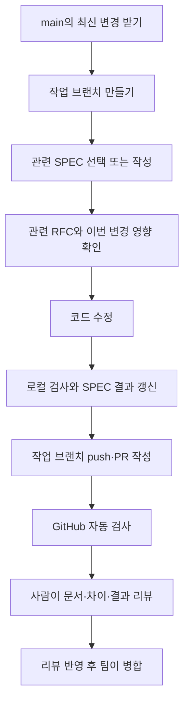

# PR 1·2·3에서 무엇을 했고, 앞으로 어떻게 작업하나요?

작성: 도재겸 · 팀 공유용 초안 v0.2 · 2026-11-12

이 문서는 팀원이 세 PR의 목적과 앞으로의 작업 순서를 이해하기 위한 안내입니다. 설명과 예시는 계속 고쳐도 됩니다. 지켜야 할 규칙의 원문은 RFC이며 이 안내로 규칙을 새로 만들지는 않습니다.

## 먼저 세 줄로 보기

| PR | 도재겸이 한 일 | 팀에 생기는 변화 |
| --- | --- | --- |
| [1 — 프로젝트 안내](https://github.com/SNU-SSC-Lab/circuit-team-05/pull/1) | README에 목표·팀·인터페이스·흐름도를 정리하고 회로 규약 초안을 작성 | 무엇을 만들고 어떤 입출력으로 동작해야 하는지 같은 자료를 보고 대화할 수 있음 |
| [2 — 작업 규칙과 훅](https://github.com/SNU-SSC-Lab/circuit-team-05/pull/2) | RFC와 SPEC 역할을 나누고 기존 모듈을 문서화. AI의 수정 전 확인과 PR·push 검사 추가 | 코드를 바꾸기 전에 관련 계획과 규칙을 확인하도록 도움 |
| [3 — 자동 테스트](https://github.com/SNU-SSC-Lab/circuit-team-05/pull/3) | 독립 정답 모델·RTL 시험·GitHub Actions 추가 | PR의 문서와 기능을 같은 명령으로 반복 검사하고 결과를 함께 리뷰 |

기존 삼진 내적 RTL은 이상원이 설계·구현한 코드입니다. 이번 세 PR은 그 코드를 이해하고 협업·검증할 기반을 추가한 작업입니다. PR 3의 RTL 변경은 파일 끝 개행뿐이며 연산·통신 로직을 다시 설계하지 않았습니다.

세 PR은 **1 → 2 → 3** 순서로 연결돼 있습니다. PR 2는 PR 1 브랜치, PR 3은 PR 2 브랜치를 기준으로 리뷰합니다. 앞 PR이 병합되면 뒤 PR의 기준 브랜치와 필요한 커밋 이력을 정리합니다. 에이전트가 임의로 병합하지 않습니다.

## PR 1: 프로젝트를 처음 보는 사람도 길을 찾게 했습니다

README에는 프로젝트 목표, 담당자, 외부 신호와 로직 블록 흐름을 간결하게 넣었습니다. 최종 목표는 MPW 4차 서비스 제출·제작 후 FPGA와 연결해 동작을 확인하는 것입니다.

상세한 입출력 약속은 [RFC 0001](rfcs/0001-ternary8-interface.md)로 분리했습니다. 예를 들면 입력값의 범위, 가중치 코드, 수신 순서, 12비트 결과, 오류와 리셋 동작입니다. 아직 Draft인 규약은 팀 리뷰로 확정해야 하며, 문서가 있다는 이유만으로 공식 제출 규정 전체를 확인한 것은 아닙니다.

Notion은 프로젝트 진행 상황·회의·활동 기록을 정리하는 공간으로 연결했습니다. 코드와 함께 버전을 맞춰야 할 회로 규약과 구현 계획은 저장소에 둡니다. Notion의 페이지 구성은 팀장이 정리할 항목으로 남아 있습니다.

## PR 2: AI에게 맡겨도 사람이 변경을 이해할 수 있게 했습니다

### RFC·SPEC·PR의 차이

| 문서 | 답하는 질문 | 우리 프로젝트의 예 |
| --- | --- | --- |
| RFC | 반드시 지켜야 할 약속은 무엇인가? | 가중치 `11`은 불법 코드이며 그 항은 0으로 계산하고 오류를 남긴다 |
| SPEC | 이번에 무엇을, 왜, 어떻게 바꾸려는가? | 오류 처리 시험을 어떤 입력으로 추가하고 무엇을 합격으로 볼지 설명한다 |
| PR | 실제로 무엇을 바꿨고 어떤 결과가 나왔는가? | 추가한 시험과 실제 통과·실패 결과를 리뷰에 제시한다 |

SPEC은 **What(무엇), Why(왜), How(어떻게)**로 씁니다. 기존 모듈 열 개의 SPEC은 코드를 읽고 역으로 정리한 문서입니다. 원래 작성자의 모든 의도를 확인했다거나 당시 시험을 완료했다는 뜻은 아닙니다.

설명은 쉬운 한국어와 실제 모듈·신호 이름으로 씁니다. 블록이나 순서가 바뀌면 같은 이름을 쓴 변경 전후 그림과 짧은 코드 차이를 보여줍니다. 사람 리뷰어가 설명을 이해하지 못하면 설명을 고쳐야 합니다.

### 훅은 언제 검사하나요?

훅은 특정 작업 앞뒤에 자동으로 실행하는 작은 검사입니다. 세 장치를 구분하면 이해하기 쉽습니다.

| 장치 | 실행 시점 | 검사하는 것 |
| --- | --- | --- |
| AI 도구의 프로젝트 훅 | 세션 시작·코드 수정 명령 전 | 관련 SPEC·RFC를 확인한 기록과 수정 범위 |
| Git pre-push 훅 | 원격 저장소로 push하기 직전 | 실제 전송 대상에 main 갱신·생성·삭제가 있는지 |
| GitHub Actions | PR 생성·수정·새 커밋 등 | 서버에서 문서와 RTL 기능을 다시 검사 |

AI 도구별 설정을 따로 두되 실제 판정은 같은 Python 검사기를 사용합니다. 확인 기록에는 세션과 문서 버전이 남습니다. 새 세션이거나 문서가 바뀌면 다시 확인합니다. **확인 기록이 있다는 사실이 내용을 이해했다는 증거는 아닙니다.** 기획·규약 변경의 타당성과 설명의 정확성은 사람이 리뷰합니다.

## PR 3: 코드가 약속대로 동작하는지 반복 검사합니다

Python 정답 모델은 가중치와 입력의 내적을 직접 계산합니다. RTL의 상태 머신이나 가중치 이동 회로를 그대로 옮겨 쓰지 않았습니다. 시험기는 실제 4비트 입력을 보내고, 외부 출력 네 조각을 모아 정답과 비교합니다.

GitHub Checks에는 `pr-policy`, 운영체제별 `policy-unit` 두 개, `rtl`이 표시됩니다. `rtl` 안에는 다음 다섯 단계가 있습니다.

| 이름 | 쉽게 말하면 |
| --- | --- |
| `rtl-lint` | 코드를 실행하기 전에 폭·연결·미사용 신호 등 의심되는 부분을 검사 |
| `rtl-unit` | 디코더·가산기·레지스터 등 부품을 따로 시험 |
| `rtl-integration` | top에 입력을 보내 경계값·오류·통신·리셋·연속 작업을 시험 |
| `rtl-regression` | 합법 가중치 6,561종 × 경계 입력 5종과 무작위 10,000작업을 반복 시험 |
| `rtl-coverage` | Verilator에서도 통합·회귀를 실행하고 어떤 RTL 줄 계측 지점에 도달했는지 보고 |

전체 테스트를 PR마다 실행합니다. 앞 검사가 실패해도 가능한 뒤 검사를 계속하며 실패를 숨기지 않습니다. 도구 버전, 검사한 코드·규약 버전, 로그와 JUnit 결과를 보관합니다. 자세한 실행 방법과 실제 결과는 [CI 안내](ci.md), 개별 시나리오는 [시나리오 목록](../verification/scenarios.json)에 있습니다.

### 커버리지와 실제 CI 소요 시간

아래는 [2026-11-12 GitHub 실행](https://github.com/SNU-SSC-Lab/circuit-team-05/actions/runs/43171049859), PR head `8319e9d`의 기록입니다. 문서가 갱신된 뒤의 최신 상태는 PR Checks에서 확인합니다.

| 커버리지 항목 | 측정 결과 | 뜻과 남은 범위 |
| --- | --- | --- |
| RTL 줄 계측 지점 | **96/98, 97.96%** | Verilator가 만든 계측 지점의 도달률. 전체 입력의 검사 비율이 아님 |
| 미도달 지점 | `dot8_controller.v` 110~111행 | 정상 상태 네 값 이외의 `default` 복구 분기. 상태 손상·X/Z 주입은 검사하지 않음 |
| 커버리지 제외 | **없음** | 미도달 두 지점을 분모에서 빼지 않음 |
| 정상 상태·전이 | 상태 **4/4**, 정상 전이 **8/8** | 컨트롤러 단위 시험에서 관찰. 비정상 상태를 포함한 모든 동작의 증명은 아님 |

RTL 단위 시험 9개, 통합 시험 4개와 전체 회귀 2개가 통과했습니다. 회귀는 경계 입력 32,805작업과 무작위 10,000작업, 총 **42,805작업**입니다. 분기·토글·전체 기능 교차 커버리지는 위 줄 커버리지 수치에 포함하지 않습니다. 의도된 상위 비트 미사용 lint 경고 한 건의 제외는 커버리지 제외와 별개입니다.

| 시간 구분 | 실제 소요 시간 |
| --- | ---: |
| **전체 CI 경과 시간** — 실행 생성부터 완료 갱신까지 | **2분 13초** |
| `pr-policy` job | 17초 |
| `policy-unit (ubuntu-24.04)` job | 25초 |
| `policy-unit (windows-2022)` job | 1분 38초 |
| `rtl` job — 환경 준비·다섯 검사·결과 보관 포함 | 2분 2초 |

job은 병렬로 실행하므로 위 시간을 더한 값이 전체 소요 시간은 아닙니다. `rtl` 다섯 검사의 실행 시간은 lint 0.30초, 단위 2.99초, 통합 0.50초, 회귀 50.49초, 커버리지 35.72초로 합계 약 **90초**였습니다. 이 합계에는 시뮬레이터가 시험용 회로를 빌드하는 시간이 포함되고, 도구 설치·다운로드와 결과 업로드는 포함되지 않습니다.

이는 Verilator 도구 캐시를 재사용한 1회 실행입니다. [최초 실행](https://github.com/SNU-SSC-Lab/circuit-team-05/actions/runs/43169698622)에서는 도구 설치·빌드 단계만 7분 6초가 걸렸습니다. 캐시 유무와 runner 상태에 따라 시간은 달라질 수 있습니다.

모든 입력을 검사했거나 제작된 칩이 안전하다는 뜻은 아닙니다. ASIC 합성·P&R·STA·DRC/LVS와 실물 시험은 별도로 해야 합니다.

## 팀원은 앞으로 이렇게 작업하면 됩니다

아래는 세 PR을 순서대로 병합한 뒤의 작업 흐름입니다. 병합 전에는 해당 기능이 있는 작업 브랜치에서만 사용할 수 있습니다.



### 처음 한 번 해야 할 일

**1. 저장소 루트에서 Git 훅을 설치하고 적용 경로를 확인합니다.** Python 3.10 이상과 Git이 필요합니다. Windows에서는 Git for Windows의 Git Bash도 설치돼 있어야 합니다.

```text
git rev-parse --show-toplevel
python --version
python scripts/install_hooks.py
git config --show-origin --get core.hooksPath
```

마지막 출력의 적용 경로가 `.githooks`인지 확인합니다. 설치기는 이 저장소 설정만 변경합니다. 다른 훅 경로가 이미 있으면 덮어쓰지 않고 알리므로 기존 설정과 함께 구성해야 합니다. 새 clone·다른 컴퓨터에서는 다시 확인합니다.

**2. AI 도구에서 프로젝트 훅의 등록·신뢰 상태를 확인합니다.** Git 훅 설치와 별도 절차입니다. 저장소 루트를 프로젝트로 열고 다음을 확인합니다.

| 도구 | 확인 절차 | 확인할 등록 내용 |
| --- | --- | --- |
| Claude Code | 프로젝트 신뢰 안내를 확인하고 `/hooks`를 열어 프로젝트 설정을 조회 | 출처 `.claude/settings.json`, `SessionStart`·`PreToolUse`, `scripts/policy.py hook --agent claude` 명령 |
| Codex CLI | 프로젝트를 신뢰한 뒤 `/hooks`에서 새로 발견되거나 변경된 훅을 검토·신뢰 | 출처 `.codex/hooks.json`, 같은 두 이벤트, `scripts/policy.py hook --agent codex` 명령 |
| Codex 앱 | 프로젝트를 연 뒤 `Review hooks` 또는 `Settings > Hooks`에서 검토·신뢰 | 이 저장소의 `.codex/hooks.json`과 두 이벤트가 표시되는지 확인 |

Claude Code의 `/hooks`는 등록 내용을 보는 화면입니다. Codex는 프로젝트 신뢰와 개별 훅 신뢰를 모두 확인해야 하며, 미승인·변경된 훅은 실행되지 않을 수 있습니다. 훅 파일을 받은 사실만으로 승인·실행을 완료했다고 판단하지 않습니다. 설정 변경 후에는 새 세션을 시작해 다시 확인합니다. [공식 OpenAI 문서](https://learn.chatgpt.com/docs/hooks), [Claude Code 문서](https://code.claude.com/docs/en/hooks)

**3. 실제 차단과 허용을 확인합니다.** 새 세션의 시작 안내에 SPEC·RFC 확인 방법과 세션 ID가 나오는지 확인합니다. 이어서 [설치 확인용 임시 파일 시험](hooks.md#실제-ai-세션에서-차단허용-확인)에 따라 SPEC 확인 전 편집 차단 → 확인 후 편집 허용 → 임시 파일 삭제를 점검합니다. 실제 RTL을 시험 삼아 고치거나 원격 main에 push하지 않습니다.

설치 경로 확인, 도구별 훅 목록·승인 확인, 실제 편집 차단·허용 확인을 모두 마친 뒤 적용 완료로 기록합니다. 실행하지 않은 단계는 미확인으로 남깁니다.

### 브랜치 보호를 따로 설정하지 않는 이유

팀은 핫픽스 대응 여지를 두기 위해 GitHub의 branch protection과 필수 Checks를 별도로 설정하지 않기로 했습니다. CI는 실행하고 결과를 공유하지만 서버 설정으로 병합을 강제 차단하지 않습니다. 긴급 대응 시점과 병합 여부는 팀이 판단합니다.

기존 Git pre-push의 main 직접 push 차단과 평상시 작업 브랜치·PR 흐름은 유지합니다. 서버의 브랜치 보호 설정과 로컬 훅 설치는 다른 항목입니다.

### AI에게 작업을 맡길 때

바꿀 동작과 관련 SPEC을 알려주고, 코드를 수정하기 전에 RFC와 영향을 확인하게 합니다. 새 기능이면 먼저 SPEC을 작성합니다. 기존 규약을 유지하는 버그 수정은 관련 SPEC을 사용할 수 있으며 매번 새 파일이 필요한 것은 아닙니다.

에이전트는 시작 훅이 알려 준 세션 ID로 다음 형식의 확인 명령을 사용합니다. SPEC 경로와 설명은 실제 작업에 맞게 바꿉니다.

```text
python scripts/policy.py review --session 세션ID --spec docs/specs/해당문서.md --summary "이번 변경이 어떤 규칙에 영향을 주는지"
```

PR은 What·Why·How로 작성하고 관련 SPEC, 실제 검사 결과, 흐름 변경 여부를 적습니다. `흐름 변경: 있음`이면 전후 그림과 핵심 코드 차이가 필요합니다. `없음`이면 그림을 생략한 이유를 적습니다. 팀장과 관련 담당자에게 리뷰를 요청합니다.

### 요구사항을 바꾸고 싶을 때

예를 들어 앞으로 내적의 항 수를 바꾸기로 합의한다면, 회로 규약인 RFC와 변경 계획인 SPEC, 정답 모델·기대 결과·테스트·RTL을 함께 검토합니다. RFC와 정답을 함께 바꾸는 PR은 팀장이 변경 이유와 기대 결과를 확인하고 승인한 뒤 병합합니다. 테스트가 통과했다는 이유만으로 새 규약이 승인되는 것은 아닙니다.

## 훅이 빠지지 않으려면 무엇을 확인해야 하나요?

- **clone만 하면 다 켜지나요?** 아닙니다. Git 훅 설치와 AI 도구의 프로젝트 훅 승인 여부를 각각 확인해야 합니다.
- **에러가 나면 훅을 꺼도 되나요?** 끄거나 `--no-verify`로 우회하지 않습니다. 메시지에 나온 SPEC 범위·문서 버전·설정을 확인하고 고칩니다.
- **RFC 해시만 새 값으로 바꾸면 되나요?** 관련 규약과 SPEC 설명을 먼저 검토해야 합니다. 해시 갱신은 확인한 버전을 남기는 절차입니다.
- **GitHub가 main 직접 push를 완전히 막나요?** 브랜치 보호를 별도로 설정하지 않으므로 서버에서의 강제 차단은 두지 않습니다. 설치된 로컬 Git 훅은 main 직접 push를 막습니다. 각 팀원의 설치 여부를 확인해야 합니다.
- **초록색 Checks면 바로 병합해도 되나요?** 사람 리뷰가 필요합니다. 자동 검사는 문장의 이해도, 기획의 타당성, 그림과 코드의 의미까지 대신 판단하지 않습니다.

문제가 나면 관련 SPEC·RFC, 실패 메시지와 작업 브랜치를 함께 공유해 원인을 확인합니다. 도구가 지원하지 않는 경로나 직접 편집까지 훅이 모두 막는 것은 아니므로 설치 확인과 사람 리뷰가 함께 필요합니다.

## 다음에 수정할 부분

이 안내는 도재겸이 팀 피드백을 받아 계속 수정할 초안입니다. 특히 처음 설치하다 막힌 단계, 이해하기 어려운 문장, 실제 작업과 다른 예시는 알려 주세요. 규칙 자체를 바꾸는 내용은 [RFC 0002](rfcs/0002-collaboration.md)에서 함께 검토합니다. P&R 후속 검증은 [별도 방법론 초안](verification/pnr-methodology.md)으로 이어집니다.
