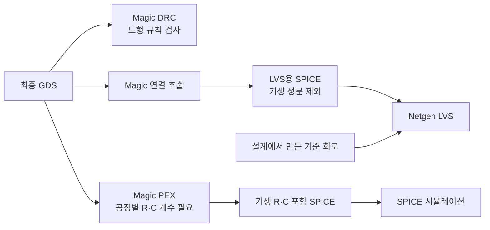

# Magic·Netgen 사용서: 설치부터 DRC·LVS·PEX까지

Circuit Team 05 / 도재겸 / 2026-11-24 / v0.2

대상: RTL은 읽어 봤지만 물리 검증 도구는 처음 쓰는 팀원. 배성준님과 PEX 설정을 함께 확인할 때도 이 문서를 기준으로 삼는다. 수정 원본은 이 Markdown이며 PDF는 공유용이다.

**전체 흐름 구현 추가:** 새 ASIC 흐름이 RTL에서 직접 NSPL 코어·제안 SOP28 GDS를 만들고 검사한다. [전체 흐름 안내](rtl-to-gds-guide.md)와 [SPEC 0017](../specs/0017-rtl-to-gds.md)을 먼저 읽는다. Qflow 예제와 비교해 OpenROAD를 구현 경로로 선택했으며 실제 코어는 KLayout 추출·Netgen으로 LVS를 검사한다. 이 문서는 현재 구현된 Magic·Netgen 단독 검사와 PEX 학습 방법을 설명한다. 공개 ETRI 설정의 존재와 현재 NSPL 키트에서의 검증 완료는 다르다.

## 1. 지금 할 수 있는 일과 아직 못 하는 일

**이 문서의 `Physical checks`는 도구 연습용이다. 실제 코어 LVS는 새 ASIC 흐름에서 검사하며, 전체 공정 DRC·GPIO LVS·정밀 RC는 미완료다.**

2026-11-24 현재 저장소에는 RTL, 합성·타이밍 검사 코드가 있다. `mychip/`에는 실제 GDS와 기준 트랜지스터 회로가 없다. 사용자가 별도 Magic 기술파일·Netgen 설정도 없다고 확인했다. 따라서 이번 GitHub 검사는 작은 연습 회로를 만들어 도구와 실패 판정이 작동하는지 확인한다.

| 구분 | 이번에 제공하는 것 | 결과의 뜻 |
| --- | --- | --- |
| PR 자동 검사 | `Physical checks / physical-selftest` | scmos 연습 회로로 도구·판정 시험 |
| 실제 회로 실행 | `run_physical.py check` | 명시한 GDS·공정 설정·기준 회로를 비교하는 로컬 명령 |
| 실제 5팀 코어 | 별도 `ASIC gate`(이전 `ASIC RTL to GDS`)에서 GDS 추출·코어 LVS·배선 규칙 일부 검사 | 이 연습 workflow와 구분. 전체 칩 공정 검증은 미완료 |
| PEX | 개념·명령·준비 자료·확인 방법 설명 | NSPL 공정의 R·C 정확도와 실행 결과는 미확인 |
| 제작 제출용 사인오프 | 기존 절차 유지 | 제출처가 인정하는 도구·공정 규칙으로 별도 확인 |

기존 `MyChip PDK`는 Yosys 합성, 게이트 수준 시험, OpenSTA 타이밍, 이미 만든 사인오프 리포트 읽기를 담당한다. 새 검사는 별도 workflow다. Magic 결과를 Calibre/Assura 리포트인 것처럼 바꾸거나 기존 리포트 폴더에 복사하지 않는다.

공유된 김태완 「My Chip 설계 실습 안내서」(2026-10-18) 8쪽은 최종 DRC/LVS/PEX에 공고의 검증된 Assura 또는 Calibre deck을 사용하고, 다른 도구는 해당 공정 지원이 확인된 경우에만 쓰라고 설명한다. Magic·Netgen의 설치 성공만으로 이 조건을 충족했다고 볼 수 없다.

## 2. DRC·LVS·PEX는 서로 무엇이 다른가

| 검사 | 묻는 질문 | 입력 → 출력 | 예 |
| --- | --- | --- | --- |
| DRC | 도형이 공정 규칙을 지키나? | 레이아웃 + 폭·간격 등의 규칙 → 오류 위치 | 금속 폭이 너무 좁음, via 둘레 금속이 부족함 |
| LVS | 실제 연결이 의도한 회로와 같은가? | 레이아웃에서 추출한 회로 + 기준 회로 → 비교 결과 | OUT이 옆 신호와 붙음, 전원 핀 누락 |
| PEX | 배선·접합의 기생 R·C는 얼마인가? | 레이아웃 + 공정별 추출 계수 → 기생 성분이 포함된 회로 | 긴 배선의 저항, 두 배선 사이 커패시턴스 |
| STA | 그 지연을 포함해 클록을 지키나? | 셀 지연·배선 기생 성분·SDC → setup·hold 여유 | 100 ns 안에 다음 레지스터에 도착하는가 |

DRC가 깨끗해도 두 신호가 잘못 연결될 수 있다. LVS가 맞아도 배선이 길어 느릴 수 있다. PEX는 R·C를 **추출하는 단계**이며 그 자체가 타이밍 합격 판정은 아니다.

Magic은 레이아웃 편집, DRC, 연결 추출, C 추출과 `extresist`를 이용한 R 추출을 지원한다. Netgen은 두 회로의 연결·소자 속성을 비교하는 LVS 도구다. 따라서 “Magic+Netgen에는 PEX가 없다”는 표현은 부정확하다. **우리 NSPL 공정에 맞는 추출 설정과 검증 결과가 아직 없다**고 말하는 것이 맞다. 명령별 범위는 [Magic extresist](https://www.opencircuitdesign.com/magic/commandref/extresist.html)와 [Netgen reference](https://opencircuitdesign.com/netgen/reference.html)를 참고한다.



## 3. 설치: Windows에서는 Ubuntu/WSL 안에서 실행

아래 `bash` 명령은 Ubuntu 터미널에서 실행한다. PowerShell에 그대로 붙여 넣지 않는다. WSL이 이미 있으면 새로 설치할 필요가 없다. 이 작업 환경에는 Ubuntu가 이미 있다.

```bash
sudo apt-get update
sudo apt-get install -y --no-install-recommends magic netgen-lvs
python3 --version
magic --version
netgen-lvs -batch
```

Python은 TOML을 읽기 위해 **3.11 이상**이어야 한다. Ubuntu 24.04의 Python 3.12로 실행할 수 있다. 이번 도구에는 추가 pip 패키지가 필요 없다. GUI는 WSLg 또는 별도 그래픽 화면 지원이 필요하지만, CI와 아래 자동 명령은 화면 없이 실행한다.

설치할 패키지 이름은 **`netgen-lvs`**다. 같은 이름을 쓰는 격자 생성 프로그램과 혼동하지 않는다. 회로용 도구는 실행 결과에 `Netgen 1.5...`가 나온다. 직접 소스로 설치한 환경은 명령 이름이 `netgen`일 수 있다. 실행기는 `netgen-lvs`를 먼저 찾고, 없으면 `netgen`을 찾는다.

```bash
command -v magic
command -v netgen-lvs || command -v netgen
dpkg-query -W magic netgen-lvs
```

두 버전이 같이 설치돼 있으면 사용할 실행 파일을 직접 지정한다. 아래 값은 실제 파일 위치로 바꾼다. 버전이 바뀌면 자체 시험을 다시 돌린다.

```bash
export SSC_MAGIC=/usr/local/bin/magic
export SSC_NETGEN=/usr/local/bin/netgen
```

Ubuntu 패키지는 최신 PEX 명령과 차이가 있을 수 있다. 이 문서의 기본 DRC·LVS 실행과 PEX 명령의 버전 조건을 구분한다. 최신판이 필요하면 [Magic 소스·빌드 안내](https://github.com/RTimothyEdwards/magic)와 [Netgen 소스·빌드 안내](https://github.com/RTimothyEdwards/netgen)를 따른다. 팀 도구 버전을 바꾸는 작업은 별도 SPEC·PR로 남긴다.

## 4. 첫 연습: 파일을 준비하지 않고 바로 실행

Windows의 기존 저장소는 WSL에서 아래 경로로 보인다. 저장소가 다른 곳에 있으면 첫 줄만 바꾼다. 인터넷에서 GDS나 PDK를 내려받지 않고, 실행기가 작은 연습용 NMOS 회로를 만든다.

```bash
cd /mnt/c/Users/jgqet/asset/univ/SemiConductor/circuit-team-05
python3 -m unittest discover -s tests/physical -v
python3 scripts/run_physical.py selftest \
  --out /var/tmp/physical-practice-01
```

정상 실행이면 아래 6개 자체 시험이 모두 통과한다. `lvs-mismatch`의 통과는 틀린 회로를 정확히 **실패로 판정했다**는 뜻이다.

| 자체 시험 | 일부러 만든 조건 | 예상 도구 결과 |
| --- | --- | --- |
| `clean` | 정상 NMOS, 맞는 기준 회로 | DRC 0, LVS 일치 |
| `lvs-mismatch` | 기준 회로의 게이트 연결 변경 | DRC 0, LVS 불일치 |
| `lvs-property` | 기준 NMOS 폭 8 µm → 7 µm | DRC 0, LVS 속성 불일치 |
| `gds-missing-ports` | 연습 공정의 일반 GDS 변환으로 핀 정보가 사라진 회로 | DRC 0, LVS 실패 |
| `hierarchy-drc` | 하위 셀에 폭 1 lambda의 가는 금속 | 하위 셀의 DRC 오류 검출 |
| `missing-top` | 존재하지 않는 top 선택 | 입력/로딩 실패, LVS 미실행 |

이 연습은 실제 트랜지스터 모델의 전류를 시뮬레이션하지 않는다. 내장 `scmos` 공정의 도형·연결을 사용하며 4차 NSPL PDK가 아니다. 5팀의 면적·타이밍·공정 적합성도 이 결과로 알 수 없다.

다시 실행할 때는 `physical-practice-02`처럼 **새 결과 폴더**를 쓴다. 실행기는 이전 성공 파일을 잘못 읽지 않도록 비어 있지 않은 폴더를 거부하며 파일을 지우지 않는다.

```bash
python3 scripts/run_physical.py report \
  --result /var/tmp/physical-practice-01/result.json
cat /var/tmp/physical-practice-01/clean/layout.spice
cat /var/tmp/physical-practice-01/hierarchy-drc/drc-detail.txt
cat /var/tmp/physical-practice-01/lvs-property/lvs.log
```

`clean/layout.spice`에는 NMOS 한 개가 있어야 한다. 정상 기준은 S·D·G 핀과 Gnd 벌크, W=8 µm·L=2 µm다. 소스·드레인의 순서는 비교 규칙에서 교환될 수 있지만 게이트와 벌크를 마음대로 바꾸어 맞추면 안 된다.

## 5. 실제 5팀 회로에 필요한 자료

아래 다섯 파일과, 그 파일이 다시 읽는 하위 파일을 확보한다. 파일 이름은 예시이며 실제 이름은 실행 명세에서 지정한다.

| 자료 | 받을 대상·확인 내용 | 없을 때 생기는 문제 |
| --- | --- | --- |
| 최종 `.gds` | 배치배선 담당자. top·pad 포함 범위·단위·출력 버전 | 검사할 도형이 없음 |
| 기준 `.spice` / `.cdl` | 설계 담당자·PDK 담당자. top과 모든 표준셀의 트랜지스터 회로, 전원 핀 | 무엇과 비교해야 할지 모름 |
| Magic `.tech` | 해당 공정 지원 담당자. GDS 레이어 매핑·DRC·추출 소자·공정 계수 | 다른 공정의 규칙으로 검사할 수 있음 |
| Magic `.magicrc` | 같은 공정 설정 배포자. 기술파일·검색 경로·단위·스타일 | 잘못된 기본 공정이나 잘못된 셀을 읽음 |
| Netgen `setup.tcl` | 해당 공정 LVS 설정 배포자. 소자 모델명·핀 순서·속성 비교 규칙 | 같은 회로가 다르게 읽히거나 오류가 가려짐 |

`mychip/2-pnr/<top>.v`는 기존 타이밍·게이트 시험을 위한 전원 핀 없는 Verilog다. 이를 그대로 트랜지스터 SPICE 기준으로 쓰지 않는다. 별도의 전원 핀 포함 회로와 표준셀 CDL을 준비해 명시적으로 연결해야 한다. Netgen 자체는 구조적 Verilog도 지원하지만, 이번 실행기는 완전한 SPICE/CDL 입력을 요구한다.

기준 회로는 **설계 쪽에서 독립적으로** 만든다. Magic이 추출한 파일을 양쪽에 넣으면 같은 잘못된 회로끼리 맞는다고 나올 수 있다. 셀 내부가 비어 있는 blackbox를 허용해 얻은 일치를 트랜지스터 수준 LVS로 해석하지 않는다. 이번 실행기는 그런 경고를 실패로 처리한다.

현재 합성 CI가 받는 Liberty에는 셀 지연·논리 기능이 있다. Liberty 하나로 Magic DRC 규칙이나 정확한 PEX 계수를 만들 수는 없다. 공개 [GoodKook ETRI050 자료](https://github.com/GoodKook/ETRI-0.5um-CMOS-MPW-Std-Cell-DK/tree/11f1218feaa245fa7fb7c8dafa440e54543c63b4/tech)에도 Magic 기술파일이 있으나 **현 NSPL_05CMOS_PDK_260820과의 호환성·제출 인정 여부는 미확인**이다. 파일 이름의 ETRI 표기만 보고 선택하지 않는다.

## 6. 실행 명세 만들기: 입력과 해시를 함께 고정

실제 GDS와 공정 설정은 Git 저장소 밖 작업 폴더에 둔다. 저장소의 `verification/physical/example.toml`을 그 폴더에 복사하고 빈 값을 채운다. 빈 예시는 실행하면 실패하는 것이 정상이다.

```bash
mkdir -p ~/ssc-physical/team05/rev01
cp verification/physical/example.toml ~/ssc-physical/team05/rev01/run.toml
cd ~/ssc-physical/team05/rev01
sha256sum chip.gds reference.cdl kit.magicrc process.tech setup.tcl
```

`run.toml`은 실행할 파일 목록이다. 다음 예시의 꺾쇠 괄호는 실제 경로·기술 이름·해시로 바꾼다. 해시는 “이 파일을 사용했다”는 식별값이며 파일의 기술적 정확성을 증명하지 않는다.

```toml
[design]
top = "v_ternary8_top"
technology_name = "<Magic tech name 결과>"
drc_style = ""
gds_input_style = ""
timeout_seconds = 300

[files]
layout = "chip.gds"
schematic = "reference.cdl"
magicrc = "kit.magicrc"
technology = "process.tech"
netgen_setup = "setup.tcl"

[sha256]
layout = "<소문자 SHA-256 64자>"
schematic = "<소문자 SHA-256 64자>"
magicrc = "<소문자 SHA-256 64자>"
technology = "<소문자 SHA-256 64자>"
netgen_setup = "<소문자 SHA-256 64자>"
```

경로는 **명세 파일이 있는 폴더**를 기준으로 읽는다. 절대 경로도 가능하다. SPICE의 `.include`나 Tcl의 `source`는 각 도구의 경로 처리도 따르므로 절대 경로 또는 설정에서 확인한 검색 경로를 쓰는 편이 명확하다. 실행기의 작업 폴더는 입력 폴더가 아닌 결과 폴더다.

기술파일이 다른 `.tech`를 포함하거나 시작 Tcl이 다른 파일을 읽으면 그 파일도 나열한다. 셀 CDL·하위 `.mag`·모델·레이어 매핑 파일 역시 대상이다. 모든 파일을 자동으로 찾는 기능은 없다. 빠진 의존 파일은 실행 결과의 재현성을 떨어뜨린다.

```toml
[[dependencies]]
path = "cells.cdl"
sha256 = "<이 파일의 SHA-256 64자>"
```

`technology_name`은 경로가 아닌 Magic의 `tech name` 출력이다. `.magicrc`가 실제로 로드하는 `.tech`와 `files.technology`가 같아야 한다. 스타일을 비워 두면 키트 기본값을 사용하고 실제 값을 기록한다. 이 선택이 맞는지는 공정 설정을 아는 사람이 확인한다.

## 7. 실제 검사 실행과 결과 읽기

저장소 폴더로 돌아와 실행한다. 입력이 준비되기 전에는 이 절차로 5팀 결과를 만들 수 없다.

```bash
cd /mnt/c/Users/jgqet/asset/univ/SemiConductor/circuit-team-05
python3 scripts/run_physical.py check \
  --manifest ~/ssc-physical/team05/rev01/run.toml \
  --out /var/tmp/team05-physical-rev01
echo $?
```

종료 값 0은 지정한 입력에서 DRC 0과 LVS 일치를 모두 확인했다는 뜻이다. 1은 DRC·LVS 실패 또는 실행 준비 오류다. “명령이 끝났다”와 “회로가 맞다”를 구분한다. Netgen 원래 명령의 종료 값만으로 판정하지 않으며 보고서와 비교 JSON도 읽는다.

```text
team05-physical-rev01/
  result.json           입력 경로·해시·버전·소요 시간·최종 판정
  magic-version.txt     Magic 버전
  netgen-version.txt    회로용 Netgen 버전
  magic-meta.txt        실제 기술파일·스타일·top 전체 경계
  magic.log             GDS 읽기·DRC·추출 과정
  drc-count.txt         전체 계층 DRC 오류 타일 수
  drc-detail.txt        셀별 오류 수, 현재 top 영역의 원인·좌표
  layout.spice          LVS용 추출 회로
  netgen.log            Netgen 실행 메시지·입력 경고
  lvs.log               소자·net·핀·속성 비교 결과
  lvs.json              기계가 읽는 비교 결과
```

오류 타일 수는 “서로 다른 규칙 개수”나 “독립적인 결함 개수”가 아니다. 하나의 긴 위반이 여러 타일로 세어질 수 있다. 하위 셀 오류는 `drc-detail.txt`의 셀별 수를 보고 그 셀을 직접 열어 위치를 찾는다.

입력이 없으면 `drc`·`lvs`는 `not_run`이다. DRC를 끝낸 뒤 LVS가 실패하면 DRC 값은 남는다. 타임아웃·JSON 누락·빈 추출 회로도 통과시키지 않는다. 실행 전 입력 해시, 로드 후 실제 기술파일, 실행 후 주요 입력 변경 여부를 확인한다. 별도 의존 파일은 실행 전 해시를 확인한다.

자동 검사는 사용자가 준 Tcl의 의미, 모든 공정 규칙의 구현 여부, 공정 계수의 정확도를 증명하지 않는다. 미지원 GDS 레이어 경고와 비정상 소자 수를 사람이 함께 읽어야 한다. 해시가 같아도 잘못된 기준 회로면 결과 역시 잘못 해석할 수 있다.

## 8. Magic 화면에서 DRC 오류 찾기

아래는 실제 공정 설정을 받은 뒤 사용하는 예다. `-T`는 정확한 기술파일, `-rcfile`은 해당 공정 시작 설정이다. GDS를 불러올 때 이미 열려 있는 다른 버전의 셀과 섞지 않도록 새 Magic 프로세스로 시작한다.

```bash
magic -T /path/process.tech -rcfile /path/kit.magicrc
```

Magic 콘솔에서 실행한다. `<실제파일>` 표기는 실제 값으로 바꾼다. `gds read` 뒤 실제 cell 목록을 확인하고 top을 선택한다.

```tcl
tech name
tech filename
gds read /path/chip.gds
cellname list allcells
load v_ternary8_top
select top cell
expand
box select
drc ignore none
drc on
drc check
drc catchup
drc listall count
drc listall count total
```

`drc check`는 선택 상자 안을 다시 검사하고 `drc catchup`은 검사가 끝날 때까지 기다린다. 현재 화면 일부만 검사하지 않도록 `select top cell`과 `box select`를 먼저 실행한다. 계층 전체 수는 `drc listall count total`로 확인한다. [Magic DRC 명령 설명](https://www.opencircuitdesign.com/magic/commandref/drc.html)

현재 셀의 오류를 찾고 이유를 읽는다. 하위 셀에 오류가 있으면 해당 셀을 열고 같은 절차를 반복한다. `drc find 1`은 현재 셀의 첫 오류를 찾는 명령이며 chip 전체에서 첫 오류라는 뜻은 아니다.

```tcl
drc find 1
drc why
drc listall why
```

수정 후에는 **새 GDS를 다시 생성해 검사**한다. Magic 메모리에서 임시로 고친 결과만 남기면 원래 P&R 데이터와 제출 GDS가 달라진다. 바뀐 레이아웃·기준 회로·실행 명세·결과가 같은 버전인지 리뷰한다. 오류가 많다고 `drc off`, `drc ignore`, 작은 halo로 숨겨 통과시키지 않는다.

## 9. LVS를 수동으로 실행하고 원인 좁히기

Magic 연결 추출은 도형을 소자·net으로 바꾸는 일이다. LVS용 출력은 작은 기생 R·C 때문에 의도한 회로와 불일치하지 않도록 `ext2spice lvs` 설정을 쓴다. 이 파일로 PEX 시뮬레이션을 했다고 기록하면 안 된다.

```tcl
extract path .
extract all
ext2spice lvs
ext2spice subcircuit top on
ext2spice -o layout.spice
```

추출 결과에서 `.subckt v_ternary8_top ...`와 실제 소자를 확인한다. `.subckt` 이름만 있고 안이 비어 있으면 정상 결과가 아니다. GDS에는 도형 외에도 핀 이름·label 레이어가 필요하다. 핀이 없을 때 이름을 억지로 맞추기 전에 GDS 출력 설정과 레이어 매핑을 확인한다. [Magic ext2spice 설명](https://www.opencircuitdesign.com/magic/commandref/ext2spice.html)

Ubuntu 셸에서 Netgen을 실행한다. 큰따옴표 안의 **파일명과 top 이름이 하나의 인수**다. 둘을 떼면 엉뚱한 셀을 비교할 수 있다.

```bash
netgen-lvs -batch lvs \
  "/path/layout.spice v_ternary8_top" \
  "/path/reference.cdl v_ternary8_top" \
  /path/setup.tcl /path/lvs.log -json
```

수동 실행은 `lvs.log`의 **마지막 최종 결과**를 읽는다. 중간 하위 셀 하나가 맞았다는 줄만 보고 전체 통과로 판단하지 않는다. `Circuits match uniquely`와 별개로 소자 속성 오류, top 핀 불일치, undefined/blackbox 경고가 있는지도 본다. 위 자동 실행기는 이 조건과 JSON을 함께 확인한다. [Netgen 비교 명령](https://opencircuitdesign.com/netgen/reference.html)

| 증상 | 먼저 볼 곳 | 해결 방향 |
| --- | --- | --- |
| top이 없음 | GDS cell 목록, 기준 `.subckt` | 대소문자·이름·pad 포함 범위 일치 |
| 소자가 0개 | `.tech` 추출 부분, GDS active/poly 레이어 | 맞는 기술파일·레이어·단위로 다시 추출 |
| 셀 내부가 undefined | 기준 CDL의 `.include`, 파일 검색 경로 | 해당 표준셀의 완전한 회로 포함 |
| 대부분의 전원 net이 다름 | VDD/VSS/GND 이름, 벌크 핀 | 실제 결선·global net·pin 선언 확인 |
| 소자 수는 같고 net 수가 다름 | `lvs.log`의 bad nets | 단락·단선, via 누락, 잘못된 label 확인 |
| W/L만 다름 | 레이아웃 단위·`.scale`, 모델 속성 | µm·m 배율과 공정 convention 확인 |
| pin matching 실패 | GDS label과 port, 기준 핀 순서 | 핀 누락·다른 이름·전원 포트부터 확인 |
| 속성 오류만 남음 | `properties`, 비교 setup | 실제 크기 오류인지, 비교에서 제외해도 되는 속성인지 검토 |

예제 setup은 연습용 `nfet`의 접합 면적·둘레 `ad/pd/as/ps`를 비교에서 뺀다. 이것을 그대로 실제 공정 설정으로 복사하지 않는다. W/L이나 중요한 소자 속성을 제거해 결과만 맞추면 LVS의 의미를 잃는다. 필요한 pin permutation·model mapping은 공정 담당자와 근거를 확인한다.

## 10. PEX: 먼저 C, 그다음 분포 R·C

**아래는 공정 설정을 검토할 때 사용할 명령 골격이다. NSPL 회로에서 실행·정확도 검증을 완료한 절차가 아니다.** Magic이 읽는 `.tech`에 레이어별 저항·면적/둘레/결합 커패시턴스 등 필요한 계수가 있어야 한다. 계수가 없거나 다른 공정 값이면 명령이 성공해도 신뢰할 수 없다.

LVS용 파일과 PEX용 파일은 결과 폴더를 분리한다. LVS 일치를 먼저 확보하고, 소자·연결은 유지한 채 기생 성분을 추가하는 것이 시작점이다. `layout.spice`를 덮어쓰지 않는다.

### 10.1 C 추출 골격

같은 최종 레이아웃을 새 Magic 프로세스에 로드하고 결과 폴더를 작업 위치로 삼는다. 경로·기술 설정·top 선택은 앞 절과 같다.

```tcl
extract path .
extract all
ext2spice default
ext2spice format ngspice
ext2spice scale off
ext2spice subcircuit top on
ext2spice cthresh 0
ext2spice rthresh infinite
ext2spice extresist off
ext2spice -o top-c-only.spice
```

`cthresh`의 단위는 fF다. 0은 작은 C도 출력하도록 요청한다. `rthresh infinite`는 여기서 lumped R 출력을 막는 설정이다. C가 0개라면 “기생 C가 없다”고 결론내리지 말고 추출 스타일·계수·대상 레이어와 로그부터 확인한다.

### 10.2 배선의 분포 R까지 추출하는 골격

Magic 8.3.597 이전은 `extresist` 앞에 `ext2sim` 파일이 필요하다. 아래는 그 호환 절차를 포함한 형태다. 사용 중인 버전의 도움말에서 지원 명령을 확인한다. 새 버전의 `extract do resistance` 방식과 동시에 섞어 두 번 실행할 필요는 없다.

```tcl
extract path .
extract all
ext2sim labels on
ext2sim
extresist all
ext2spice default
ext2spice format ngspice
ext2spice scale off
ext2spice subcircuit top on
ext2spice cthresh 0
ext2spice extresist on
ext2spice -o top-rc.spice
```

핵심은 **`extresist`로 R망을 만들고 `ext2spice extresist on`으로 그 결과를 포함하는 두 단계**다. `ext2spice rthresh 0`만 넣어서 분포 배선 저항을 추출했다고 판단하지 않는다. 생성되는 `.res.ext`와 SPICE의 실제 R 소자를 함께 본다. 계층·평탄화와 threshold 선택도 사용하는 공정 설정에 맞춰야 한다. [Magic extresist의 절차와 버전 차이](https://www.opencircuitdesign.com/magic/commandref/extresist.html)

R·C를 모두 보려고 무조건 threshold를 0으로 내리면 파일과 시간이 커질 수 있다. 먼저 작은 셀 하나로 단위·연결·값을 확인하고 전체 회로로 넓힌다. 이 문서의 CI에는 실제 공정 PEX 합격 기준이 없다.

```text
LVS용 연결:   driver ---------------- receiver

PEX 후 예:    driver --- R1 --- node1 --- R2 --- receiver
                                 |                  |
                                C1                 C2
                                 |                  |
                                GND                GND
```

실제 추출 결과에는 접지 C뿐 아니라 다른 net과의 결합 C도 있을 수 있다. 그림은 개념도이며 실제 네트워크 구조나 정확도를 보장하지 않는다.

## 11. PEX 결과를 어떻게 확인하고 사용할까

파일에 R·C 줄이 있다는 것만으로 정확도를 판단하지 않는다. 최소한 다음 순서로 작은 회로를 확인한다.

1. 같은 레이아웃의 LVS 통과 결과와 해시를 고정한다. 추출 스타일·Magic 버전·계수 출처도 남긴다.
2. 회로의 도형·W/L·핀 이름·벌크·전원과 기생 성분의 단위가 맞는지 확인한다.
3. 단순한 배선에서 저항의 근사식 `R = Rsheet × 길이/폭`으로 손계산해 자릿수를 비교한다. via/contact 저항은 이 식에 포함되지 않는다.
4. C도 지원되는 면적·둘레·결합 계수로 대략적인 자릿수를 확인한다. 서로 다른 계수를 한 값으로 뭉개지 않는다.
5. 가능하면 배포자가 검증한 예제나 공식 추출 결과와 비교한다. 일치해야 할 항목과 허용 오차는 사람끼리 정한다. 현재 합의된 수치는 없다.
6. 같은 입력·부하·전압·온도에서 추출 전후 SPICE 파형을 비교한다. 출력 기능, 전파 지연, slew, 필요하면 전력·글리치도 본다.

디지털 회로 전체의 트랜지스터 SPICE는 RTL보다 훨씬 무겁다. 작은 대표 경로·셀부터 확인한다. MOS 소자 시뮬레이션에는 공정의 모델 파일과 모델 선택이 추가로 필요하다. Netgen LVS에 사용한 setup Tcl은 MOS 전류 모델을 대신하지 않는다.

아래는 ngspice testbench의 **형태 예시**다. 전압·시간·모델·핀을 실제 회로에 맞추기 전에는 실행 가능한 5팀 시험이 아니다.

```spice
* Example skeleton only: fill from the actual process and extracted ports.
.include "approved-transistor-models.spice"
.include "top-rc.spice"
* VDD source / clock / reset / IN / IN_VALID / loads
* Xdut <ports in extracted .subckt order> v_ternary8_top
* .tran <time step> <stop time>
.end
```

Magic의 PEX SPICE는 이 저장소의 OpenSTA가 읽는 **SPEF와 형식이 다르다**. 파일 확장자를 `.spef`로 바꾸어 넣으면 안 된다. 칩 전체 STA에는 P&R 도구의 SPEF 등 검증된 경로를 사용하거나, SPICE→SPEF 변환기의 node 매핑·단위·지원 범위를 별도 검증해야 한다. SDF 역시 지연을 전달하는 다른 형식이다.

## 12. GitHub에서 무엇을 확인하나

PR의 **Checks → Physical checks → physical-selftest**를 연다. 이번 workflow는 PR, main 커밋, Run workflow에 반응한다. 손 실행도 연습 회로 자체 시험이다. 실제 GDS 업로드나 PEX 실행 버튼은 아직 없다.

단계는 설치 → `physical-unit` → `physical-selftest` → 요약 → 결과 보관이다. workflow는 공개 scmos 연습 회로만 다룬다. 별도 서버·라이선스·PDK secret을 요구하지 않는다. Ubuntu 배포판의 `magic`·`netgen-lvs`를 설치하므로 버전은 실행 로그에 남긴다. 버전까지 고정한 재현 환경은 후속 검토 사항이다.

Artifacts의 `physical-selftest-실행ID-재시도번호`를 받으면 `result.json`과 각 사례의 로그를 볼 수 있다. 보관 기간은 7일이다. 실패 시험의 예상 결과와 실제 결과는 `result.json`의 `expected`·`actual`에 같이 있다. 6개 시험이 초록색이어도 요약의 **실제 5팀 DRC·LVS: 미실행**을 함께 읽는다.

### 실행 확인과 소요 시간

[2026-11-24 GitHub 실행](https://github.com/SNU-SSC-Lab/circuit-team-05/actions/runs/45341149757)은 `abfa293`에서 통과했다. Ubuntu 24.04, Python 3.12.3, Magic 8.3.105, Netgen 1.5.133 조합이다. 입력·판정 단위 시험 18개와 도구 자체 시험 6개가 통과했다.

| 측정 범위 | 시간 |
| --- | --- |
| GitHub job 전체: 도구 설치·시험·결과 업로드 포함 | 33초 |
| 그중 연습 회로 생성과 자체 시험 6개 | 1.07초 |
| 로컬 WSL: Magic 8.3.681·Netgen 1.5.323, 같은 자체 시험 | 2.37초 |

각 환경에서 한 번 측정한 값이며 대기 시간은 제외했다. **실제 칩의 DRC/LVS/PEX 실행 시간 추정값이 아니다.** 여섯 사례의 검출 확인이지 전체 공정 규칙이나 레이아웃의 커버리지 수치는 아니다. Ubuntu Netgen의 옛 보고서와 로컬 최신 보고서는 형식이 달라 두 형식을 지원하며, 모두 최종 판정과 JSON을 함께 확인한다.

실제 칩을 GitHub에서 검사할 목표 경로는 CI가 직접 만든 GDS·기준 회로를 검사 단계에 전달하는 것이다. 공정 파일의 고정 버전·전달 방법과 NSPL 지원 검증이 먼저 필요하다. 외부 GDS를 받는 아래 `check` 명령은 단독 검사에도 사용할 수 있다. `ASIC gate`(이전 `ASIC RTL to GDS`)가 실제 GDS를 생성하며, 이 문서의 `Physical checks`와 구분한다. 학교 서버가 제공된다고 가정하지 않는다.

로컬 `check` 결과를 남길 때는 GDS 해시·기준 회로 해시·공정 설정 해시·명세·결과와 핵심 리포트를 같은 버전으로 묶는다. `mychip/3-signoff`는 기존 제출용 리포트 계약을 유지한다. 새 결과 폴더를 거기에 통째로 복사하지 않는다. GDS·도구 DB는 현재 저장소 규칙상 커밋 대상이 아니다.

## 13. 성준님과 같이 확인할 자료

아래는 전달할 질문 목록이다. 아직 답을 받은 사실이나 새 팀 규약이 아니다.

| 확인할 것 | 받아야 다음에 할 수 있는 일 |
| --- | --- |
| 현 4차 NSPL 키트와 맞는 Magic `.tech`·`.magicrc`가 있는가? | 같은 레이어·단위·DRC·추출 스타일로 열기 |
| 그 설정의 출처·버전과 검증한 셀 예제는 무엇인가? | 결과 재현과 공정 호환성 판단 |
| Netgen setup과 표준셀 CDL, VDD/VSS·벌크 규칙은 무엇인가? | 실제 top의 트랜지스터 수준 LVS |
| PEX는 Magic인가, 다른 추출 도구인가? C만인가 R·C인가? | 맞는 명령·출력 파일·후속 시뮬레이션 선택 |
| R·C 계수·코너·threshold·계층 처리 방식은 무엇인가? | 추출 값의 의미와 생략 범위 확인 |
| 검증된 작은 예제의 추출 파일과 비교 기준이 있는가? | 설치만 된 상태에서 정확도 확인 단계로 진행 |
| SPICE 모델 파일과 실행 가능한 testbench가 있는가? | 추출 전후 파형·지연 비교 |
| 제출처가 Magic/Netgen 결과를 어디까지 인정하는가? | 보조 검사와 제작용 최종 검증 구분 |

현재 단독 검사는 최종 GDS와 독립적인 기준 회로를 입력받는다. 계획한 전체 흐름에서는 CI가 두 결과를 각각 생성하고, 검증 담당자가 버전·공정 지원·비교 결과를 확인한다. 공정 설정을 아는 담당자와 팀장이 공정 호환성·제출용 범위를 검토한다. PEX 담당자에게는 10~11절과 작은 셀 결과, SPEC 0017의 RC 자료 부족 항목을 함께 전달한다.

## 14. 자주 막히는 지점과 참고자료

| 상황 | 조치 |
| --- | --- |
| `tomllib`가 없다고 나옴 | `python3 --version` 확인. 3.11 이상 사용 |
| Magic 창이 안 뜸 | 자동 명령은 창을 안 띄우는 것이 정상. GUI는 WSLg/화면 환경 확인 |
| 결과 폴더가 비어 있지 않다고 실패 | 새 폴더 이름 지정. 이전 결과를 덮어쓰지 않음 |
| 해시가 다르다고 실패 | 어떤 입력이 바뀌었는지 리뷰. 새 설계 버전이면 해시와 명세 갱신 |
| NSPL 기술파일을 어디서 받나? | 현재 팀에 없음. 공정 지원 담당자에게 확인. scmos로 대체하지 않음 |
| DRC 0인데 LVS 실패 | 도형 검사와 연결 검사는 다름. 핀·소자·전원·단위부터 확인 |
| `extresist` 명령이 다르게 동작 | Magic 버전과 그 버전의 명령 도움말 확인. 오래된 PEX 예제를 그대로 적용하지 않음 |
| GitHub만 통과함 | 연습 회로 자체 시험인지 실제 칩 검사인지 요약에서 확인 |

공식 명령 설명과 소스:

- [Magic DRC](https://www.opencircuitdesign.com/magic/commandref/drc.html): check·catchup·계층 오류 수.
- [Magic tech](https://www.opencircuitdesign.com/magic/commandref/tech.html): 실제 기술 이름·파일·스타일 확인.
- [Magic GDS](https://www.opencircuitdesign.com/magic/commandref/gds.html): GDS 입출력과 옵션.
- [Magic ext2spice](https://www.opencircuitdesign.com/magic/commandref/ext2spice.html): LVS·C 출력·extresist 포함 옵션.
- [Magic extresist](https://www.opencircuitdesign.com/magic/commandref/extresist.html): R망 추출·threshold·버전별 절차.
- [Netgen reference](https://opencircuitdesign.com/netgen/reference.html): 비교 입력·setup·핀·소자 속성.
- [Magic 소스](https://github.com/RTimothyEdwards/magic), [Netgen 소스](https://github.com/RTimothyEdwards/netgen): 설치·문제 추적.
- 저장소 구현 계획: [SPEC 0016](../specs/0016-magic-netgen.md). 합성 이후 전체 흐름: [P&R 검증 방법론](pnr-methodology.md).

링크의 명령 설명은 버전에 따라 바뀔 수 있다. 실행 결과의 버전 로그와 함께 읽는다. 이 문서가 공정 배포 문서나 공식 제출 규정을 대신하지 않는다.
