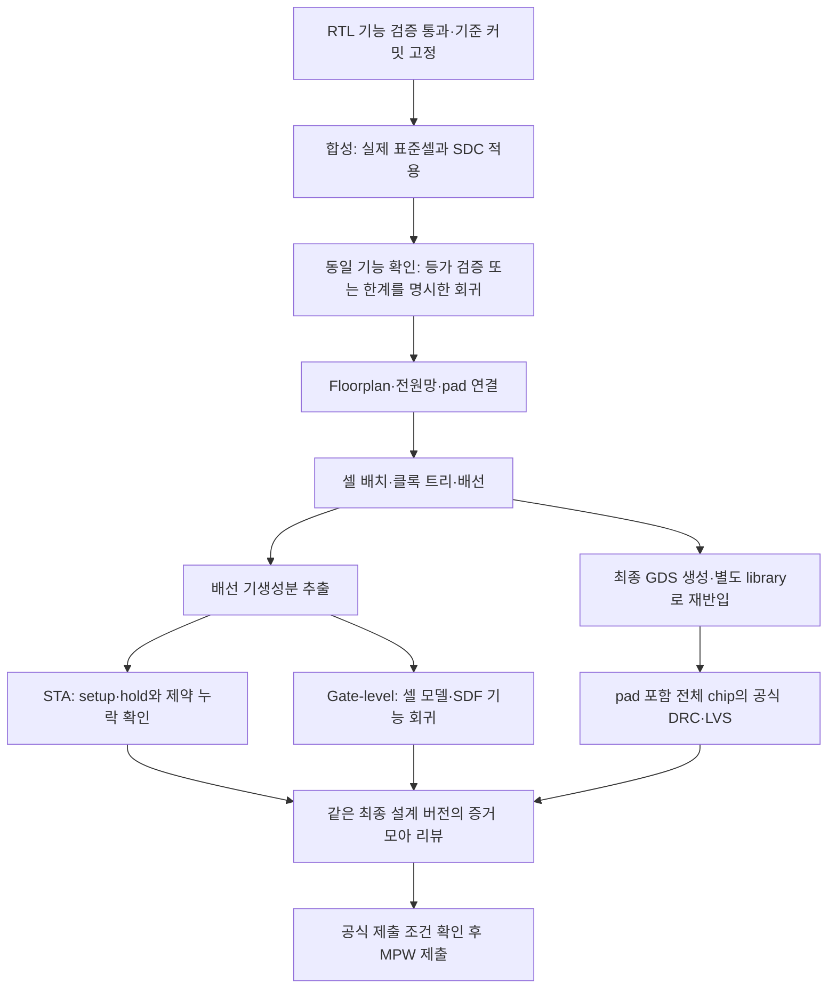
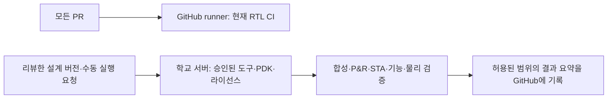

# P&R 이후 검증 방법론

팀 공유용 검토 초안 v0.1 · 2026-11-12

목적은 **RTL에서 맞던 계산이 실제 셀과 배선으로 바뀐 뒤에도 동작하고, 공정 규칙에 맞는 최종 GDS를 제출하는 것**입니다. 현재 PR 3은 RTL 검증까지 담당합니다. 이 문서는 다음 단계의 검증을 준비하는 방법이며 실제 합성·P&R 실행 또는 제출 승인을 뜻하지 않습니다.

공유된 「SNU MyChip VCore·PCore 5Team Design Guide」(김태완, 2026-10-18) 9~10쪽을 기준으로 정리했습니다. 공정·도구·검증 deck의 실제 배포 범위와 최신 MPW 제출 규정은 담당 멘토·운영기관에 확인해야 합니다. 원문은 현재 저장소에 포함돼 있지 않습니다. 아직 합의하지 않은 팀 규칙을 이 초안으로 확정하지 않습니다.

## RTL 검증에서 무엇이 더 필요한가요?

| 질문 | 확인 방법 |
| --- | --- |
| 합성하면서 계산이나 상태가 달라졌는가? | RTL과 합성 netlist의 등가 검증, gate-level 기능 회귀 |
| 배선 지연까지 포함해 제시간에 값이 도착하는가? | RC 추출 후 setup·hold 정적 타이밍 분석(STA) |
| 실제 셀 모델과 지연을 넣어도 외부 입출력이 맞는가? | 타이밍 모델·SDF를 적용한 gate-level 시뮬레이션 |
| 그린 도형이 공정의 폭·간격 등 규칙을 지키는가? | 공식 deck의 DRC |
| 그린 배선과 소자가 의도한 회로와 연결이 같은가? | LVS |
| 제출 파일을 다시 열었을 때도 같은 칩인가? | 최종 GDS 재반입과 DRC/LVS 재실행 |

P&R은 셀을 배치하고 배선을 연결하는 작업입니다. STA·DRC·LVS·기능 회귀는 그 결과를 서로 다른 관점에서 검사합니다. 한 검사 통과가 다른 검사를 대신하지 않습니다.

## 검증 흐름

타이밍이나 물리 오류를 고치면 해당 설계에서 결과를 다시 만듭니다. 앞 버전의 타이밍 보고서와 뒤 버전의 GDS를 섞어 제출하지 않습니다. 마지막 수정 후 영향을 받는 등가·타이밍·기능·물리 검사를 다시 확인합니다.

## 시작 전에 받아야 할 자료와 도구

| 준비물 | 필요한 이유 | 현재 확인할 사항 |
| --- | --- | --- |
| 정확한 ETRI 공정명·PDK 버전·공식 튜토리얼 | 허용 소자·층·검증 경로 결정 | 실제 배포 버전과 제출 서비스 조건 |
| 표준셀·pad의 Liberty와 기능·타이밍 모델 | 합성, STA, gate-level 시뮬레이션 | 지원 전압·온도·공정 조건과 누락 모델 |
| tech/cell LEF·셀 GDS·layer map | 셀 배치·배선·GDS 출력 | 표준셀·pad·전원핀 이름 일치 |
| RC 추출 기술 자료 | 배선 저항·용량 반영 | 지원 추출 도구와 제공 corner |
| 공식 DRC/LVS/PEX deck와 소자 모델 | 공정 규칙·연결·기생성분 검증 | 운영기관이 인정하는 도구·버전·실행법 |
| 전체 chip의 LVS 기준 회로와 셀·pad 참조 netlist | 레이아웃과 의도한 연결 비교 | 코어뿐 아니라 pad·전원 연결까지 같은 top으로 비교 |
| SDC와 보드 I/O 조건 | 클록·입출력 타이밍 정의 | 실제 FPGA 송수신 시점, pad 지연·부하 |
| Linux 실행 서버·도구 설치·라이선스 | 상용 ASIC 도구 실행 | 학교 제공 경로·접속·라이선스 사용 가능 여부 |

안내서 기준 도구와 역할은 다음과 같습니다. 실제로 제공되는 제품과 라이선스를 확인한 뒤 실행 환경을 확정합니다.

| 단계 | 안내서 기준 또는 지원 후보 | 확인할 결과 |
| --- | --- | --- |
| 합성 | Genus | mapped netlist, SDC, 셀·면적·경고·타이밍 보고서 |
| 등가 검증 | Conformal, 제공될 경우 | RTL ↔ 합성 netlist의 비교 결과 |
| 배치배선·클록 트리 | Innovus | 배선 완료 DB, 연결·설계 규칙 검사, netlist·GDS |
| RC 추출 | 공정이 지원하는 Quantus·Calibre 등 | SPEF 등 지원 형식과 추출 조건 |
| 최종 STA | Tempus 또는 공정이 지원하는 sign-off STA | 제공 corner별 setup·hold와 제약 누락 |
| Gate-level 시뮬레이션 | Xcelium과 공식 셀 모델·SDF | 기능 회귀, 타이밍 위반, SDF 적용 내역 |
| DRC·LVS·PEX | 공식 deck를 지원하는 Assura·Calibre 등 | 최상위 chip의 공정 규칙·연결·추출 결과 |

Vivado는 FPGA 구현을 담당합니다. ETRI PDK만 추가해 CMOS ASIC의 합성·P&R·물리 검증 도구로 사용할 수는 없습니다. 공개 RTL 도구만으로 위 상용 도구와 공식 검증 경로가 준비됐다고 볼 수도 없습니다.

## 단계마다 무엇을 확인하나요?

### 1. 합성 전: 검사할 설계를 고정합니다

RTL 검증을 통과한 Git 커밋, 대상 top, RTL 목록, 관련 RFC·SPEC을 기록합니다. 현재 `v_ternary8_top`은 코어이며, pad를 포함한 전체 chip top은 별도로 확인해야 합니다. 공유 안내서의 `MPW_PAD_28pin`에 어떻게 연결할지와 실제 사용 가능 영역을 확정합니다.

클록과 입력·출력 신호, 동기 리셋, 입력 전이 시간과 출력 부하를 SDC에 반영합니다. 초기 10 MHz는 주기 100 ns에 해당하지만 입력·출력 지연과 부하까지 정해 주지는 않습니다. 안내서의 초기 예시를 그대로 최종 제약으로 쓰지 않고 FPGA·pad·보드 조건으로 검토합니다. 동기 리셋을 일괄 false path로 처리해 타이밍 검사를 숨기지 않습니다.

### 2. 합성 후: 기능과 회로 구조를 확인합니다

실제 Liberty로 합성하고 unresolved reference·예상하지 않은 black box·폭과 부호 문제를 해결합니다. latch·순차소자·셀 수·면적을 확인합니다. 삼진 내적의 가산기 공유가 의도대로 합성됐는지도 보고서와 회로 구조에서 확인합니다.

Conformal이 제공되면 RTL과 합성 netlist의 등가 검증을 실행합니다. 제공되지 않으면 gate-level 회귀와 구조 검토를 하고 **formal 등가 검증 미실시**를 결과에 명시합니다. 시뮬레이션 통과를 모든 입력에 대한 등가 증명이라고 부르지 않습니다.

### 3. 배치배선 중: 연결과 전원·클록을 확인합니다

전원·접지·pad·ESD rail, well/substrate 연결, filler·tap·endcap 등 필요한 구조를 공정 가이드에 맞춥니다. 클록 트리 합성(CTS) 뒤에는 클록 도착 시간 차이와 삽입 지연을 확인합니다. 허용 metal stack 안에서 배선하고 전원·클록·신호의 open/short, 혼잡과 설계 규칙 위반을 해소합니다.

Innovus 내부 검사는 설계 중 오류를 찾는 데 사용합니다. 이 결과만으로 공식 공정 DRC/LVS를 통과했다고 표시하지 않습니다.

### 4. 배선 후: 실제 지연과 기능을 확인합니다

지원 RC 자료로 기생성분을 추출하고, 제공된 slow/fast 등 조건에서 setup과 hold를 모두 검사합니다. 아래 조건은 안내서에 따른 종료 증거이며 실제 sign-off corner·mode 목록을 함께 남겨야 합니다.

| 항목 | 확인할 종료 증거 |
| --- | --- |
| 타이밍 | 검사한 조건별 WNS ≥ 0, TNS = 0. setup·hold 위반 없음 |
| 제약 | 모든 의도된 clock·endpoint 검사. 누락 제약과 미검토 경로 없음. 예외는 이유와 리뷰 기록 |
| 기능 | 마지막 항·오류·리셋·연속 작업을 포함한 gate-level 회귀 통과 |
| 지연 모델 | 실제 netlist와 셀 모델·SDF 버전 일치. annotation 결과와 누락·경고의 검토 기록 |
| 물리 규칙 | 공식 DRC 0건 또는 운영기관이 인정한 waiver만 남음 |
| 연결 | LVS 일치. 임의의 black box·미검토 불일치로 통과 처리하지 않음 |
| 제출 파일 | 최종 GDS를 별도 library로 재반입하고 전체 chip DRC/LVS 재실행 |

SDF는 셀과 배선의 지연을 시뮬레이터에 적용하는 자료입니다. cell 모델이나 RC·GPIO 타이밍 자료가 없으면 임의의 값을 만들어 빈칸을 채우지 않습니다. 제공 기관과 담당 멘토에게 가능한 대체 검증과 남는 한계를 확인하고, 해당 범위를 미실행 또는 제한 검증으로 표시합니다.

RTL에서 사용한 정답 모델과 입력 시나리오는 재사용할 수 있습니다. 다만 실제 chip top의 pad·포트 연결, 리셋, 셀 모델과 지연 적용에 맞게 시험기를 확인해야 합니다. SDF 기능 회귀는 실행한 입력의 동작을 확인하며 모든 타이밍 경로를 검사하는 STA를 대신하지 않습니다.

## GitHub에서 P&R 검증도 실행할 수 있나요?

**GitHub Actions가 학교의 실행 서버에 작업을 요청하는 구성은 가능합니다.** 도구·PDK·라이선스·접속 권한이 그 서버에 있어야 합니다. 공개 GitHub runner에 학교 환경이 기본 제공되지는 않습니다.

초기에는 학교 서버에서 수동으로 검증하고 실행 스크립트·요약 보고서·기준 버전을 정리합니다. 이 경로가 재현된 뒤 self-hosted runner 연결 여부를 결정하는 순서를 제안합니다. P&R 도구 설치나 runner 등록은 이번 PR에서 수행하지 않습니다.

학교 runner에는 검토하지 않은 PR 코드를 자동으로 실행하지 않습니다. 사용할 브랜치·커밋, 실행 권한과 라이선스 동시 사용 수를 먼저 정합니다. PDK·deck·라이선스 정보와 반출이 제한된 설계 데이터는 승인된 위치에 보관합니다. GitHub artifact에 올릴 수 있는 보고서 범위도 기관 정책에 맞춰 확인합니다. 라이선스나 필수 자료가 없어서 실행하지 못하면 통과로 표시하지 않습니다.

## 실행마다 남길 기록

한 번의 실행 결과에는 다음 자료를 함께 묶습니다. 제한된 원본 파일은 승인된 서버에 두고 GitHub에는 허용된 요약과 위치 식별 정보만 남깁니다.

- Git 커밋, RTL 목록·top, 관련 RFC·SPEC과 SDC 버전
- PDK·셀·도구·deck·RC 자료의 버전, 실행일, corner·mode
- 실제 명령·스크립트, 입력 DB·netlist·GDS의 식별값과 보고서 위치
- 등가·setup·hold·DRC·LVS·SDF·기능 회귀의 통과·실패·미실행 상태
- 경고·waiver·미검증 항목의 이유, 검토자와 후속 조치

WNS는 검사한 경로 중 가장 작은 여유 시간이며 음수면 위반입니다. TNS는 음수 여유 시간의 합입니다. 이 수치만 제시하지 않고 어떤 corner와 경로를 검사했는지 같이 남깁니다. 최종 제출 GDS의 식별값으로 모든 종료 증거가 같은 설계를 가리키는지 확인합니다.

## 다음에 확정할 일

1. 운영기관·멘토에게 실제 공정/PDK·표준셀·pad·RC·공식 deck·지원 도구 목록을 확인합니다.
2. 실행 서버와 라이선스, chip top과 보드 I/O 조건을 확인합니다.
3. 제공 자료로 합성부터 최종 GDS 재검증까지 한 번 수동 실행하고 누락 자료를 기록합니다.
4. 실제 도구와 결과를 바탕으로 별도 구현 SPEC과 필요한 제출·검증 규약을 검토합니다. 이후 자동화 범위를 정합니다.

공식 도구 설명: [Innovus](https://www.cadence.com/en_US/home/tools/digital-design-and-signoff/soc-implementation-and-floorplanning/innovus-plus-synthesis-implementation-system.html), [Tempus](https://www.cadence.com/en_US/home/tools/digital-design-and-signoff/silicon-signoff/tempus-timing-signoff-solution.html), [Quantus](https://www.cadence.com/en_US/home/tools/digital-design-and-signoff/silicon-signoff/quantus-extraction-solution.html), [Calibre](https://www.siemens.com/en-us/products/ic/calibre-design/physical-verification/), [GitHub self-hosted runner](https://docs.github.com/en/actions/how-tos/manage-runners/self-hosted-runners/add-runners). 제작 가능 여부는 해당 공정의 공식 자료와 제출 심사에서 확인합니다.
