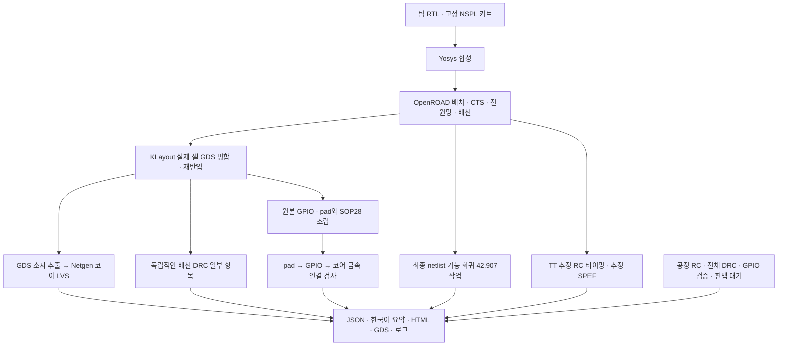

# RTL → GDS·검증·리포트 사용 안내

2026-11-24 · 구현 실험 단계. 기획·비교 근거는 [SPEC 0017](../specs/0017-rtl-to-gds.md).

처음 재현할 팀원은 [DRC·LVS 단계별 사용법과 R&D 맥락](drc-lvs-handoff.md)에서 코드 받기·설치·실행·결과 확인 순서로 따라갈 수 있다. 9~12절에는 전체 검증 CI를 완성하지 못한 경위, 해결한 오류, 남은 실험을 정리했다.

RTL을 변경하면 **실제 NSPL 표준셀로 합성하고, 배치·클록 트리·배선·GDS 생성과 검사를 실행**한다. 공식 pad·GPIO와 조립한 SOP28 GDS도 만든다. 아직 공정 전체 검증과 제작 제출 준비가 끝난 상태는 아니다.

## 현재 실행하는 흐름



| 검사 | 확인하는 것 |
| --- | --- |
| `asic-input` | 표준셀 5개 view의 고정 해시, LEF 장애물과 GDS 도형의 대응 |
| `asic-synth` | 실제 셀 매핑·셀 수·면적, 미매핑·latch·루프·다중 구동, 제외 셀 사용 여부 |
| `asic-pnr` / `asic-cts` | 배치·전원 연결·배선 명령 완료, FF 수에 대응하는 clock sink |
| `asic-route` | 배선 도구 자체 DRC 보고서가 존재하며 0건 |
| `asic-gds` | 원본 셀 GDS 병합·독립 재반입, 인스턴스 수·원본 master 도형 보존 |
| `asic-drc-subset` | 별도 KLayout으로 금속·cut 폭/간격/둘러쌈·서로 다른 cut 층 겹침 확인. 전체 공정 DRC는 아님 |
| `asic-extract` / `asic-lvs` | 실제 코어 GDS의 MOS·연결과 최종 netlist + 원본 CDL을 비교. 핀·W/L 오류를 무시하지 않음 |
| `asic-gate` | 최종 netlist로 경계·오류·프로토콜·리셋·합법 가중치 전체 배열·무작위 회귀 |
| `asic-estimated-sta` | 10MHz·TT·전파 클록의 setup/hold 탐색. RC는 보정 전 추정값 |
| `asic-chip-gds` | 원본 pad opening 28개 위치·GPIO 도형 보존, 제안 핀맵으로 조립 |
| `asic-chip-connectivity` | 183개 탐침점 및 모든 코어 금속 연결 성분 대조. 조립으로 생긴 단선·합선 검사 |

`asic-pex`, `asic-drc`, `asic-chip-lvs`, `asic-chip-timing`, `asic-pinmap`은 현재 `unsupported`다. 이 항목이 남으면 전체 상태는 `incomplete`, 기본 명령의 종료 코드는 1이다. 실행 오류나 실제 위반은 `fail`, 앞 단계 때문에 못 돌린 검사는 `not_run`이다.

## 1팀 방식과 비교한 선택

같은 16셀·8비트 예제의 합성 netlist로 Qflow와 OpenROAD를 실행했다. Qflow는 합성 0.874초·배치 2.074초·배선 0.269초·GDS/연결 검사 3.583초였다. OpenROAD의 배치·CTS·전원망·배선은 5.759초였다. **영역·실행 단계가 달라 속도·면적 우열의 근거로 쓰지 않는다.** 반복 실행 통계도 아니다.

| 비교 항목 | 확인한 Qflow 경로 | 선택한 OpenROAD 경로 |
| --- | --- | --- |
| 실제 셀 GDS·배선 연결 | 1팀 예제 재현, 단선/합선 0건 | 실제 GDS의 320 MOS와 독립 기준 회로가 LVS 일치 |
| SDC·클록 트리 | 예제 실행에서는 SDC 미적용·CTS 미입증 | SDC 적용, clock buffer 3개·sink 8개 |
| 기능 | 작은 예제 연결 검사 | 최종 netlist 1,000사이클 기능 시험 통과 |
| 공정 RC·전체 DRC | 미입증 | 미입증. 추정 타이밍과 배선 규칙 일부만 표시 |

클록·제약·배선을 같은 실행으로 연결한 근거로 **OpenROAD의 작은 Tcl 흐름을 채택**했다. ORFS 전체를 복제하지 않는다. 합성은 기존 Yosys, GDS·소자 추출은 KLayout, LVS 비교는 Netgen을 쓴다. Magic은 기존 연습 시험에 남긴다. 공개 Magic 설정을 현재 NSPL에 적용한 시험에서는 핀·규칙 호환 문제가 있어 실제 코어 추출기로 선택하지 않았다.

1팀 발표의 작은 Qflow 예제와 이후 Genus·Innovus 전체 칩 결과를 구분했다. 조립 배치 방법을 참고한 코드에는 출처와 [GPL-3.0 원문](../../scripts/asic/COPYING.Team01)을 보관한다. 비교용 `compare.py`는 1팀의 고정 버전 `src/`가 따로 필요하며 CI 의존성이 아니다.

## 로컬 실행

Ubuntu 24.04 x86_64 또는 WSL Ubuntu를 사용한다. 저장소 맨 위에서 실행하고 새 결과 폴더를 지정한다. 기존 결과를 덮어쓰지 않는다.

```sh
sudo apt-get update
sudo apt-get install yosys iverilog klayout netgen-lvs python3-venv libtcl8.6 libgomp1 libqt5widgets5 libqt5gui5 libqt5network5 libqt5printsupport5 time
python3 -m venv ~/.venvs/team05-asic
. ~/.venvs/team05-asic/bin/activate
python -m pip install -r requirements-ci.txt
python scripts/asic/setup_tools.py --out "$HOME/ssc-asic-tools"
python scripts/asic/fetch_pdk.py --out "$HOME/ssc-asic-pdk"
python scripts/asic/selftest.py --out .policy-tmp/asic-selftest-new
python scripts/run_asic.py --pdk "$HOME/ssc-asic-pdk/NSPL_05CMOS_PDK_260820" --openroad "$HOME/ssc-asic-tools/bin/openroad" --target chip --out .policy-tmp/asic-new
```

현재 마지막 명령은 산출물을 만든 뒤에도 미확인 공정 항목 때문에 1로 종료한다. `result.json`에서 실제 실패와 미완료를 구분한다. 구현 실험에서만 `--experimental`을 붙이면 **지정한 공정 미확인 항목 외의 필수 검사를 전부 실행·통과한 경우**만 종료 코드 0을 허용한다. 검사 누락·미실행은 실험에서도 실패한다. 보고서의 `incomplete`와 `ready_for_submission: false`는 유지한다. `--target core`는 pad 조립을 생략하며 코어도 RC·전체 DRC가 미확인이므로 제출 통과가 아니다.

OpenROAD 버전·URL·SHA-256은 [tools.json](../../verification/asic/tools.json), 표준셀 원본 해시는 [nspl.py](../../scripts/asic/nspl.py)에 있다. 다른 CPU·OS용 설치기로 사용하지 않는다. 캐시를 재사용해도 매번 해시를 검사한다. PDK 원본은 Git에 올리지 않는다.

## GitHub에서 받는 결과

`ASIC RTL to GDS`는 PR·main push에서 기본 `asic (strict)`로 실행한다. 정상적으로 끝까지 실행해도 미확인 항목 때문에 **이 검사가 빨간색으로 남는다**. 11월 24일 첫 원격 실행은 그보다 앞선 실행기 할당 단계에서 계정 결제/사용 한도 안내로 차단되어 실제 ASIC 검사를 실행하지 못했다. 이를 성공으로 덮거나 자동 병합하지 않는다. 수동 실행의 `experimental` 선택은 구현 실험용이며 검사 이름에도 표시한다. workflow가 main에 반영된 뒤 Actions 화면에서 수동 실행할 수 있다.

Summary에서 상태·시간을 읽고, `asic-실행ID-시도번호` artifact를 받는다. 보관 기간은 7일이다. 실패해도 만들어진 증거를 올린다. 설치 단계에서 실패하면 GDS가 없을 수 있으며 해당 로그를 먼저 확인한다.

| 파일 | 용도 |
| --- | --- |
| `summary.md` / `report.html` | 상태·미확인 항목·단계별 시간·그림. HTML은 artifact 전체를 푼 뒤 연다 |
| `result.json` | 커밋·소스 해시·도구 버전·검사 상태·산출물 해시·일부 외부 명령의 최대 RSS |
| `v_ternary8_top.gds` / `.png` | 실제 코어 도형과 그림 |
| `ternary8_sop28.gds` / `.png` / `.json` | 제안 SOP28 조립본·그림·탐침점·배선 목록 |
| `pnr/final.v`, `final.def`, `final.odb`, `constraints.sdc` | 최종 netlist·배치배선 DB·제약 |
| `pnr/estimated.spef` | 전역 배선 추정 RC. 정밀 PEX 결과로 사용 금지 |
| `lvs/layout.spice`, `schematic.spice`, `lvs.log`, `lvs.json` | GDS 추출·독립 기준·실제 LVS 결과 |
| `drc-subset.json`, `chip-connectivity.json`, `gate/` | 검사 범위·오류 좌표·금속 연결·게이트 회귀 근거 |
| `technology/adapter.json`, `lef-audit.json` | 원본/파생 설정 해시와 도형 대조 |

로컬 `ternary-05`는 전체 177.086초, P&R 14.106초, 게이트 회귀 141.8초였다. 논리 452셀·66FF·247,564.8µm², 코어 MOS 3,790개가 LVS 일치했다. 배선 도구 DRC와 독립 배선 규칙 일부 항목은 각각 0건이다. 조립 후 183개 탐침점·996개 코어 금속 연결 성분의 단선/합선은 0건이었다. TT 추정 setup/hold slack은 +49.145/+1.636ns였다. 미커밋 코드·로컬 Yosys 0.68의 한 번 실행이며 GitHub 시간·모든 PVT 보증은 아니다. 추가 Ubuntu 24.04 Yosys 0.33·Netgen 1.5.133 호환 실행은 437셀·66FF·3,892 MOS LVS·42,907작업 통과였고 전체 256.202초였다. 두 로컬 실행의 차이를 도구별 성능 우열로 읽지 않는다. [입력·검사·증거 기록](../../verification/asic/experiment-20261124.json)에 범위를 남겼다. GitHub 실제 시간은 아직 측정하지 못했다.

## 제작 준비를 끝내려면

1. **공정 RC 보정**: 키트에 ITF·TLU·Assura/Calibre 자료는 있으나 검증된 OpenRCX 규칙은 아직 없다. 배선 패턴 기준 추출과 오차 비교 후 SPEF·annotation·setup/hold 검사를 연결한다. 다른 공정 계수로 대체하지 않는다.
2. **전체 DRC**: 배선 규칙 일부 외에 well·active·poly·implant·tap·pad·넓은 금속 등의 규칙과 정상/위반 예제가 필요하다. 0건을 전체 공정 DRC 통과로 읽지 않는다.
3. **전체 칩 LVS·타이밍**: GPIO의 저항·ESD 소자 추출, 독립 기준 회로, GPIO/보드 타이밍 조건이 필요하다. 금속 연결 검사가 이를 대신하지 않는다.
4. **핀맵 검토**: 제안 조립본은 13개 신호+15개 전원/접지로 28개 pad를 연결한다. 안내서의 사용 핀 25개 이하 조건과의 적용을 팀장·설계 담당자가 확인해야 한다. 전원·ESD를 임의로 제거해 숫자를 맞추지 않는다.
5. **제출 인정 확인**: 서비스에서 인정하는 최종 deck·도구·검사 범위를 확인한다. 오픈소스 실행 성공과 제출 승인을 구분한다.

현재 추출/비교 경로에서 34종 셀 중 23종이 일치했고 11종은 미확인이다. [셀별 결과](../../verification/asic/cell-qualification.json)를 남기고 그 11종을 새 ASIC 합성에서 제외했다. 원본 PDK·RTL·기존 PDK 검사의 기본 매핑은 바꾸지 않았다. LVS 핀·W/L 검사는 유지한다.

칩 간 공유 계약은 circuit-integration 야간 작업이 이 저장소를 읽어 검사한다. 이 저장소는 2026-11-28 공개 전환으로 비공개 재사용 워크플로를 호출할 수 없어 PR 검사 `MyChip integration`을 폐지했다([SPEC 0019](../specs/0019-merge-gate.md)). 이 야간 검사는 5팀 자체 구현·검증이나 모든 칩의 공동 물리 검사를 대신하지 않는다. branch protection은 추가하지 않으며 팀장이 미확인 항목과 제출 조건까지 보고 수동 병합한다.

공개 원본의 전체 규칙 대조와 추가 기하 시험은 [DRC 작업 기록](nspl-drc-rule-audit.md), 담당자에게 전달할 질문은 [자료·지원 요청문](pdk-support-request.md)에 따로 정리했다.
