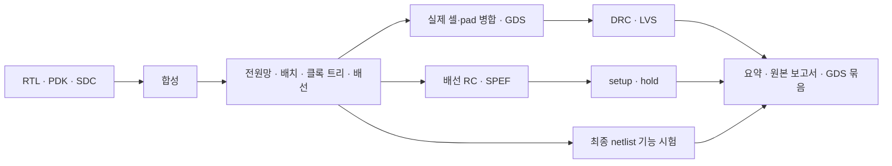

# RTL부터 GDS·검증·리포트까지: 준비와 결과 읽기

팀 공유 초안 · 2026-11-24

목표는 **RTL을 수정해 PR을 올리면 CI가 칩을 구현하고, 검사 결과와 GDS를 돌려주는 것**이다. 지금은 구현 계획을 검토하는 단계다. 실제 실행 명령·workflow는 도구 비교와 NSPL 공정 확인 후 추가한다. 상세 계획과 출처는 [SPEC 0017](../specs/0017-rtl-to-gds.md)에 있다.

## 지금 되는 일과 앞으로 만들 일

| 검사 | 현재 되는 일 | 전체 흐름에서 추가할 일 |
| --- | --- | --- |
| `RTL CI` | 모듈·프로토콜·오류·리셋·정답 비교, lint·커버리지 | 기존 시험 유지 |
| `MyChip PDK` | 실제 4차 NSPL 셀 합성·게이트 기능 회귀·배치 전 STA | 검증된 코드를 전체 흐름에 재사용 |
| `Physical checks` | scmos 연습 회로로 Magic·Netgen과 실패 판정 시험 | 연습과 실제 칩 검사를 분리해 표시 |
| 실제 P&R·GDS·추출 | 미구현 | 전원망·배치·CTS·배선·GDS·RC 추출 추가 |
| 실제 칩 검사 | 미실행 | 최종 GDS의 DRC·LVS, 배선 후 STA·기능 회귀 추가 |
| `MyChip integration` | 공통 포트·프로토콜·정답 모델·보드 조건 검사 | 공유 계약 검사로 유지 |

integration이 5팀의 배치배선·사인오프를 대신하지 않는다. 또한 모든 칩을 실제 연결한 공동 시뮬레이션이 이미 끝났다는 뜻도 아니다. 각 검사의 대상과 경고·미실행 항목을 함께 읽는다.

## 어떤 도구를 고를까

**1팀 방식을 참고하고 Qflow와 OpenROAD를 비교한 뒤 선택한다.** 먼저 정한 도구에 결과를 맞추지 않는다.

| 선택지 | 현재 확인한 장점 | 먼저 확인할 부분 |
| --- | --- | --- |
| 1팀 Qflow 경로 | 같은 NSPL 공정의 작은 예제·GDS 병합·가이드가 있음 | SDC 적용·클록 트리·hold·배선 RC·배선 후 타이밍 |
| OpenROAD/ORFS | 합성부터 클록 트리·배선·추출까지 연결하는 구조 | NSPL용 셀·층·전원·RC 설정과 실제 실행 |

1팀의 11월 21일 발표는 16셀 Qflow 예제와 가짜 입력을 이용한 실행기 자체 시험을 보고했다. 이후 실제 Census8 전체 칩 결과는 Genus·Innovus 기반이다. 두 시점을 구분한다. 1팀 전체 칩 결과가 있다는 사실만으로 오픈소스 전용 GitHub 흐름이 완성됐다고 판단하지 않는다. 원문은 SPEC의 참고자료에서 확인한다.

비교할 때는 같은 작은 회로·PDK·클록·부하·면적 조건을 쓴다. 배선과 기능이 맞는지 먼저 확인하고, 클록·물리 검사·RC·setup/hold가 실제로 되는지 본다. 이후 시간·메모리·결과 읽기·재실행 편의성을 비교한다. 필수 검사가 빠진 후보는 빠르다는 이유로 선택하지 않는다.

현재 재사용할 후보는 기존 Yosys·게이트 회귀·OpenSTA, GDS 병합·그림의 KLayout, 회로 비교의 Netgen이다. Magic·KLayout 중 어느 경로가 현재 NSPL의 도형·소자를 정확히 읽는지 먼저 확인한다. 배선 RC는 OpenRCX를 우선 조사하되 공정별 보정 자료가 아직 필요하다.

## 구현 후 PR에서 보게 될 흐름

첫 단계는 코어 `v_ternary8_top`이다. 다음은 SOP28의 공식 pad·전원·ESD 연결까지 포함한 전체 칩이다. 코어 결과와 전체 칩 결과를 따로 표시한다. 코어 GDS를 전체 칩 제출 파일로 사용하지 않는다.

합의할 입력은 chip top 이름, 패키지 핀 배치, 전원 연결과 사용 영역, FPGA 입출력 지연·부하, 검사 corner다. 안내서에 있는 `MPW_PAD_28pin`·사용 핀 조건을 출발점으로 하고, 1팀의 핀 배치를 그대로 복사하지 않는다. 연산·통신 규약을 바꾸는 결정은 RFC 변경으로 따로 남긴다.

## 리포트는 이렇게 읽는다

GitHub job의 한 줄 요약에 대상 `core/chip`, 커밋, 전체 상태, 실패 단계와 이유가 나와야 한다. 아래는 **구현할 표시 형식 예시**이며 실제 측정값이 아니다.

| 표시할 항목 | 확인할 질문 |
| --- | --- |
| 대상·커밋·PDK·도구 | 내가 리뷰하는 변경과 같은 입력으로 만든 결과인가? |
| 단계 상태 | 모든 필수 단계가 `pass`인가? `not_run`·`unsupported`가 남았나? |
| 셀·면적·배선 | 회로가 비어 있거나 셀·배선이 빠지지 않았나? |
| DRC | 어떤 공정 규칙을 검사했으며 미지원 규칙이 남았나? |
| LVS | GDS에서 읽은 회로가 독립적인 기준 CDL과 같은가? |
| 타이밍 | 어떤 corner·클록·I/O 조건에서 setup·hold를 검사했나? SPEF·제약이 빠지지 않았나? |
| 기능 | 배치배선 후 최종 netlist가 오류·리셋·경계·연속 작업 시험을 통과했나? |
| 산출물 | 최종 GDS·netlist·CDL·SDC·SPEF·로그의 해시가 같은 실행 묶음에 있나? |
| 시간·자원 | 어느 단계가 오래 걸리고 메모리·디스크를 얼마나 썼나? |
| 제출 검토 | 오픈소스 검사 결과와 별도로 제작 서비스가 인정하는 검증을 마쳤나? |

DRC 0건은 읽은 규칙에서 오류가 없다는 뜻이다. 규칙 구현이 빠졌거나 잘못된 레이어로 읽었다면 충분한 근거가 아니다. LVS도 소자·핀을 제대로 추출했는지 확인해야 한다. 빈 회로끼리의 일치는 실패로 처리한다.

SPEF는 배선의 저항·용량을 STA에 전달하는 파일이다. Magic PEX의 SPICE와는 다르다. 공개된 예제 PEX 파일이나 다른 공정 계수를 이름만 바꿔 사용하지 않는다. RC 규칙이 미검증이면 전체 타이밍 검증 완료로 표시하지 않는다.

## 초록색이면 병합해도 되나

구현을 마친 뒤에는 5팀의 필수 자체 검사와 integration 상태를 함께 확인하고 팀장이 리뷰·병합한다. 필수 결과가 없거나 미지원이면 전체 칩 검사를 통과시키지 않는 방식으로 구현한다. 브랜치 보호와 자동 병합은 추가하지 않는다.

지금은 전체 흐름이 없으므로 현재 Checks의 초록색은 현재 실행한 검사 범위만 뜻한다. 공정 지원·제출 인정 여부도 별도다. 설계 안내서 8쪽의 최종 검증 조건을 오픈소스 도구 설치만으로 충족했다고 표시하지 않는다.

## 다음 작업 순서

1. NSPL 작은 셀의 도형·핀·소자·DRC/LVS·RC 지원을 정리한다.
2. 같은 8비트 예제로 Qflow와 OpenROAD를 비교하고 결과·선택 근거를 SPEC에 추가한다.
3. 선택한 경로로 5팀 코어를 구현하고 실제 실행 시간·메모리를 측정한다.
4. 전체 칩 pad·전원·I/O 조건을 검토하고 chip 범위를 구현한다.
5. 재현 가능한 Linux 실행을 GitHub에 연결하고 팀원이 결과를 읽고 재실행해 본다.

실행 시간이 나온 뒤 PR마다 돌릴 범위와 자원을 판단한다. 현재 RTL 커버리지나 연습 회로 실행 시간을 전체 칩 물리 검증률·P&R 시간으로 바꾸어 적지 않는다.

관련 문서: [구현 SPEC·비교 출처](../specs/0017-rtl-to-gds.md), [P&R 검증 방법론](pnr-methodology.md), [Magic·Netgen 상세 사용서](magic-netgen-guide.md), [현재 CI 실행법](../ci.md).
